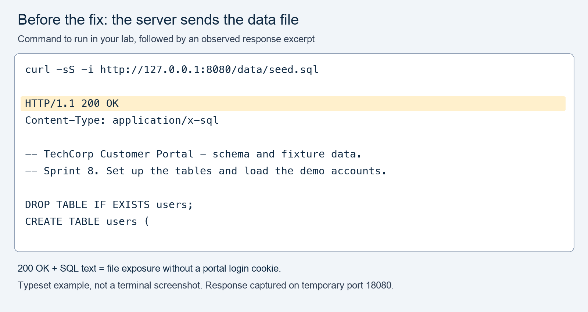
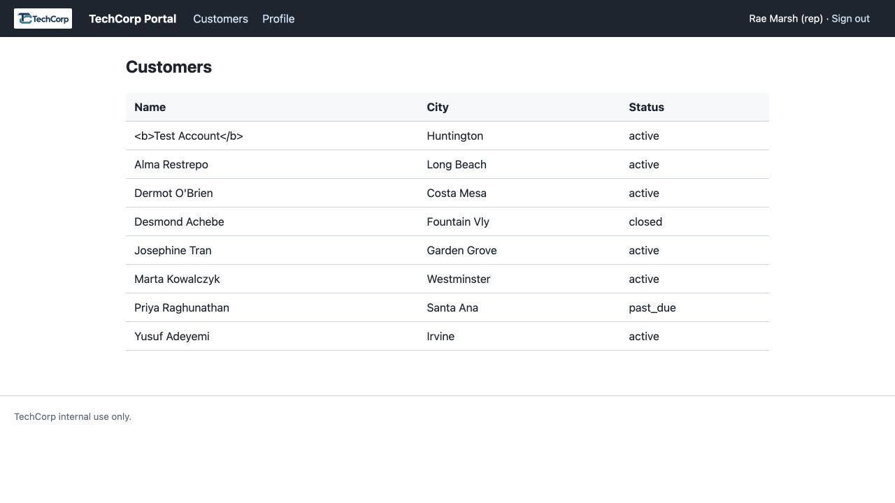
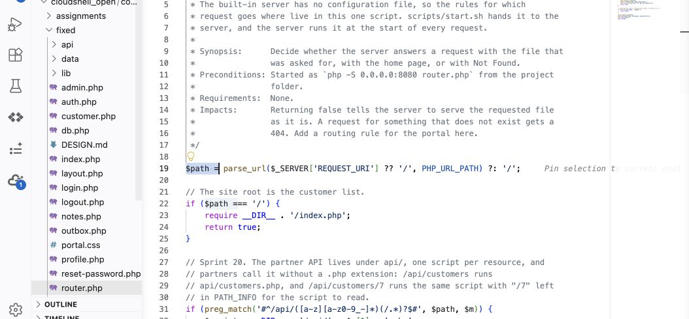
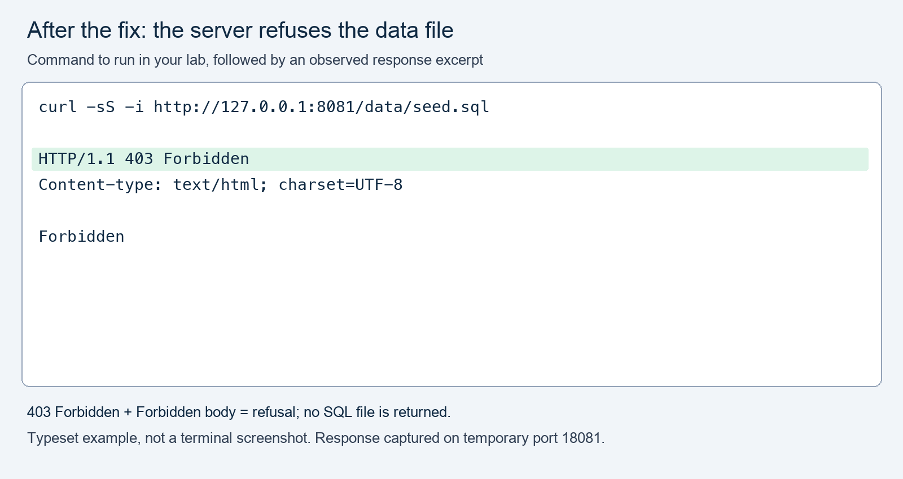
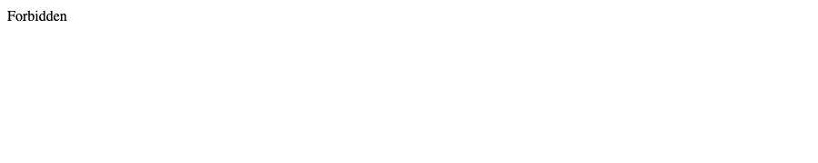

# M02 - Assignment: Block Direct Access to Sensitive Data Files

> This repository copy contains the current task instructions and reference images. Download the Word report template from the matching Canvas assignment. Keep your existing Cloud Shell workspace and earlier repairs; returning students do not need a new clone.


## Downloads and instructions

Start here. These are all the supplied files for this assignment.

| File | Download and use |
|---|---|
| Word report | **Download report**: obtain `m02-design-audit-template.docx` from this module’s Canvas assignment. Open it in Word or Word Online and save your own copy. |
| Task instructions | [Download assignment.md](assignment.md). This is the supplied copy of these instructions; keep it unchanged and submit it with your work. |

The complete step-by-step instructions follow on this page. For help with report editing, screenshots, revision history, and uploading, use **Word Reports and Assignment Files** (reference page in Canvas). That guide also lists all current Word report and instruction downloads together.

Your changed **router.php** must come from your own working copy. Download the complete edited file(s) from Cloud Shell as directed below; they are not supplied completed answers.


## One assignment: Read → Fix → Prove → Report

Submit the supplied Word report with your brief additions and your changed `fixed/router.php` for this activity. The module quiz remains separate.

## What you will do

**The problem: a visitor who has not signed in can download sensitive files directly.** Requesting `/data/seed.sql` or `/data/portal.sqlite` returns the file, including the portal's fictional customer and staff-account data. The visitor never needs to open a PHP page, so the sign-in checks on those pages do not protect the files.

Ticket PORTAL-118 asks you to investigate this direct-access flaw. Reproduce it on the original site, change `fixed/router.php` to refuse `/data/` requests, and prove that the requests are blocked while signed-in customer use still works. Plan about 60–75 minutes.

**Design lesson — OWASP A06 Insecure Design:** sensitive data files were placed inside the directory the web server serves. Your deny rule is a mitigation for that design decision; it blocks the assigned URLs but leaves the files in that directory. Moving sensitive storage outside the served directory would address the file-placement flaw. This lab asks you to apply and explain the mitigation.

The supplied corporate report contains the case background, management narrative, risk assessment, and response plan. Your additions are brief: three claim rows, one flow, one threat, and a before/after table. Every entry includes an EXAMPLE showing the expected form and detail. The full threat-modeling method remains in the lecture for practice; an exhaustive audit, diagram, STRIDE register, and ranked backlog are not required for this submission.

## Your report template

Use the Word report in **Downloads and instructions** above.

1. Open the template in Word or a DOCX editor. Choose **Save As** and name your copy `m02-design-audit.docx`.
2. Read the supplied executive summary and case narrative as a model of professional reporting. Keep its title, headings, supplied facts, [STUDENT] prompts, and **EXAMPLE** entries. Examples show the expected form and detail; they are not your observations. Write your own response after **Answer:**.
3. Record actual before-and-after results as you work. Paste command output as selectable text. In the screenshot spaces, choose **Insert → Pictures**, use **In Line with Text**, and add descriptive **Alt Text**. Add a short written description of the result as well.
4. Complete **Revision History** at the bottom with your actual date, name, and a short change summary; each entry includes an **EXAMPLE**. Before submission, use **Review → Check Accessibility**, address the findings, and save the completed Word report. Submit this one report file with `assignment.md` and your changed code. Required screenshots can go inside the Word report; separate image uploads are needed only if you reference files that are not included in it.


> [!NOTE] Use the released portal as supplied
> The Customers menu opens a list with plain-text customer names. That is expected. If your released repository copy of `assignment.md` still asks for an account link, use these corrected Canvas instructions and download the updated `assignment.md` from this page; no repository update is needed. This assignment changes only `fixed/router.php` to block direct `/data/` requests. A working signed-in Customers list is the legitimate-use check; opening a customer account is not required.
>
> The screenshots below are instructor examples captured from a temporary local copy of the released portal. They show the page content, not Cloud Shell browser controls or its preview URL. Your Cloud Shell tabs remain on ports 8080 and 8081. Capture your own results for the report; do not submit these example images.

## Step 1: Open both portals

1. [Launch Google Cloud Shell](https://shell.cloud.google.com/) with the Google account used for setup. Open your existing course folder containing `site`, `fixed`, `reports`, and `scripts`.
2. Select **Open Editor** if needed. Right-click the course folder and choose **Open in Integrated Terminal**.
3. Run this command and press **Enter**:

```bash
bash scripts/start.sh
```

4. Wait for both startup messages. Open **Web Preview → Preview on port 8080** for **site**, then **Web Preview → Change port → 8081** for **fixed**.
5. Sign in separately with fictional username `rmarsh` and password `password`. Check the port before each test. Leave `site/` unchanged and keep earlier repairs in `fixed/`.

Use the **Cloud Shell Guide** (reference page in Canvas) for first setup or startup problems. Test only your own copies under the course **Rules Of Engagement** (reference page in Canvas).

## Step 2: Open your report

Download the Word template listed in **Downloads and instructions** above, save your copy, and fill in your name and AI disclosure. Complete its prompts as you follow the steps below. Write answers after **Answer:** and paste evidence into the matching section.

## Step 3: Download the files without signing in

These terminal requests do not send a portal login cookie. They show what someone can download without signing in, even if your browser tab is signed in.

1. In the file list on the left, click the arrow beside **site**, then click **DESIGN.md**. Read the **Authorization** and **Deployment** sections. They claim visitors cannot reach application data and supporting files are not served.
2. Click inside the terminal at the bottom of Cloud Shell. Paste this command and press **Enter**:

```bash
curl -sS -i http://127.0.0.1:8080/data/seed.sql
```

3. Look for `HTTP/1.1 200 OK` near the top, followed by SQL text. **200 means the server sent the file.** Copy that status line and two or three lines of SQL into the report's evidence block.
4. Now paste this command and press **Enter**. It saves the database to a file rather than filling the terminal with unreadable binary data:

```bash
curl -sS -D reports/m02-before-headers.txt -o reports/m02-before.sqlite http://127.0.0.1:8080/data/portal.sqlite
```

5. Paste this command and press **Enter** to display the response information:

```bash
cat reports/m02-before-headers.txt
```

6. Find its status line. It should also say `200 OK`. Copy the actual line into your report.
7. Paste this command and press **Enter** to identify the downloaded file:

```bash
file reports/m02-before.sqlite
```

8. The output should identify a SQLite database. Copy that output into your report. You have now downloaded both files without signing in. Keep the downloaded database in Cloud Shell; do not submit it.
9. In your report's first two claim rows, mark each claim **supported** or **contradicted** by these results. Add the status or file-identification evidence beside your answer.
10. Open the original portal's **8080** browser tab. Sign in as `rmarsh` if needed. Click **Customers** and confirm that the customer list opens. In the third claim row, record whether the list loaded. Customer names on this page are plain text in the released portal; you do not need an account link.
11. In the editor, open `site/router.php`. Press **Ctrl+F** (**Cmd+F** on a Mac), search for `file_exists`, and read the block containing `return false`. That branch lets the server send an existing file directly. In the report, explain in one sentence why a sign-in check on a different PHP page did not stop the downloads.

### Fill in the three short design prompts

1. In the report's **Flow** line, put `/data/seed.sql` on the request arrow and the downloaded SQL on the return arrow. Name the browser-to-server boundary: the request came from outside the server. No drawing is required.
2. In **Threat and STRIDE category**, write one sentence saying who could download what data. Compare that threat with the six STRIDE categories in lecture section 5, choose one, and state why it fits.
3. In **Requirement**, finish “The portal must…” with a rule describing who must be refused access to these files and what response should show the refusal. You will test that rule next.

### Before the fix: compare these reference views

Run this in your Cloud Shell terminal against the original portal on port **8080**:

```bash
curl -sS -i http://127.0.0.1:8080/data/seed.sql
```

The command sends no portal login cookie. Look for `200 OK` and SQL text in your own response.



**Read the evidence:** the highlighted `200 OK` status and SQL body show that the original server sent the file. This figure shows your port-8080 command alongside a typeset excerpt of an actual instructor `curl` response; it is not a terminal screenshot. The temporary instructor server used port 18080. Run the assignment's selectable command on your original port **8080** and save your own status and short SQL excerpt. Some browser previews download `.sql` files instead of displaying them, so use the terminal command rather than expecting a browser SQL page.



**Record the baseline:** this is the original Customers list before the rule was added. Names are plain text. After your repair, the working copy should still display this kind of list. Compare the menu, rows, and signed-in state; exact row order or styling may differ. Your later modules may have changed the working copy's heading.

The Cloud Shell editor screenshot in Step 4 shows the insertion location before the rule is added. Together, these views show what you are testing, what ordinary access looks like, and where the scoped repair goes. They are instructor references, not evidence to paste into your own report.

## Step 4: Add the blocking rule to fixed

> [!CONCEPT] A direct file request bypasses the page
> The request asks the web server for /data/seed.sql or /data/portal.sqlite. It does not open a PHP page, so a sign-in check on that page cannot protect the download.


1. In the editor's file list, expand **fixed**, then click **router.php**. Check the editor tab's path: it must be `fixed/router.php`, not `site/router.php`.
2. Press **Ctrl+F** (**Cmd+F** on a Mac). Search for `$path =`. Close the Find box. You should see this existing line:

```php
$path = parse_url($_SERVER['REQUEST_URI'] ?? '/', PHP_URL_PATH) ?: '/';
```

3. Click at the end of that line and press **Enter**. Paste the following code on the new line, before the existing `// The site root` comment. Do not add another `<?php` tag.

```php
// Block direct requests for the data folder.
if (str_starts_with($path, '/data/')) {
    http_response_code(403);
    exit("Forbidden\n");
}
```

4. Read the three actions: `str_starts_with` checks the requested path, `http_response_code(403)` sets the refusal status, and `exit` stops the router before it can serve the file. This rule blocks all `/data/` requests, including unsigned-in requests.
5. Save with **Ctrl+S** (**Cmd+S** on a Mac). Leave `site/router.php` unchanged.
6. Click inside the terminal. Paste this command and press **Enter**:

```bash
php -l fixed/router.php
```

7. Look for `No syntax errors detected in fixed/router.php`. Copy the actual output into your report. If PHP reports an error, compare your pasted block with the example above, check its braces and semicolons, save, and run the command again. A clean syntax check means the file can be read by PHP; the next step checks whether it blocks the downloads.



*Actual Cloud Shell IDE: fixed is expanded on the left and router.php is selected. Insert the supplied rule on the blank line after $path is set, before the site-root branch. The exact code above remains selectable text.*

## Step 5: Check that the rule works

1. In the terminal, paste this command and press **Enter**. Notice **8081**: this request goes to your changed copy.

```bash
curl -sS -i http://127.0.0.1:8081/data/seed.sql
```

2. Look for `403 Forbidden` and a body saying `Forbidden`, instead of the SQL file. **403 means access was refused.** Put the actual status in the report table's **Fixed 8081** column for `/data/seed.sql`.
3. Run this command for the database:

```bash
curl -sS -i http://127.0.0.1:8081/data/portal.sqlite
```

4. Check for `403 Forbidden` again. Put the actual status in the table's **Fixed 8081** column for `/data/portal.sqlite`. Copy both status lines into the evidence block.
5. Repeat the port-8080 commands from Step 3, actions 2, 4, and 5. The original should still send both files with `200 OK`. Enter those actual statuses in the table's **Original site 8080** column.
6. Open the **8081** portal tab. Sign in as `rmarsh` if needed, click **Customers**, and confirm that the customer list still opens. Record what you saw in the table's legitimate-use row. Also record the original site's result from Step 3. Do not add customer links or change `index.php` or `customer.php` for this assignment.


7. If 8081 still sends a file, check that you edited and saved `fixed/router.php`, placed the new block immediately after `$path` is set, and tested port **8081**. Run the syntax check again after correcting an edit.
8. In the report's explanation, answer these two questions in one sentence each: Are the data files still inside the served folder? What would happen if this blocking rule were absent? This explains why the rule is a temporary control, or **mitigation**, rather than removal of the file-placement flaw.
9. Leave the rule in `fixed/router.php`. You will keep this repair for later course work.

### Screenshot guide: verify the repaired copy

Run the same request against your repaired portal on port **8081**:

```bash
curl -sS -i http://127.0.0.1:8081/data/seed.sql
```



Compare this with the pre-fix example: the path and `curl` options are the same; only the port changes from **8080** to **8081**. The original sends SQL with **200 OK**; the repaired copy refuses it with **403 Forbidden** and a **Forbidden** body. Both figures are typeset reference excerpts from observed responses, not terminal screenshots. Instructor captures used temporary ports 18080 and 18081; the displayed commands use your student ports. Run your own commands and record your actual results.



The browser response body should say **Forbidden**. This image alone does not establish the HTTP status: use the selectable `curl -sS -i` commands above and record **403 Forbidden** for both sensitive-file URLs. A blank page, a sign-in redirect, or a 404 is not the required result.


Use **Customers** in the top navigation. A successful legitimate-use check displays the customer rows under **Name**, **City**, and **Status**, while you remain signed in. Names do not need to be clickable. This shows that the file-blocking rule preserved normal access; it does not prove the application has no other vulnerabilities.


## Step 6: Report and submit

1. Finish the supplied prompts with short answers. Keep your name, disclosure, and a two-sentence reflection. The corporate narrative is already supplied; only brief student additions are required.
2. Save the Word report and check that every prompt has an answer and the evidence is readable.
3. Save your completed `m02-design-audit.docx` on your computer. In Cloud Shell, right-click `fixed/router.php` and choose **Download**.
4. In this module's Canvas assignment, choose **Start Assignment**, upload both files plus the supplied `assignment.md`, and select **Submit Assignment**. Check the confirmation and filenames. Screenshots are optional if text evidence is sufficient; upload any you reference.

## What to submit

> [!NOTE] Keep the report and implementation together
> The Word report explains your results. The complete changed source is the implementation. Include both, plus the supplied assignment.md, in the same Canvas attempt.


Submit your completed Word report. All changed-code requirements still apply; paste required screenshots into the report.


- `m02-design-audit.docx`: completed short report with three claims, one flow/threat/requirement, test results, brief explanation, and disclosure/reflection.
- `router.php`: your complete changed file from `fixed/`.
- Any optional image evidence referenced in your report.

Keep the working change in your portal. Do not submit the database, original site, or a full application archive.

Place screenshots in the Word report beside their prompts, with a caption and alt text. Keep written test results in the report too.

## Download and submit the assignment instructions

Submit these three parts together: **assignment.md**, your completed **m02-design-audit.docx**, and your changed **router.php**. Include any screenshots required above. Keep the [STUDENT] prompts in your report and write each answer directly below its prompt.

1. In the IDE file list, expand `assignments`, then `module-02`, and click `assignment.md`. This is the supplied task description. Leave it unchanged.
2. Right-click that `assignment.md` file and choose **Download**. The same file is linked in **Downloads and instructions** at the top.
3. Save your completed Word report on your computer and download the changed source file(s) from `fixed/`, as directed above.
4. Upload **all three parts** to the same Canvas attempt, together with required evidence images. For this activity, include the complete changed source files named in the submission list.
5. Before selecting **Submit Assignment**, confirm the upload list contains `assignment.md`, your report, every required changed source file, and required images. Keep the lab instructions, your completed report, and your changed code together in the same submission.

Open notes and open book are both fine. Respond in your own words; do not copy from other sources.

**AI use on this assignment.** The syllabus policy governs; these are its terms for a lab evidence packet.

> [!CORRECT] Permitted, with disclosure
> - Asking an AI to explain a concept, an OWASP guideline, or a PHP error message in general terms.
> - A grammar or spelling checker on your own writing.
> - Generating or refactoring code, proposing tests, and planning or editing the report, with disclosure of the tool, help requested, material used or changed, and checks performed. Report only results you observed.

> [!CRITICAL] Not permitted
> - Submitting AI-generated code, analysis, or writing without disclosing it.
> - Pointing an AI-assisted tool at any target other than your own course environment.

You must be able to explain every line you submit, on request. Undisclosed AI use is handled as academic dishonesty under the syllabus.


## Explain the impact

Read report section **4 Business impact and risk**, including TechCorp’s initial ratings and risk matrix. Complete the [STUDENT] entry: confirm or revise **Impact** and **Likelihood** as Low, Medium, or High, give a short reason for each, and explain how the control helps. Use the clearly labeled **EXAMPLE** as a model and write your own answer below it. Module 1 assesses the reliability of the setup and comparison process; it does not ask you to discover a vulnerability or claim customer-data exposure. Keep answers brief.
