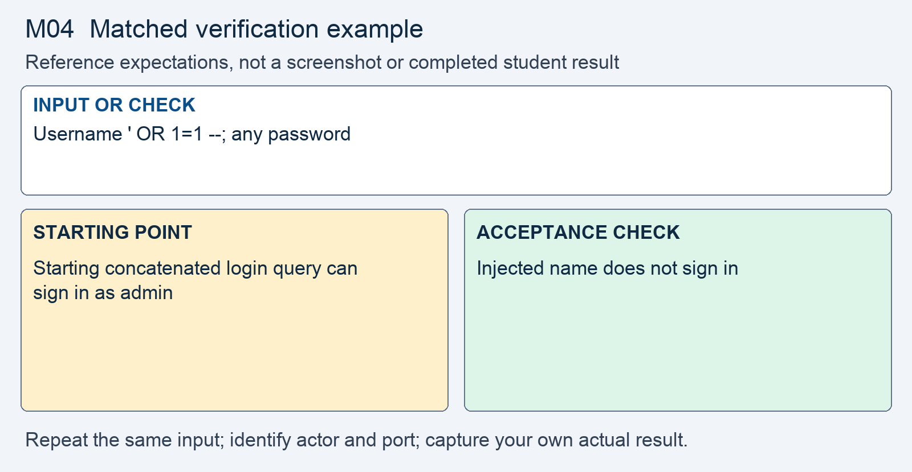
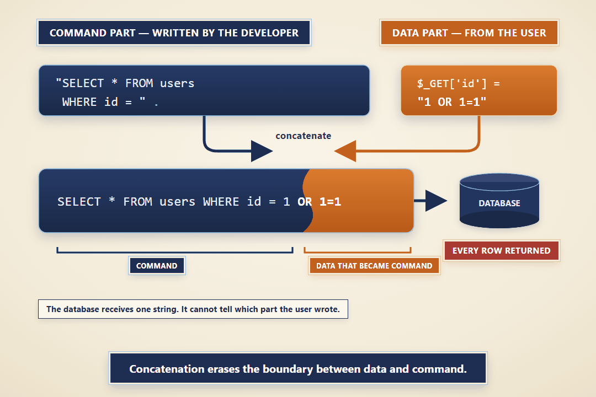

# M04 - Assignment: Incident Report and Fix - SQL Injection in the Sign-In Form

> This repository copy contains the current task instructions and reference images. Download the Word report template from the matching Canvas assignment. Keep your existing Cloud Shell workspace and earlier repairs; returning students do not need a new clone.


## Downloads and instructions

| Supplied file | Use |
|---|---|
| **Download report**: obtain `m04-tc-ir-003-report-template.docx` from this module’s Canvas assignment | Read the supplied model, then complete the marked entries in Word or Word Online. |
| [Download assignment.md](assignment.md) | Keep this copy of the instructions unchanged and include it with the submission. |

All supplied downloads are listed here. The step-by-step activity follows. For Word editing and submission steps, use the course report guide in Orientation. Screenshots belong inside the report unless the activity explicitly requests a separate file.

<!-- verification-guide:start -->
## Visual guide and matched verification

Use a fresh signed-out browser session for the login-bypass test. Open /customer.php?q=Brien directly for customer search; there is no search box on index.php.

Open this path in your **original 8080 preview tab**, preserving its Cloud Shell hostname:

```text
/login.php
```


This is an actual instructor browser capture from a disposable copy of the released portal. It shows the starting interface, not your repaired result. The capture used a temporary local port; your original and working copies remain **8080** and **8081**. Capture your own evidence.

### Keep the comparison controlled



This comparison card summarizes the first row below. It is a teaching guide, not an observed repaired result. The full table and commands remain selectable text.

For each row, record the exact input, signed-in actor, path, port, status or visible behavior, and any state change. Repeat the same test on the original **8080** and working **8081** copies; change only the intended control or comparison variable. If an earlier repair already blocks a case, record that result and keep the repair. Never invent the illustrated outcome.

| Input or check | Starting point to record | Acceptance check to capture |
|---|---|---|
| Username ' OR 1=1 --; any password | Starting concatenated login query can sign in as admin | Injected name does not sign in |
| q=O'Brien | Observe the query failure | O'Brien is found without a query error |
| id=0 OR 1=1 | An account may be selected despite id 0 | No unrelated account is returned |

**Legitimate use and limits.** A real representative can sign in; a real customer ID and apostrophe-containing name still work. Keep Module 03 validation and output encoding.

### Capture and submit consistently

Keep command inputs as selectable text beside their output. For browser evidence, show the relevant page, field, and result; a browser image alone does not establish the HTTP status. For HTTP evidence, retain the status and relevant headers as text, and verify any claimed write or refusal in application state. Label before and after captures with the port, actor, and test input. Add captions and alt text in the Word report. Use the complete verification steps below, not just the summary rows.

<!-- verification-guide:end -->

> [!NOTE] Shared lab and reporting references
> Use the **Incident Reporting Guide** (reference page in Canvas) for analysis and evidence, the **Lab Guide** (reference page in Canvas) for environment details, and **Rules Of Engagement** (reference page in Canvas) before testing. The requirements below define this assignment's scope and deliverables.

## What you will do

An unauthenticated sign-in request was reported to enter an administrator account without its password. Review identified the same data-to-command failure in the sign-in query and two customer lookups. The response replaces all three concatenated queries with bound parameters and verifies that ordinary account access remains available.

Read the supplied report, reproduce the original behavior, make the scoped change in the working copy, prove hostile refusal and normal operation, then add your own results and reasoning.

## The incident: TC-IR-003

Here is the ticket the desk filed, and the analyst's determination on top of it.

> **Incident TC-IR-003 - Someone signed in to an admin account without its password**
> An ops engineer reported signing in to the portal using a username that is not an account. They typed `' OR 1=1 --` in the username box, any text in the password box, and were signed in as an administrator, with the Admin link showing in the navigation.
>
> **Analyst determination.** The sign-in builds its SQL by pasting the typed username straight into the query text. The input `' OR 1=1 --` closes the username string, adds a condition that is always true, and comments out the password check, so the query matches every account and the sign-in takes the first one, which is an administrator. Anyone can sign in as any account without a password. The same concatenation flaw sits at two more sinks in `customer.php`: the name search, where a crafted term returns records the rep never searched for, and the account-id lookup, where a crafted id opens an account, tax ID included, that was never requested. All three are SQL injection, and all three close this module.


## Your lab

Your work happens in your own course environment. If it is not open, launch it from the **Launch Course Environment** page in Module 01. It is your copy and the only target you are authorized to test. The pages in question are `auth.php`, which runs the sign-in query, and `customer.php`, which runs the name search and the account-id lookup. Both build SQL from what the user typed.

For section 5, this figure is the shape you are tracing. Reproduce it in your own words for your environment.


***Figure 1.** String concatenation lets a typed value cross from the data part of a query into the command part, where the database parser reads it as SQL instead of a value.*

## Read the report and required analysis

> [!CONCEPT] Read the supplied report
> The report supplies the corporate case and management record. Complete the marked [STUDENT] entries, keep every EXAMPLE, and write your own answer after Answer. Later modules require fuller justification; use evidence rather than expanding the report with unsupported claims.


Use the supplied Word report. The following table identifies the analytical coverage required; keep the completed corporate context and add your own contribution to its marked entries.


| Section | What it must say |
|---|---|
| **2. Executive summary** | Two or three sentences a manager could read: what was exposed, to whom, and whether it is fixed. No code. |
| **3. Systems and data affected** | The `auth.php` sign-in query and the `users` table, and the `customer.php` name search and account-id lookup. Name the values involved: the typed username, and the accounts and customer records the injection exposes, tax IDs included. |
| **4. Timeline of events** | When the bypass was reported and when you acted, in relative terms. |
| **5. Detection and analysis** | Trace the typed value from each form into its query. Name the **source**, the **trust boundary**, the **sink**, and the **interpreter**. There are three injectable queries; account for all three. |
| **6. Response actions** | The fix you applied: bound parameters for the sign-in query and both customer lookups, so user input is always data and never SQL. |
| **7. Confirmation of remediation, annotated** | Your before and after evidence from Part 2, with an annotation on each check saying what it proves and what it does not. |
| **9. Post-incident actions** | The OWASP guidance you followed, by name, and one change that would stop this class of bug recurring on other pages. |

## Open the working environment

1. [Launch Google Cloud Shell](https://shell.cloud.google.com/) with the account used for the earlier labs.
2. In the editor, locate the existing workspace containing `site`, `fixed`, `reports`, and `scripts`. Right-click the workspace folder and select **Open in Integrated Terminal**.
3. Run:

```bash
bash scripts/start.sh
```

4. Open **Web Preview → Preview on port 8080** for the original. Use **Web Preview → Change port → 8081** for the working copy. Check the port before testing. Sign in separately using the account required below.
5. Read/reproduce the starting flaw on **site, port 8080**. Edit and verify **fixed, port 8081**. Keep earlier repairs. If an earlier control already prevents the case on fixed, report that result and test the remaining work without removing the control.
6. Download the report from the list at the top, open it in Word or Word Online, and save your copy. The IDE is for the source and command evidence; the Word report stays outside the code repository.


> [!NOTE] Capture the comparison
> Record original and working results separately. The same demo username can have different password or session state after earlier modules. Use the current working credentials for 8081; do not reset the whole application to make an old example reappear.


## Fix and prove the working copy

> [!CORRECT] Change the working files
> Open the corresponding paths under fixed/. Use Find to locate the named expression or function; the cited line numbers are reference locations and will change as your repairs accumulate. Save each change before testing.


Do this in your course environment, on `auth.php` and `customer.php`. Each step produces evidence that goes into the report.

1. **Reproduce the bypass.** On the sign-in form, type `' OR 1=1 --` in the username box and any text in the password box, then sign in.
   - You are signed in as an administrator and land on the customer list, with the Admin link now in the navigation.
   - Capture the screen. This is your first piece of **before** evidence for section 7.

2. **Reproduce the two customer lookups.** The name search and the id lookup build SQL the same way.
   - Open `/customer.php?q=O%27Brien` in the original preview tab. The Customers menu itself has no search box. The apostrophe breaks the query and returns a database error, which proves the term reaches the SQL as syntax.
   - Then open `customer.php?id=0 OR 1=1`. No customer has id `0`, yet an account opens, tax ID and all.
   - Capture both. This is the rest of your **before** evidence.

3. **Trace the flow.** Find the exact line where data became syntax in each query.
   - In `auth.php`, the line that pastes the username into the login string, and the call that hands it to the database.
   - In `customer.php`, the `LIKE '%$q%'` name search and the `WHERE id = $id` lookup.
   - For each, name the source, the trust boundary, the sink, and the interpreter.

4. **Parameterize the sign-in query.** Replace the concatenated login query with a prepared statement.
   - Put a placeholder where the username belongs, prepare the statement, and execute it with the username bound as a value.
   - `' OR 1=1 --` is now looked up as a literal account name, matches nothing, and signs no one in.
   - Do not strip characters; a real username with an apostrophe must still work. How the password is stored is out of scope for this module.

5. **Parameterize both customer lookups.** Do the same in `customer.php`.
   - For the name search, write `LIKE ?` and bind the finished pattern `'%' . $term . '%'`, so the wildcards live in the value, not the SQL text.
   - For the id lookup, bind the id to a placeholder. Validating it as an integer first is a fair supporting control, but the binding is the fix.
   - A fix that deletes the apostrophe returns nothing for `O'Brien`; that removes the evidence, not the flaw.

> [!NOTE] Record your own results
> Switch to the working portal on 8081. Capture the actual hostile and legitimate outcomes and compare them with the original. Keep a failed check in the record while you correct it.

6. **Prove it.** Capture, side by side with your before evidence:
   - the `' OR 1=1 --` username now failing to sign in, and a real account still signing in;
   - the name search no longer returning records you did not search for, and `O'Brien` returning his account with no error;
   - `customer.php?id=0 OR 1=1` now returning nothing, and a real id still opening its account.
   - A fix that blocks a real sign-in, or breaks `O'Brien`, or breaks a normal lookup, is a regression, not a fix.

The scoped injection repair is ready for review when all three query paths pass the hostile and legitimate checks. This does not close unrelated findings or establish the scope of historical unauthorized access.

Open notes and open book are both fine. Respond in your own words; do not copy from other sources.

**AI use on this assignment.** The syllabus policy governs; these are its terms for an incident report and fix.

> [!CORRECT] Permitted, with disclosure
> - Asking an AI to explain a concept, an OWASP guideline, or a PHP error message in general terms.
> - A grammar or spelling checker on your own writing.
> - Generating or refactoring code, proposing tests, and planning or editing the report, with disclosure of the tool, help requested, material used or changed, and checks performed. Report only results you observed.

> [!CRITICAL] Not permitted
> - Submitting AI-generated code, analysis, or writing without disclosing it.
> - Pointing an AI-assisted tool at any target other than your own course environment.

You must be able to explain every line you submit, on request. Undisclosed AI use is handled as academic dishonesty under the syllabus.

## Expected output

> [!CORRECT] Check the result, not just the syntax
> The injected username no longer signed in; the normal representative still signed in. O'Brien was found without a query error, and an injected ID did not select another account. These are EXAMPLE outcomes; record the actual results from your copy and annotate what each test establishes.


Your captures will differ in cosmetic detail; the behavior must not. The assignment passes when the report is complete and the fix holds:

- The `' OR 1=1 --` username no longer signs anyone in; it is looked up as a name that matches no account.
- A real account still signs in normally.
- The name search no longer returns records that were not searched for, and `O'Brien` returns his account with no error.
- `customer.php?id=0 OR 1=1` returns nothing, while a real id still opens its account.
- Section 5 names the source, the trust boundary, the sink, and the interpreter for all three queries; section 7 shows the before and after for each.

## What to submit

- Completed `m04-tc-ir-003-report.docx` with your own results, required screenshots, disclosure, reflection, and Revision History.
- Supplied `assignment.md`, unchanged.
- Complete changed source, including `fixed/auth.php`, `fixed/customer.php`. Include every additional helper, migration, or test file you changed or added. Do not submit unchanged helper files merely because you called them.

In Word, save the report on your computer or document storage. In Cloud Shell Editor, right-click the required source files and choose **Download**. Download `assignment.md` from the list at the top. In Canvas, select **Start Assignment** or **New Attempt**, attach all required parts to the same attempt, select **Submit Assignment**, and check the file list and confirmation. A saved local file is not a submission.

Cite the OWASP SQL Injection Prevention and Query Parameterization cheat sheets, and the OWASP Proactive Controls 2024 C3, Validate all Input and Handle Exceptions, which calls for prepared statements, where you relied on them.

## Grading rubric

Read the **Assignment rubric** (reference page in Canvas) before submitting. The rubric assesses this activity separately from the other work in the module.

## Complete the report record

Read the supplied business-impact assessment and likelihood–impact table. Complete its marked rating entries using the actual case or your own evidence, and explain why the control changes the risk. Keep the EXAMPLE responses and write your own answers after Answer. Finish the identity, sources, disclosure, reflection, and Revision History entries that the report requests.
