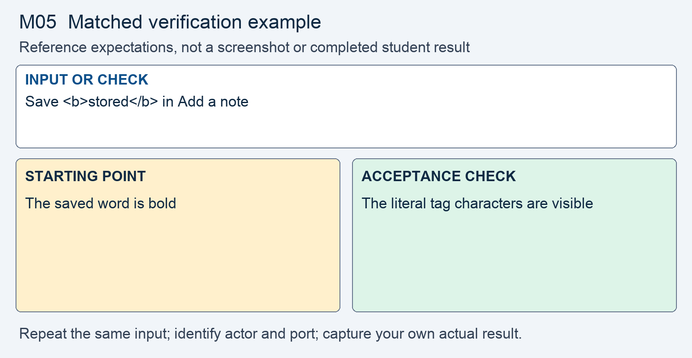

# M05 - Assignment: Incident Report and Fix - Stored Script in Account Notes

> This repository copy contains the current task instructions and reference images. Download the Word report template from the matching Canvas assignment. Keep your existing Cloud Shell workspace and earlier repairs; returning students do not need a new clone.


## Downloads and instructions

| Supplied file | Use |
|---|---|
| **Download report**: obtain `m05-tc-ir-004-report-template.docx` from this module’s Canvas assignment | Read the supplied model, then complete the marked entries in Word or Word Online. |
| [Download assignment.md](assignment.md) | Keep this copy of the instructions unchanged and include it with the submission. |

All supplied downloads are listed here. The step-by-step activity follows. For Word editing and submission steps, use the course report guide in Orientation. Screenshots belong inside the report unless the activity explicitly requests a separate file.

<!-- verification-guide:start -->
## Visual guide and matched verification

Open the notes URL directly or use Call notes for this account on /customer.php?id=1. Use the same customer and saved payload notes when comparing copies.

Open this path in your **original 8080 preview tab**, preserving its Cloud Shell hostname:

```text
/notes.php?customer_id=1
```


This is an actual instructor browser capture from a disposable copy of the released portal. It shows the starting interface, not your repaired result. The capture used a temporary local port; your original and working copies remain **8080** and **8081**. Capture your own evidence.

### Keep the comparison controlled



This comparison card summarizes the first row below. It is a teaching guide, not an observed repaired result. The full table and commands remain selectable text.

For each row, record the exact input, signed-in actor, path, port, status or visible behavior, and any state change. Repeat the same test on the original **8080** and working **8081** copies; change only the intended control or comparison variable. If an earlier repair already blocks a case, record that result and keep the repair. Never invent the illustrated outcome.

| Input or check | Starting point to record | Acceptance check to capture |
|---|---|---|
| Save <b>stored</b> in Add a note | The saved word is bold | The literal tag characters are visible |
| Save ; view as lchen | Observe execution from stored content | Literal text; no alert for the second viewer |
| Save customer said the price was < 500 "firm" | Record the original note | All punctuation is preserved |

**Legitimate use and limits.** Real notes still save and render. Inspect response bytes as well as the page. Do not change the date-picker call in this module.

### Capture and submit consistently

Keep command inputs as selectable text beside their output. For browser evidence, show the relevant page, field, and result; a browser image alone does not establish the HTTP status. For HTTP evidence, retain the status and relevant headers as text, and verify any claimed write or refusal in application state. Label before and after captures with the port, actor, and test input. Add captions and alt text in the Word report. Use the complete verification steps below, not just the summary rows.

<!-- verification-guide:end -->

> [!NOTE] Shared lab and reporting references
> Use the **Incident Reporting Guide** (reference page in Canvas) for analysis and evidence, the **Lab Guide** (reference page in Canvas) for environment details, and **Rules Of Engagement** (reference page in Canvas) before testing. The requirements below define this assignment's scope and deliverables.

## What you will do

A call note was interpreted as active page content when a representative opened a customer record. The stored note can reach a later viewer without the payload appearing in that viewer’s request. Engineering will encode the note body at its HTML text output and verify both a second viewer and ordinary business punctuation.

Read the supplied report, reproduce the original behavior, make the scoped change in the working copy, prove hostile refusal and normal operation, then add your own results and reasoning.

## The incident: TC-IR-004

Here is the ticket the desk filed, and the analyst's determination on top of it.

> **Incident TC-IR-004 - A call note runs as script in a rep's browser**
> A support rep opened a customer's call notes and the page ran code in their browser instead of showing a note's text. The rep had not typed anything unusual. They only opened the account.
>
> **Analyst determination.** A call note is saved to the `notes` table and later written into the notes page without encoding. A note whose body contains markup is handed to the browser as HTML and run, not shown as text. The note is stored, so it runs for every rep who opens that account, not only for the person who wrote it. The author name and the date on the same page are already encoded; the note body is not.


## Your lab

Your work happens in your own course environment. If it is not open, launch it from the **Launch Course Environment** page in Module 01. It is your copy and the only target you are authorized to test. Sign in with the rep account from Module 01. The page in question is `notes.php`; reach a customer's notes through the **Call notes for this account** link on that customer's page.

The only test payloads you use are the harmless ones the lecture names: `<b>stored</b>` and ``. Nothing you type reads a cookie or contacts another host.

## Read the report and required analysis

> [!CONCEPT] Read the supplied report
> The report supplies the corporate case and management record. Complete the marked [STUDENT] entries, keep every EXAMPLE, and write your own answer after Answer. Later modules require fuller justification; use evidence rather than expanding the report with unsupported claims.


Use the supplied Word report. The following table identifies the analytical coverage required; keep the completed corporate context and add your own contribution to its marked entries.


| Section | What it must say |
|---|---|
| **2. Executive summary** | Two or three sentences a manager could read: what was exposed, to whom, and whether it is fixed. No code. |
| **3. Systems and data affected** | The `notes.php` call-notes page, and which values are involved: the note body, and the browser session of every rep who opens the account. |
| **4. Timeline of events** | When it was reported and when you acted, in relative terms. |
| **5. Detection and analysis** | Trace the note from the request that saved it, into the database, and back out onto the page. Name the **source**, the **trust boundary**, each **sink**, the **context** at the browser sink, and the **interpreter**. Say why this is stored XSS rather than reflected, and who it fires for. |
| **6. Response actions** | The fix you applied: output encoding of the note body at the point it is written into the page, for the context it lands in. Name the principle and the control, using the lecture's words. |
| **7. Confirmation of remediation, annotated** | Your before and after evidence from Part 2. The markup case is inert for a second signed-in rep after the fix; an ordinary note with punctuation still reads as typed. |
| **9. Post-incident actions** | The OWASP cheat sheet you followed, by name. Then name a Content Security Policy as the control you would add on top, and say what it restricts and why it is not the fix. |

For section 5, the figure in lecture section 4 is the shape you are tracing. Your incident is the stored route: the note is saved, then written into the page for a later viewer.

## Open the working environment

1. [Launch Google Cloud Shell](https://shell.cloud.google.com/) with the account used for the earlier labs.
2. In the editor, locate the existing workspace containing `site`, `fixed`, `reports`, and `scripts`. Right-click the workspace folder and select **Open in Integrated Terminal**.
3. Run:

```bash
bash scripts/start.sh
```

4. Open **Web Preview → Preview on port 8080** for the original. Use **Web Preview → Change port → 8081** for the working copy. Check the port before testing. Sign in separately using the account required below.
5. Read/reproduce the starting flaw on **site, port 8080**. Edit and verify **fixed, port 8081**. Keep earlier repairs. If an earlier control already prevents the case on fixed, report that result and test the remaining work without removing the control.
6. Download the report from the list at the top, open it in Word or Word Online, and save your copy. The IDE is for the source and command evidence; the Word report stays outside the code repository.


> [!NOTE] Capture the comparison
> Record original and working results separately. The same demo username can have different password or session state after earlier modules. Use the current working credentials for 8081; do not reset the whole application to make an old example reappear.


## Fix and prove the working copy

> [!CORRECT] Change the working files
> Open the corresponding paths under fixed/. Use Find to locate the named expression or function; the cited line numbers are reference locations and will change as your repairs accumulate. Save each change before testing.


Do this on `notes.php` in your course environment. Each step produces evidence that goes into the report.

1. **Reproduce it.** Sign in as `rmarsh` and open a customer's call notes. In **Add a note**, save `<b>stored</b>`.
   - The note shows the word **stored** in bold, not the characters you typed.
   - Save a second note, ``. The handler runs when the page loads, with no `<script>` tag anywhere in it.
   - Capture the screen. This is your **before** evidence for section 7.

2. **Show that it is stored, and who it fires for.** Sign out, then sign in as `lchen`, the second rep account listed in your portal's `README.md`.
   - Open the same customer's notes. Both notes still run, and nothing in this request carried a payload. The value came out of the database.
   - Capture this. It is the sentence section 5 has to earn: the note fires for every rep who opens the account.

3. **Find the same data written safely on the same page.** Open `notes.php` in the editor.
   - Each note's author name and date are written a few lines below its body. Compare the three lines.
   - Write one sentence on what the author-name line does that the note-body line does not.

4. **Trace the flow.** In `notes.php`, find by line number:
   - where the note body enters the request, and the trust boundary it crosses there;
   - the statement that writes it to the `notes` table, and what keeps the body data at that sink;
   - the query that reads it back, which is a source again, as lecture section 4 says;
   - the line that writes the body into the page, the context it lands in, and the interpreter beyond it.
   - List every other untrusted value the page writes (`customer_id`, `from`, `created_by_name`, `created_at`) with its context, and say whether each is already encoded. The `from` date also reaches the picker's script through `json_encode`; name that context and leave it as it is. It is out of scope for this module.

5. **Encode at the sink.** At the line that writes the note body into the page, apply the encoding the lecture gives for HTML text: `htmlspecialchars` with `ENT_QUOTES | ENT_SUBSTITUTE` and `'UTF-8'`.
   - Encode at the moment of writing, for the place it is written. Do not encode once at the top of the file.
   - Do not strip tags from the note on the way in instead. A rep who writes `price was < 500` would lose part of the sentence, and the stored value would still be unsafe the next time something writes it.

> [!NOTE] Record your own results
> Switch to the working portal on 8081. Capture the actual hostile and legitimate outcomes and compare them with the original. Keep a failed check in the record while you correct it.

6. **Prove it.** Capture, side by side with your before evidence:
   - the same customer's notes as `lchen`, both payload notes now showing their literal characters, and no handler running;
   - a legitimate note, `customer said the price was < 500 "firm"`, saved and displayed exactly as typed;
   - the bytes the browser received for one payload note, showing `&lt;` where `<` was. Use the Network panel's **Response** tab or `curl` with the saved sign-in cookie, as the **Requests and Developer Tools** page in the Course Orientation module shows.
   - A fix that mangles ordinary business text is a regression, not a fix.

Open notes and open book are both fine. Respond in your own words; do not copy from other sources.

**AI use on this assignment.** The syllabus policy governs; these are its terms for an incident report and fix.

> [!CORRECT] Permitted, with disclosure
> - Asking an AI to explain a concept, an OWASP guideline, or a PHP error message in general terms.
> - A grammar or spelling checker on your own writing.
> - Generating or refactoring code, proposing tests, and planning or editing the report, with disclosure of the tool, help requested, material used or changed, and checks performed. Report only results you observed.

> [!CRITICAL] Not permitted
> - Submitting AI-generated code, analysis, or writing without disclosing it.
> - Pointing an AI-assisted tool at any target other than your own course environment.

You must be able to explain every line you submit, on request. Undisclosed AI use is handled as academic dishonesty under the syllabus.

## Expected output

> [!CORRECT] Check the result, not just the syntax
> As the second representative, I saw the literal img text and no alert. A note containing < 500 and quotation marks still displayed exactly as entered. These are EXAMPLE outcomes; record the actual results from your copy and annotate what each test establishes.


Your captures will differ in cosmetic detail; the behavior must not. The assignment passes when the report is complete and the fix holds:

- A note containing markup displays as literal text after the fix, for a second signed-in rep, and the `onerror` payload no longer runs.
- An ordinary note with an angle bracket and quotes still displays exactly as typed.
- Adding and viewing notes still works, and the seeded notes still read normally.
- Section 5 names the source, the trust boundary, each sink, the context, and the interpreter, and says why this is stored XSS and who it fires for; section 7 shows the before and after; section 9 names a Content Security Policy as the control added on top.

## What to submit

- Completed `m05-tc-ir-004-report.docx` with your own results, required screenshots, disclosure, reflection, and Revision History.
- Supplied `assignment.md`, unchanged.
- Complete changed source, including `fixed/notes.php`. Include every additional helper, migration, or test file you changed or added. Do not submit unchanged helper files merely because you called them.

In Word, save the report on your computer or document storage. In Cloud Shell Editor, right-click the required source files and choose **Download**. Download `assignment.md` from the list at the top. In Canvas, select **Start Assignment** or **New Attempt**, attach all required parts to the same attempt, select **Submit Assignment**, and check the file list and confirmation. A saved local file is not a submission.


## Grading rubric

Read the **Assignment rubric** (reference page in Canvas) before submitting. The rubric assesses this activity separately from the other work in the module.

## Complete the report record

Read the supplied business-impact assessment and likelihood–impact table. Complete its marked rating entries using the actual case or your own evidence, and explain why the control changes the risk. Keep the EXAMPLE responses and write your own answers after Answer. Finish the identity, sources, disclosure, reflection, and Revision History entries that the report requests.
