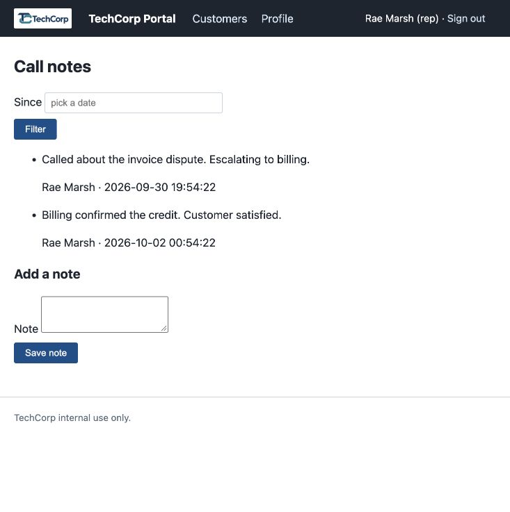
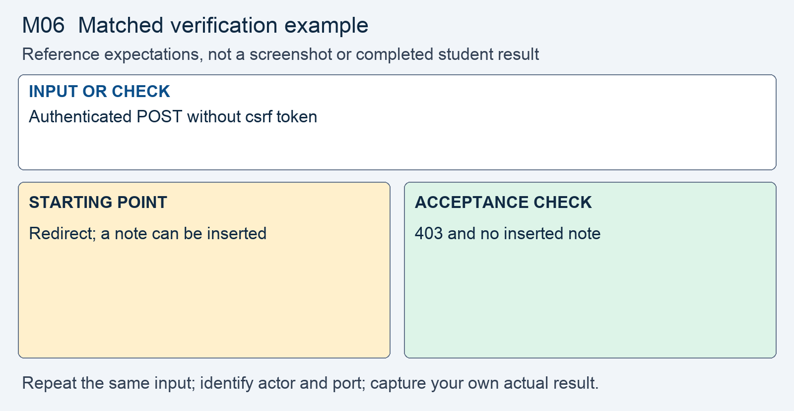

# M06 - Assignment: Incident Report and Fix - Forged Note on a Customer Account

> This repository copy contains the current task instructions and reference images. Download the Word report template from the matching Canvas assignment. Keep your existing Cloud Shell workspace and earlier repairs; returning students do not need a new clone.


## Downloads and instructions

| Supplied file | Use |
|---|---|
| **Download report**: obtain `m06-tc-ir-005-report-template.docx` from this module’s Canvas assignment | Read the supplied model, then complete the marked entries in Word or Word Online. |
| [Download assignment.md](assignment.md) | Keep this copy of the instructions unchanged and include it with the submission. |

All supplied downloads are listed here. The step-by-step activity follows. For Word editing and submission steps, use the course report guide in Orientation. Screenshots belong inside the report unless the activity explicitly requests a separate file.

<!-- verification-guide:start -->
## Visual guide and matched verification

The request below intentionally omits a CSRF token while carrying a valid login cookie. It tests the server-side intent check, not a complete cross-site browser exploit.

Open this path in your **original 8080 preview tab**, preserving its Cloud Shell hostname:

```text
/notes.php?customer_id=1
```



This is an actual instructor browser capture from a disposable copy of the released portal. It shows the starting interface, not your repaired result. The capture used a temporary local port; your original and working copies remain **8080** and **8081**. Capture your own evidence.

### Keep the comparison controlled



This comparison card summarizes the first row below. It is a teaching guide, not an observed repaired result. The full table and commands remain selectable text.

For each row, record the exact input, signed-in actor, path, port, status or visible behavior, and any state change. Repeat the same test on the original **8080** and working **8081** copies; change only the intended control or comparison variable. If an earlier repair already blocks a case, record that result and keep the repair. Never invent the illustrated outcome.

| Input or check | Starting point to record | Acceptance check to capture |
|---|---|---|
| Authenticated POST without csrf token | Redirect; a note can be inserted | 403 and no inserted note |
| Altered token; token from another session | No synchronizer-token check exists | 403 and no insert for each case |
| Submit the real portal form with its own token | Normal form saves a note | Normal form still saves a note |

**Legitimate use and limits.** Show actual note counts or the notes list after each refusal. A refusal status alone does not prove no write occurred.

### Copyable tokenless request comparison

Use separate cookie jars. Sign in to each copy first as the Requests and Developer Tools guide shows; save original cookies to `reports/m06-original.cookies` and working cookies to `reports/m06-working.cookies`. Use the current working password on 8081, and do not paste cookie contents into the report. Then run the matching requests:

```bash
curl -sS -i -b reports/m06-original.cookies --data-urlencode 'customer_id=1' --data-urlencode 'body=M06 tokenless check' http://127.0.0.1:8080/notes.php
curl -sS -i -b reports/m06-working.cookies --data-urlencode 'customer_id=1' --data-urlencode 'body=M06 tokenless check' http://127.0.0.1:8081/notes.php
```

These commands intentionally have no token and no `-L`: retain the initial status and Location header. The repaired server must refuse without an insert. Separately submit the genuine working form with its own token and verify that its note is saved.

### Capture and submit consistently

Keep command inputs as selectable text beside their output. For browser evidence, show the relevant page, field, and result; a browser image alone does not establish the HTTP status. For HTTP evidence, retain the status and relevant headers as text, and verify any claimed write or refusal in application state. Label before and after captures with the port, actor, and test input. Add captions and alt text in the Word report. Use the complete verification steps below, not just the summary rows.

<!-- verification-guide:end -->

> [!NOTE] Shared lab and reporting references
> Use the **Incident Reporting Guide** (reference page in Canvas) for analysis and evidence, the **Lab Guide** (reference page in Canvas) for environment details, and **Rules Of Engagement** (reference page in Canvas) before testing. The requirements below define this assignment's scope and deliverables.

## What you will do

A note was recorded under a signed-in representative’s identity without evidence that the representative intended the action. Authentication identifies the session but does not establish request intent. The response introduces a shared synchronizer-token check before insertion, with cookie attributes as an additional control.

Read the supplied report, reproduce the original behavior, make the scoped change in the working copy, prove hostile refusal and normal operation, then add your own results and reasoning.

## The incident: TC-IR-005

Here is the ticket the desk filed, and the analyst's determination on top of it.

> **Incident TC-IR-005 - A note appeared that no rep wrote**
> A support rep reported a call note on a customer account that they do not remember writing, and no other rep on the team remembers writing it either. The note is stamped with the rep's own display name and was saved while the rep was signed in.
>
> **Analyst determination.** The add-note form on `notes.php` posts two fields, `customer_id` and `body`, back to `notes.php`. The handler checks that someone is signed in, then inserts the note with the session's display name. Nothing in the request proves it came from the portal's own form, and the browser attaches the session cookie to any request bound for the portal. A request assembled anywhere else, carrying the rep's session, is accepted. The request is authentic and was never intended. This is cross-site request forgery. The fix is a per-session token another page cannot read, checked on the server before the note is written.


## Your lab

Your work happens in your own course environment. If it is not open, launch it from the **Launch Course Environment** page in Module 01. It is your copy and the only target you are authorized to test. Sign in with the rep account from Module 01. The pages in question are `notes.php`, which holds the add-note form and the POST handler that inserts the note, and `auth.php`, where the session starts.

## Read the report and required analysis

> [!CONCEPT] Read the supplied report
> The report supplies the corporate case and management record. Complete the marked [STUDENT] entries, keep every EXAMPLE, and write your own answer after Answer. Later modules require fuller justification; use evidence rather than expanding the report with unsupported claims.


Use the supplied Word report. The following table identifies the analytical coverage required; keep the completed corporate context and add your own contribution to its marked entries.


| Section | What it must say |
|---|---|
| **2. Executive summary** | Two or three sentences a manager could read: that a note was saved on a customer account without any rep intending it, whose session was used, and whether it is fixed. No code. |
| **3. Systems and data affected** | The `notes.php` add-note feature, the row it writes to the `notes` table (`customer_id`, `body`, `created_by_name`, `created_at`), and the rep session the request rode on. |
| **4. Timeline of events** | When the unexplained note was noticed and when you acted, in relative terms. |
| **5. Detection and analysis** | Explain the mechanism in the lecture's words. Name the **ambient authority** the browser supplies, what the **same-origin policy** lets another page do and not do, and which of the three questions (who, may they, did they mean to) the request leaves unanswered. Classify it: the OWASP category and the CWE. |
| **6. Response actions** | The fix you applied: one shared token check called from the add-note form and from the first line of the POST branch, and the cookie attributes set before the session starts. Name the pattern and the control in the lecture's words, and say which is the primary control and which is defense in depth. |
| **7. Confirmation of remediation, annotated** | Your before and after evidence from Part 2. A token-less POST with a valid session saves a note before the fix and is refused after it, while the portal's own add-note form still saves a note. |
| **9. Post-incident actions** | The OWASP guidance you followed, by name, and one change that would stop this class of bug from recurring on every state-changing page in the portal. |

## Open the working environment

1. [Launch Google Cloud Shell](https://shell.cloud.google.com/) with the account used for the earlier labs.
2. In the editor, locate the existing workspace containing `site`, `fixed`, `reports`, and `scripts`. Right-click the workspace folder and select **Open in Integrated Terminal**.
3. Run:

```bash
bash scripts/start.sh
```

4. Open **Web Preview → Preview on port 8080** for the original. Use **Web Preview → Change port → 8081** for the working copy. Check the port before testing. Sign in separately using the account required below.
5. Read/reproduce the starting flaw on **site, port 8080**. Edit and verify **fixed, port 8081**. Keep earlier repairs. If an earlier control already prevents the case on fixed, report that result and test the remaining work without removing the control.
6. Download the report from the list at the top, open it in Word or Word Online, and save your copy. The IDE is for the source and command evidence; the Word report stays outside the code repository.


> [!NOTE] Capture the comparison
> Record original and working results separately. The same demo username can have different password or session state after earlier modules. Use the current working credentials for 8081; do not reset the whole application to make an old example reappear.


## Fix and prove the working copy

> [!CORRECT] Change the working files
> Open the corresponding paths under fixed/. Use Find to locate the named expression or function; the cited line numbers are reference locations and will change as your repairs accumulate. Save each change before testing.


Do this on `notes.php` and `auth.php` in your course environment. Each step produces evidence that goes into the report.

1. **Reproduce it.** In the Cloud Shell terminal, sign in with `curl` into a cookie jar, then POST `customer_id` and `body` to `notes.php` with that cookie and nothing else.
   - The response is a redirect, and the note appears on the customer's call-notes page under your display name.
   - Capture the command, the response, and the page: your **before** evidence for section 7.
   - The **Requests and Developer Tools** page shows the sign-in and the cookie jar.

2. **Say what the request proved.** Write one sentence on what that request carried and one on what it did not.
   - It carried a valid session, so the sign-in check passed.
   - It carried nothing that could only have come from a page the portal served. That is the gap the lecture's section 3 comparison shows.

3. **Trace the flow.** In `notes.php`, find by line number:
   - where the POST is received and the two fields are read;
   - where the sign-in check runs;
   - where the note is inserted;
   - what the handler checks between reading the fields and inserting. Name each check, and name the one that is absent.
   - In `auth.php`, find where the session starts and what cookie parameters are set.

4. **Read the cookie the portal sets.** Request the sign-in page with `curl -i`, or use the Network panel, and read the `Set-Cookie` line for the session cookie.
   - Record which attributes it carries and which it does not. Lecture section 7 says what the missing attribute means and why the browser then decides.
   - The **Requests and Developer Tools** page shows both ways to read it.

5. **Add one shared check.** Put the token logic in one new file, in the shape lecture section 6 shows, and make `notes.php` use it.
   - The add-note form carries the token as a hidden field.
   - The POST branch calls the check on its first line, before the insert.
   - A POST without this session's token ends in `403` with a short denial and writes nothing.

6. **Set the cookie attributes.** In `auth.php`, set `SameSite` and `HttpOnly` on the session cookie before the session starts, as lecture section 7 shows.
   - Read the `Set-Cookie` line again and confirm both attributes are present.
   - In the report, state what `SameSite=Lax` covers and the three limits the lecture gives, so the reader sees why it backs up the token rather than replacing it.

> [!NOTE] Record your own results
> Switch to the working portal on 8081. Capture the actual hostile and legitimate outcomes and compare them with the original. Keep a failed check in the record while you correct it.

7. **Prove it.** Run the first four rows of the table in lecture section 10 against `notes.php` and capture each result, before beside after:
   - the portal's own add-note form still saves a note;
   - the step 1 request, repeated, gets `403` and `Request denied`, and no note appears;
   - an altered token gets `403`;
   - a valid token sent with a different signed-in session's cookie gets `403`.
   - A fix that blocks the real form is a regression.

Setting `Secure` on the session cookie is out of scope for this module. The portal's other POST handlers are out of scope for this module; section 9 asks what would protect them.

Open notes and open book are both fine. Respond in your own words; do not copy from other sources.

**AI use on this assignment.** The syllabus policy governs; these are its terms for an incident report and fix.

> [!CORRECT] Permitted, with disclosure
> - Asking an AI to explain a concept, an OWASP guideline, or a PHP error message in general terms.
> - A grammar or spelling checker on your own writing.
> - Generating or refactoring code, proposing tests, and planning or editing the report, with disclosure of the tool, help requested, material used or changed, and checks performed. Report only results you observed.

> [!CRITICAL] Not permitted
> - Submitting AI-generated code, analysis, or writing without disclosing it.
> - Pointing an AI-assisted tool at any target other than your own course environment.

You must be able to explain every line you submit, on request. Undisclosed AI use is handled as academic dishonesty under the syllabus.

## Expected output

> [!CORRECT] Check the result, not just the syntax
> A valid-session POST without a token returned 403 and created no note. The real form still saved a note; altered and cross-session tokens were refused. These are EXAMPLE outcomes; record the actual results from your copy and annotate what each test establishes.


Your captures will differ in cosmetic detail; the behavior must not. The assignment passes when the report is complete and the fix holds:

- A POST to `notes.php` with a valid session and no token, or a wrong token, gets `403` and `Request denied`, and no note is written.
- The portal's own add-note form still saves a note.
- The session cookie's `Set-Cookie` line carries `SameSite` and `HttpOnly`, and the report states what each covers and does not cover.
- The token check lives in one file that any other POST page can call.
- Section 5 names the ambient authority, the same-origin policy's part, and the unanswered question; section 7 shows the before and after.

## What to submit

- Completed `m06-tc-ir-005-report.docx` with your own results, required screenshots, disclosure, reflection, and Revision History.
- Supplied `assignment.md`, unchanged.
- Complete changed source, including `fixed/notes.php`, `fixed/auth.php`, `fixed/lib/csrf.php`. Include every additional helper, migration, or test file you changed or added. Do not submit unchanged helper files merely because you called them.

In Word, save the report on your computer or document storage. In Cloud Shell Editor, right-click the required source files and choose **Download**. Download `assignment.md` from the list at the top. In Canvas, select **Start Assignment** or **New Attempt**, attach all required parts to the same attempt, select **Submit Assignment**, and check the file list and confirmation. A saved local file is not a submission.

Cite the OWASP Cross-Site Request Forgery Prevention Cheat Sheet and OWASP Top 10:2025 A01 Broken Access Control where you relied on them.

## Grading rubric

Read the **Assignment rubric** (reference page in Canvas) before submitting. The rubric assesses this activity separately from the other work in the module.

## Complete the report record

Read the supplied business-impact assessment and likelihood–impact table. Complete its marked rating entries using the actual case or your own evidence, and explain why the control changes the risk. Keep the EXAMPLE responses and write your own answers after Answer. Finish the identity, sources, disclosure, reflection, and Revision History entries that the report requests.
