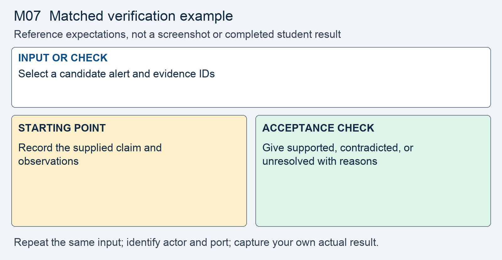

# M07 - Assignment: Reading a Scan, and Knowing Your Tools

> This repository copy contains the current task instructions and reference images. Download the Word report template from the matching Canvas assignment. Keep your existing Cloud Shell workspace and earlier repairs; returning students do not need a new clone.

## Downloads and instructions

| Supplied file | Use |
|---|---|
| **Download report**: obtain `m07-report-template.docx` from this module’s Canvas assignment | Read the supplied model, then complete the marked entries in Word or Word Online. |
| [Download assignment.md](assignment.md) | Keep this copy of the instructions unchanged and include it with the submission. |
| **Read the supplied evidence packet** (reference page in Canvas) | Analyze this packet; no scanner run is required. |

All supplied downloads are listed here. The step-by-step activity follows. For Word editing and submission steps, use the course report guide in Orientation. Screenshots belong inside the report unless the activity explicitly requests a separate file.

<!-- verification-guide:start -->
## Visual guide and matched verification

This activity analyzes supplied simulated evidence. There is no original/fixed portal repair and no scanner execution to screenshot.

### Keep the comparison controlled

This comparison card summarizes the first row below. It is a teaching guide, not an observed repaired result. The full table and commands remain selectable text.

The stages below are the evidence workflow for this activity. They are requirements, not completed student observations.

| Input or check | Starting point to record | Acceptance check to capture |
|---|---|---|
| Select a candidate alert and evidence IDs | Record the supplied claim and observations | Give supported, contradicted, or unresolved with reasons |
| Read the coverage record and E1 | Absence of an alert is a coverage limit | Explain the unreported ownership weakness |
| Compare Nessus, ZAP, and Burp | Identify each tool's question | Tie the tool choice to one course incident |

**Legitimate use and limits.** Cite supplied evidence by identifier. A screenshot of the packet is not evidence that you ran a scanner.

### Capture and submit consistently

Keep command inputs as selectable text beside their output. For browser evidence, show the relevant page, field, and result; a browser image alone does not establish the HTTP status. For HTTP evidence, retain the status and relevant headers as text, and verify any claimed write or refusal in application state. Label before and after captures with the port, actor, and test input. Add captions and alt text in the Word report. Use the complete verification steps below, not just the summary rows.

<!-- verification-guide:end -->

> [!CONCEPT] Read the supplied report
> The report supplies the corporate case and management record. Complete the marked [STUDENT] entries, keep every EXAMPLE, and write your own answer after Answer. Later modules require fuller justification; use evidence rather than expanding the report with unsupported claims.

## What you are doing, and why

Security testing is its own field, large enough that whole tools and whole jobs are built around it. You are not going to master it in one module, and this assignment does not pretend you will. Instead it does the two things that actually transfer: it teaches you what the major tools are *for*, so you reach for the right one, and it has you analyze a simulated evidence packet and turn candidate alerts into supported conclusions.

This is deliberately a reading-and-analysis assignment, not a tool install. Everything here works from a browser on any device. You will study a documented testing walkthrough, compare the tools the profession uses, and interpret clearly labeled simulated observations. Plan about 90 minutes.

*A scanner tells you where to look. Deciding what its findings mean is still your job.*

## Why this is delivered this way

Running an active scanner well needs a machine that can run it, and pointing one at a shared host you do not own is not something this course will ask you to do. Neither of those should decide whether you can learn what scanning is and how to read what it finds. So the analysis skill is practiced through a supplied simulated packet, which every student can reach equally, and no live scanning is required for this assignment. The understanding is the graded outcome; the keystrokes are not.

## What you are given

- The Simulated Security-Testing Evidence Packet listed in Downloads and instructions, containing scope, candidate alerts, supporting observations, and coverage limits.
- The Module 07 lecture, which explains the workflow and tool distinctions.
- Your earlier incident reports for the tie-in question.

> [!WARNING] Identify simulated evidence correctly
> This is an authored teaching packet, not an exported report from a scanner run. Do not claim that a tool produced these observations or that you performed the supplied tests. This distinction keeps the analysis honest and traceable.

## Part 1 - Read the scan

1. **Read the walkthrough.** Read the packet scope, candidate alerts, and evidence identifiers. Explain what is represented and what the coverage record excludes, because an alert is meaningful only in its testing context.

2. **Interpret the report.** From the packet, pick three candidate alerts. For each, say in one or two sentences: what the finding means, whether the claim is supported, contradicted, or unresolved in this snapshot, and if supported, which earlier control addresses it; if unresolved, what evidence is missing. A scanner raises alerts; you decide which are true here.

3. **Name what the scanner missed.** Using the packet's coverage record and evidence E1, name one weakness the alerts did **not** identify, and say why a scanner is blind to it. This is the most important skill in the assignment: knowing the tool's limits.

## Part 2 - Know your tools

Compare three tools the profession uses. The point is not which is best. The point is that they answer different questions, so you know which to reach for.

| Tool | The question it answers |
|---|---|
| **Nessus** | What known-vulnerable software, missing patches, and misconfigurations are on this host? |
| **OWASP ZAP** | What vulnerabilities does this running web application expose, found mostly by automated crawling and attack? |
| **Burp Suite** | The same web-application question, but driven by a human intercepting and changing requests by hand. |

4. **Write the comparison** in about 250 words. For each tool, say what question it answers and when a professional would reach for it. Do not compare feature lists or price. Frame it as: Nessus is host- and network-facing; ZAP and Burp are application-facing; ZAP leans automated, Burp leans human-driven.

5. **The tie-in.** Pick one incident you handled this term. Which of the three tools would have caught it, what it could miss, and why? This is where the comparison stops being abstract.

Open notes and open book are both fine. Respond in your own words; do not copy from other sources.

**Acceptable AI use.** Itemized for this course; the syllabus policy governs.

> [!CORRECT] These uses are permitted
> - Grammar and spelling checkers (Grammarly, Word's checker) on your own writing.
> - Asking an AI to explain a course concept, an OWASP guideline, or a PHP error message in general terms while studying.
> - AI assistance on module practice work (labs, assignments, forum posts) **with disclosure**: state what you asked and what you used in the AI disclosure line of your submission.

> [!CRITICAL] These uses are not permitted
> - Any AI use on quizzes or the design project's individual defense.
> - Submitting undisclosed AI-generated code, analysis, or writing as your own work.
> - Running AI-assisted tools against any target other than your own course environment.

You must be able to explain every line you submit, on request. Undisclosed AI use is handled as academic dishonesty under the syllabus.

## Expected output

> [!NOTE] Review what the evidence supports
> Confirm that each conclusion refers to a source, a supplied observation, your own test, or an explicit team decision. Mark unimplemented work and unresolved questions rather than describing them as complete.

A complete submission reads three candidate alerts from the simulated packet and gives evidence-based verdicts, names one vulnerability the scanner missed and why, compares the three tools by the question each answers, and says which tool could help investigate one of your earlier incidents. The graded core is judgment: telling a real finding from a false alarm, and knowing what a scanner cannot see.

## What to submit

- Completed `m07-report.docx` with your own results, required screenshots, disclosure, reflection, and Revision History.
- Supplied `assignment.md`, unchanged.

In Word, save the report on your computer or document storage. Download `assignment.md` from the list at the top. In Canvas, select **Start Assignment** or **New Attempt**, attach all required parts to the same attempt, select **Submit Assignment**, and check the file list and confirmation. A saved local file is not a submission.

## Complete the report record

Read the supplied business-impact assessment and likelihood–impact table. Complete its marked rating entries using the actual case or your own evidence, and explain why the control changes the risk. Keep the EXAMPLE responses and write your own answers after Answer. Finish the identity, sources, disclosure, reflection, and Revision History entries that the report requests.
