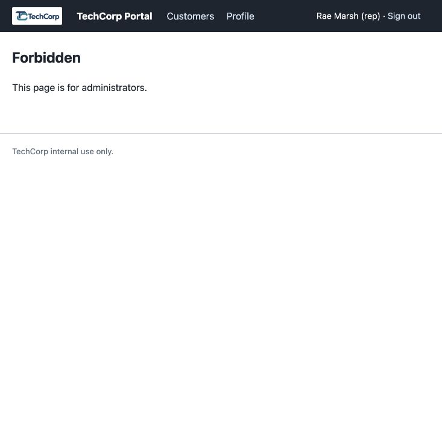
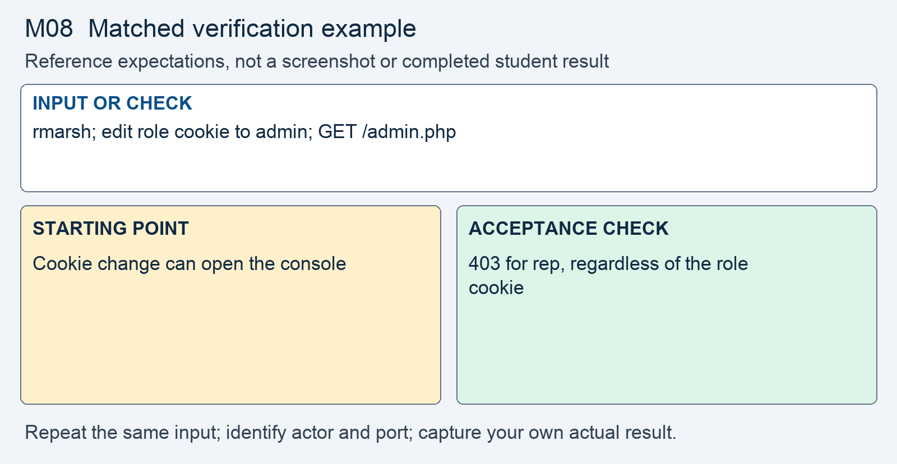

# M08 - Assignment: Incident Report and Fix - Broken Access Control in the Rep Portal

> This repository copy contains the current task instructions and reference images. Download the Word report template from the matching Canvas assignment. Keep your existing Cloud Shell workspace and earlier repairs; returning students do not need a new clone.


## Downloads and instructions

| Supplied file | Use |
|---|---|
| **Download report**: obtain `m08-tc-ir-007-report-template.docx` from this module’s Canvas assignment | Read the supplied model, then complete the marked entries in Word or Word Online. |
| [Download assignment.md](assignment.md) | Keep this copy of the instructions unchanged and include it with the submission. |

All supplied downloads are listed here. The step-by-step activity follows. For Word editing and submission steps, use the course report guide in Orientation. Screenshots belong inside the report unless the activity explicitly requests a separate file.

<!-- verification-guide:start -->
## Visual guide and matched verification

An unmodified rep is initially refused by admin.php; that is the baseline shown here, not proof that the role-cookie flaw is fixed. Perform the controlled role-cookie change described below.

Open this path in your **original 8080 preview tab**, preserving its Cloud Shell hostname:

```text
/admin.php
```



This is an actual instructor browser capture from a disposable copy of the released portal. It shows the starting interface, not your repaired result. The capture used a temporary local port; your original and working copies remain **8080** and **8081**. Capture your own evidence.

### Keep the comparison controlled



This comparison card summarizes the first row below. It is a teaching guide, not an observed repaired result. The full table and commands remain selectable text.

For each row, record the exact input, signed-in actor, path, port, status or visible behavior, and any state change. Repeat the same test on the original **8080** and working **8081** copies; change only the intended control or comparison variable. If an earlier repair already blocks a case, record that result and keep the repair. Never invent the illustrated outcome.

| Input or check | Starting point to record | Acceptance check to capture |
|---|---|---|
| rmarsh; edit role cookie to admin; GET /admin.php | Cookie change can open the console | 403 for rep, regardless of the role cookie |
| rmarsh; /customer.php?id=1 versus id=4 | Both records can be returned | Owned id 1 allowed; lchen-owned id 4 refused |
| dpatel; enable then restore a staff account | Administrator workflow works | Still works under the server-held role policy |

**Legitimate use and limits.** Test own, other-owner, and missing records separately. Use the same chosen refusal behavior for other-owner and missing records. Session role remains authoritative in later modules.

### Capture and submit consistently

Keep command inputs as selectable text beside their output. For browser evidence, show the relevant page, field, and result; a browser image alone does not establish the HTTP status. For HTTP evidence, retain the status and relevant headers as text, and verify any claimed write or refusal in application state. Label before and after captures with the port, actor, and test input. Add captions and alt text in the Word report. Use the complete verification steps below, not just the summary rows.

<!-- verification-guide:end -->

> [!NOTE] Shared lab and reporting references
> Use the **Incident Reporting Guide** (reference page in Canvas) for analysis and evidence, the **Lab Guide** (reference page in Canvas) for environment details, and **Rules Of Engagement** (reference page in Canvas) before testing. The requirements below define this assignment's scope and deliverables.

## What you will do

A representative reached administrator functionality by changing a role cookie and could request accounts assigned to other representatives by changing a URL identifier. Both findings arise when the client influences an authorization decision. The response makes identity and role authoritative on the server and constrains object retrieval by ownership.

Read the supplied report, reproduce the original behavior, make the scoped change in the working copy, prove hostile refusal and normal operation, then add your own results and reasoning.

## The incident: TC-IR-007

Here is the ticket the desk filed, and the analyst's determination on top of it.

> **Incident TC-IR-007 - A rep reached the admin console and other reps' customers**
> A support rep signed in with an ordinary rep account, reached the admin console, and from there opened customer accounts assigned to other reps, tax identifiers included.
>
> **Analyst determination.** Two weaknesses combine into one failure. The signed-in user's role travels in a browser cookie named `role`, which the client can edit, so setting it to `admin` opens `admin.php`, including its staff enable and disable form. And `customer.php` returns any account whose id is in the URL, with no check that the account is assigned to the requesting rep, so changing the number walks through every rep's accounts. In both cases the server lets the client say what it may do. Both halves are yours to close.


## Your lab

Your work happens in your own course environment. If it is not open, launch it from the **Working in Google Cloud Shell** page in the Course Orientation module. It is your copy and the only target you are authorized to test. The files in question are `auth.php`, `admin.php`, `customer.php`, and the navigation in `layout.php`.

You need two rep accounts and the administrator. The seeded accounts in `data/seed.sql` are `rmarsh` (password `password`), `lchen` (password `123456`), and the administrator `dpatel` (password `12345678`). One rep account cannot show a rep reading another rep's customer.

## Read the report and required analysis

> [!CONCEPT] Read the supplied report
> The report supplies the corporate case and management record. Complete the marked [STUDENT] entries, keep every EXAMPLE, and write your own answer after Answer. Later modules require fuller justification; use evidence rather than expanding the report with unsupported claims.


Use the supplied Word report. The following table identifies the analytical coverage required; keep the completed corporate context and add your own contribution to its marked entries.


| Section | What it must say |
|---|---|
| **2. Executive summary** | Two or three sentences a manager could read: what was reachable, by whom, and whether it is fixed. No code. |
| **3. Systems and data affected** | The sign-in helpers in `auth.php`, the admin console `admin.php` with its staff enable and disable action, the customer lookup `customer.php`, and the data exposed: other reps' customer accounts, tax identifiers included. |
| **4. Timeline of events** | When it was reported and when you acted, in relative terms. |
| **5. Detection and analysis** | Trace both paths. For the console: where the role is set, that it rides in a client-editable **cookie**, which is the trust boundary, and the line that trusts it. For the customer walk: where the **id** enters, the lookup that runs, and the ownership decision that never runs. Name the **subject**, the **action**, the **object**, and the **context** that was never checked, for each path. Classify the weakness with its CWE from the lecture. |
| **6. Response actions** | The fix you applied: the role carried in the server-side session and read from there on every request, and the ownership rule bound into the lookup. Name the principle and the control in the lecture's words. |
| **7. Confirmation of remediation, annotated** | Your before and after evidence from Part 2. The edited cookie no longer reaches `admin.php`; the id walk returns the same response as a record that does not exist; a rep's own customers still open with every field intact. |
| **8. Notification determination** | Tax identifiers were exposed, to an internal account. Say who makes the notification decision and on what basis, and what the exposure window was. |
| **9. Post-incident actions** | The OWASP guidance you followed, by name, and one change that would stop this class of bug from recurring on other pages. |

## Open the working environment

1. [Launch Google Cloud Shell](https://shell.cloud.google.com/) with the account used for the earlier labs.
2. In the editor, locate the existing workspace containing `site`, `fixed`, `reports`, and `scripts`. Right-click the workspace folder and select **Open in Integrated Terminal**.
3. Run:

```bash
bash scripts/start.sh
```

4. Open **Web Preview → Preview on port 8080** for the original. Use **Web Preview → Change port → 8081** for the working copy. Check the port before testing. Sign in separately using the account required below.
5. Read/reproduce the starting flaw on **site, port 8080**. Edit and verify **fixed, port 8081**. Keep earlier repairs. If an earlier control already prevents the case on fixed, report that result and test the remaining work without removing the control.
6. Download the report from the list at the top, open it in Word or Word Online, and save your copy. The IDE is for the source and command evidence; the Word report stays outside the code repository.


> [!NOTE] Capture the comparison
> Record original and working results separately. The same demo username can have different password or session state after earlier modules. Use the current working credentials for 8081; do not reset the whole application to make an old example reappear.


## Fix and prove the working copy

> [!CORRECT] Change the working files
> Open the corresponding paths under fixed/. Use Find to locate the named expression or function; the cited line numbers are reference locations and will change as your repairs accumulate. Save each change before testing.


Do this on `auth.php`, `admin.php`, and `customer.php` in your course environment. Each step produces evidence that goes into the report.

1. **Reproduce the console reach.** Sign in as `rmarsh`. Open `admin.php`; the response is `403`.
   - Change the value of the `role` cookie to `admin`, as the **Requests and Developer Tools** page shows under "Viewing and editing a cookie".
   - Reload. The admin console opens for a rep, staff list and enable and disable buttons included.
   - Capture the screen. This is a **before** capture for section 7.

2. **Reproduce the customer walk.** Still signed in as `rmarsh`, open one of your own customers from the search and note the `id` in the address bar.
   - Change the id to one assigned to `lchen` and press enter. The account opens, tax identifier and all.
   - Sign in as `lchen` and confirm the walk runs the other direction.
   - Capture both. These are **before** captures.

3. **Trace both flows.** In the shipped files, find by line number:
   - in `auth.php`, where the role is written into the cookie at sign-in, and the function that reads the cookie back;
   - in `admin.php` and `layout.php`, the lines that call that function, and what each decides from it;
   - in `customer.php`, where `id` enters, the lookup that runs, and the column that already records which rep the account belongs to.
   - Write one sentence per file: what it trusts, and where that trust is misplaced.

4. **Carry the role in the session.** In `auth.php`, after the credential check passes, store the account's role in the server-side session.
   - Make the function that reports the role read the session, so nothing the browser sends decides it.
   - The navigation keeps working, because it calls the same function.

5. **Refuse on the server in `admin.php`.** Before the enable and disable handler and before any output, read the role from the session and deny by default.
   - An account that is not an administrator is refused on every request, whatever its cookie says.
   - The staff enable and disable POST sits behind the same decision.

6. **Bind the owner into the lookup in `customer.php`.** Constrain the account lookup so it can only return an account assigned to the signed-in rep.
   - Put the owner in the `WHERE` clause and bind the signed-in identity to it. A row that is not theirs is never loaded.
   - A record that is not yours and a record that does not exist return the same response.
   - The search results list every rep's customers. Constrain that query the same way; filter in the query, not in the page.
   - Decide, and write down, whether an administrator may open any account, and enforce that from the session role.

7. **Write the matrix, then prove it.** Before you run anything, write the matrix from lecture section 11 for this incident: subject, object, action, expected result.
   - Rows to include: `rmarsh` on an own account, `rmarsh` on an `lchen` account, `rmarsh` on an id that does not exist, `rmarsh` with the edited cookie on `admin.php`, `dpatel` on `admin.php`, and `dpatel` disabling and re-enabling a staff account.
   - Run every row and capture the results beside your before evidence.
   - A fix that blocks a rep from their own accounts, or blocks the administrator from the staff action, is a regression.

The sign-in's password handling is out of scope for this module.

Open notes and open book are both fine. Respond in your own words; do not copy from other sources.

**AI use on this assignment.** The syllabus policy governs; these are its terms for an incident report and fix.

> [!CORRECT] Permitted, with disclosure
> - Asking an AI to explain a concept, an OWASP guideline, or a PHP error message in general terms.
> - A grammar or spelling checker on your own writing.
> - Generating or refactoring code, proposing tests, and planning or editing the report, with disclosure of the tool, help requested, material used or changed, and checks performed. Report only results you observed.

> [!CRITICAL] Not permitted
> - Submitting AI-generated code, analysis, or writing without disclosing it.
> - Pointing an AI-assisted tool at any target other than your own course environment.

You must be able to explain every line you submit, on request. Undisclosed AI use is handled as academic dishonesty under the syllabus.

## Expected output

> [!CORRECT] Check the result, not just the syntax
> Changing the role cookie did not authorize the admin page or POST. The representative could open an assigned account, could not open another representative’s account, and the actual administrator workflow still worked. These are EXAMPLE outcomes; record the actual results from your copy and annotate what each test establishes.


Your captures will differ in cosmetic detail; the behavior must not. The assignment passes when the report is complete and the fix holds:

- Editing the `role` cookie no longer opens `admin.php`; the rep is refused on the server, and the staff enable and disable action is behind that refusal.
- Changing the id in `customer.php` no longer returns an account assigned to another rep, and the denial is identical to the response for an id that does not exist.
- The search results show only the signed-in rep's customers.
- A rep still opens their own customers with every field intact, and the administrator still reaches the console and the staff action.
- Section 5 traces both paths and names the missing decision in each; section 7 shows every matrix row before and after.

## What to submit

- Completed `m08-tc-ir-007-report.docx` with your own results, required screenshots, disclosure, reflection, and Revision History.
- Supplied `assignment.md`, unchanged.
- Complete changed source, including `fixed/auth.php`, `fixed/admin.php`, `fixed/customer.php`, `fixed/layout.php`. Include every additional helper, migration, or test file you changed or added. Do not submit unchanged helper files merely because you called them.

In Word, save the report on your computer or document storage. In Cloud Shell Editor, right-click the required source files and choose **Download**. Download `assignment.md` from the list at the top. In Canvas, select **Start Assignment** or **New Attempt**, attach all required parts to the same attempt, select **Submit Assignment**, and check the file list and confirmation. A saved local file is not a submission.

Cite OWASP A01 Broken Access Control and the Authorization Cheat Sheet where you relied on them.

## Grading rubric

Read the **Assignment rubric** (reference page in Canvas) before submitting. The rubric assesses this activity separately from the other work in the module.

## Complete the report record

Read the supplied business-impact assessment and likelihood–impact table. Complete its marked rating entries using the actual case or your own evidence, and explain why the control changes the risk. Keep the EXAMPLE responses and write your own answers after Answer. Finish the identity, sources, disclosure, reflection, and Revision History entries that the report requests.
