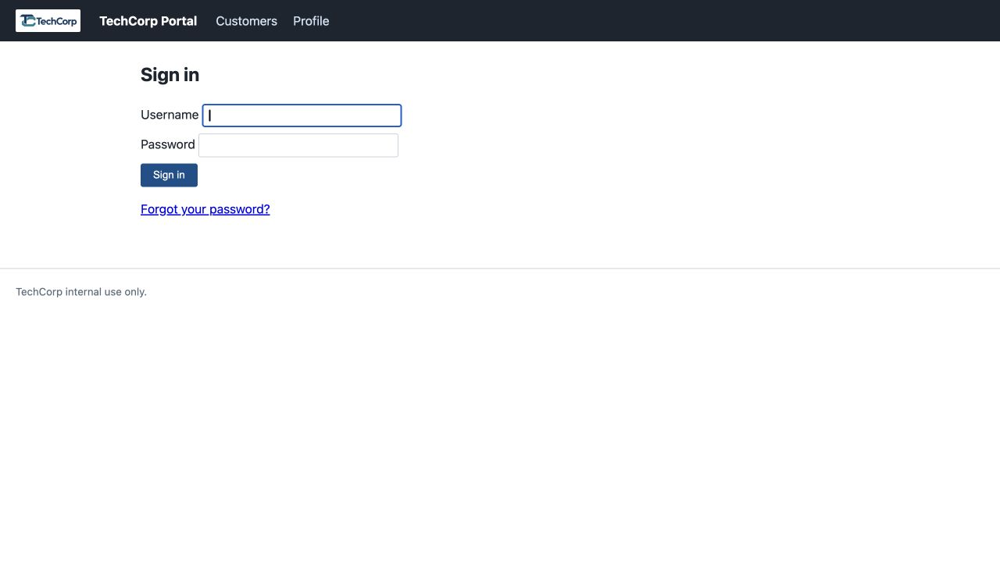
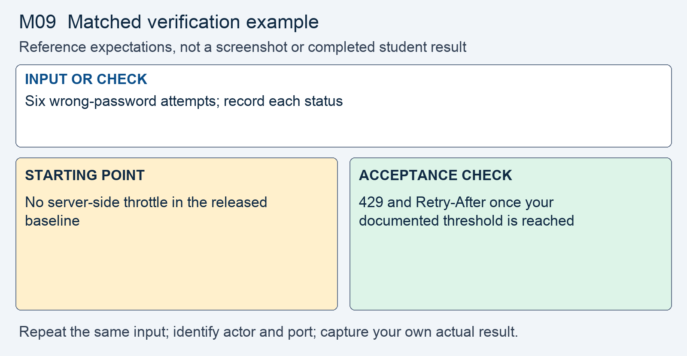

# M09 - Assignment: Incident Report and Fix - A Guessed Password and a Fast Hash at Sign-In

> This repository copy contains the current task instructions and reference images. Download the Word report template from the matching Canvas assignment. Keep your existing Cloud Shell workspace and earlier repairs; returning students do not need a new clone.


## Downloads and instructions

| Supplied file | Use |
|---|---|
| **Download report**: obtain `m09-tc-ir-008-report-template.docx` from this module’s Canvas assignment | Read the supplied model, then complete the marked entries in Word or Word Online. |
| [Download assignment.md](assignment.md) | Keep this copy of the instructions unchanged and include it with the submission. |

All supplied downloads are listed here. The step-by-step activity follows. For Word editing and submission steps, use the course report guide in Orientation. Screenshots belong inside the report unless the activity explicitly requests a separate file.

<!-- verification-guide:start -->
## Visual guide and matched verification

Keep the earlier parameterized queries and server-held role from Module 08. The baseline auth.php line references describe site/, not necessarily your repaired fixed/ file.

Open this path in your **original 8080 preview tab**, preserving its Cloud Shell hostname:

```text
/login.php
```



This is an actual instructor browser capture from a disposable copy of the released portal. It shows the starting interface, not your repaired result. The capture used a temporary local port; your original and working copies remain **8080** and **8081**. Capture your own evidence.

### Keep the comparison controlled



This comparison card summarizes the first row below. It is a teaching guide, not an observed repaired result. The full table and commands remain selectable text.

For each row, record the exact input, signed-in actor, path, port, status or visible behavior, and any state change. Repeat the same test on the original **8080** and working **8081** copies; change only the intended control or comparison variable. If an earlier repair already blocks a case, record that result and keep the repair. Never invent the illustrated outcome.

| Input or check | Starting point to record | Acceptance check to capture |
|---|---|---|
| Six wrong-password attempts; record each status | No server-side throttle in the released baseline | 429 and Retry-After once your documented threshold is reached |
| Compare session ID before and after a successful login | Identifier persists in the baseline | Successful login rotates the identifier |
| Migrate legacy row and sign in twice | Legacy MD5 digest | Adaptive hash; cleared legacy digest; both logins work |

**Legitimate use and limits.** Use a fresh session for each identifier comparison; redact cookie values in the report. Preserve the working database and existing accounts.

### Copyable header comparison

Run both requests without a saved cookie so the server can issue a new session cookie. Redact cookie values before putting headers in a report. These commands inspect headers; they do not perform the login, rate-limit, or migration tests.

```bash
curl -sS -i http://127.0.0.1:8080/login.php
curl -sS -i http://127.0.0.1:8081/login.php
```

### Capture and submit consistently

Keep command inputs as selectable text beside their output. For browser evidence, show the relevant page, field, and result; a browser image alone does not establish the HTTP status. For HTTP evidence, retain the status and relevant headers as text, and verify any claimed write or refusal in application state. Label before and after captures with the port, actor, and test input. Add captions and alt text in the Word report. Use the complete verification steps below, not just the summary rows.

<!-- verification-guide:end -->

> [!NOTE] Shared lab and reporting references
> Use the **Incident Reporting Guide** (reference page in Canvas) for analysis and evidence, the **Lab Guide** (reference page in Canvas) for environment details, and **Rules Of Engagement** (reference page in Canvas) before testing. The requirements below define this assignment's scope and deliverables.

## What you will do

The response review identified unlimited password attempts, a session identifier that survives sign-in, and fast unsalted password digests. These conditions require separate controls rather than a single password reset. The scoped change introduces adaptive password hashing, verify-then-rehash migration, server-side throttling, and identifier regeneration.

Read the supplied report, reproduce the original behavior, make the scoped change in the working copy, prove hostile refusal and normal operation, then add your own results and reasoning.

## The incident: TC-IR-008

Here is the ticket the desk filed, and the analyst's determination on top of it.

> **Incident TC-IR-008 - A rep's account was signed in by someone else, and the stored passwords are fast digests**
> A rep reported customer records opened on their account at a time they were not working. The password on the account was one the rep had reused on another site that was breached earlier in the year. The server's request log shows a long run of `POST` requests to `login.php` for that one username, seconds apart, then one answered with a redirect to `index.php`. Days later, the review of the database copy taken in the pre-term breach, TC-IR-001, found that the `users` table stores each staff password as an MD5 digest in the `password_md5` column.
>
> **Analyst determination.** One break-in, three weaknesses in `auth.php` and its data. First, the sign-in accepts attempts as fast as they arrive. Nothing counts a failed attempt, so an automated run works through candidate passwords until one lands, and the `login_failures` table added in sprint 20 is never written or read. Second, a successful sign-in keeps the session identifier the visitor arrived with, so an identifier fixed before sign-in is still valid after it. Third, the passwords are unsalted MD5 digests, a fast hash, so the copy taken in TC-IR-001 gives up every staff password quickly; treat every staff password as exposed. This assignment closes all three. The role cookie the sign-in sets, the session cookie's attributes, and the security-question reset on `reset-password.php` are out of scope for this module.


## Your lab

Your work happens in your own course environment. If it is not open, launch it from the **Launch Course Environment** page in Module 01. It is your copy and the only target you are authorized to test. The guessing run you make is against your own rep account from Module 01, in your own environment, and nowhere else. The files in question are `fixed/auth.php`, which checks the password and starts the session, `fixed/login.php`, which calls it, and `fixed/data/seed.sql`, which defines the `users` and `login_failures` tables. You call `lib/passwords.php` and `lib/query.php`; read their headers first.

## Read the report and required analysis

> [!CONCEPT] Read the supplied report
> The report supplies the corporate case and management record. Complete the marked [STUDENT] entries, keep every EXAMPLE, and write your own answer after Answer. Later modules require fuller justification; use evidence rather than expanding the report with unsupported claims.


Use the supplied Word report. The following table identifies the analytical coverage required; keep the completed corporate context and add your own contribution to its marked entries.


| Section | What it must say |
|---|---|
| **1. Administrative details** | The report ID, a severity with one sentence of justification, the discovery time, and you as the preparer. |
| **2. Executive summary** | Five to eight sentences a manager could read: whose account was reached, how, what the attacker could see, the root cause in one plain sentence, and whether sign-in is fixed. No code. |
| **3. Systems and data affected** | The `auth.php` sign-in and the session it issues; the `users` table and its `password_md5` column; the customer records a rep account can read, named by category. |
| **4. Timeline of events** | The run of failed sign-ins, the one that succeeded, the TC-IR-001 database copy, and your actions, each with its source. |
| **5. Detection and analysis** | 5.1: the rep's report and the request log. 5.2: the three weaknesses in your own words, each with its CWE from the lecture, and why each existed. 5.3: what the records cannot tell you, such as which customer records were opened and how many other accounts were tried. |
| **6. Response actions** | 6.1: the stopgap, a reset of the rep's password, labelled as a mitigation. 6.2: the four changes from Part 2, with the threshold and window you chose and the per-account trade-off. 6.3: how a locked-out user gets back in. |
| **7. Confirmation of remediation, annotated** | Your before and after evidence from Part 2, one row per check, each with an annotation saying what it proves and what it does not. |
| **8. Notification determination** | Whether the attacker could reach customer tax identifiers, who makes the call on notifying, and the reason for the call you record. |
| **9. Post-incident actions** | The OWASP category you worked under, by name, and one corrective action from 5.3. |
| **10. Closure and attestation** | Your name and the date; closure only if section 7 is complete. |

## Open the working environment

1. [Launch Google Cloud Shell](https://shell.cloud.google.com/) with the account used for the earlier labs.
2. In the editor, locate the existing workspace containing `site`, `fixed`, `reports`, and `scripts`. Right-click the workspace folder and select **Open in Integrated Terminal**.
3. Run:

```bash
bash scripts/start.sh
```

4. Open **Web Preview → Preview on port 8080** for the original. Use **Web Preview → Change port → 8081** for the working copy. Check the port before testing. Sign in separately using the account required below.
5. Read/reproduce the starting flaw on **site, port 8080**. Edit and verify **fixed, port 8081**. Keep earlier repairs. If an earlier control already prevents the case on fixed, report that result and test the remaining work without removing the control.
6. Download the report from the list at the top, open it in Word or Word Online, and save your copy. The IDE is for the source and command evidence; the Word report stays outside the code repository.


> [!NOTE] Capture the comparison
> Record original and working results separately. The same demo username can have different password or session state after earlier modules. Use the current working credentials for 8081; do not reset the whole application to make an old example reappear.


## Fix and prove the working copy

> [!CORRECT] Change the working files
> Open the corresponding paths under fixed/. Use Find to locate the named expression or function; the cited line numbers are reference locations and will change as your repairs accumulate. Save each change before testing.


Do this in your course environment. Each step produces evidence that goes into the report.

1. **Reproduce the guessing run.** Send six wrong-password sign-ins for your own rep account, one after another, with `curl` as the **Requests and Developer Tools** page shows.
   - Every attempt is answered the same way, as quickly as you send it, and the sixth is accepted for checking like the first.
   - Keep the six responses, trimmed to the status line. This is your **before** evidence for one row of section 7.

2. **Watch the identifier that never changes.** In the browser, open the Application panel as the tool page shows and note the session cookie's value before you sign in.
   - Sign in with the correct password and read it again. On the unfixed `auth.php` it is the same value.
   - Write one sentence on why an identifier that survives sign-in is a problem, in the lecture's words. Record both values with the middle characters redacted.

3. **Read the password store.** Open `data/seed.sql`.
   - The `users` table declares `password_md5 TEXT NOT NULL` on line 13, and lines 25 to 30 seed five accounts with their digests.
   - In a small PHP file, compute the MD5 of your rep account's password and compare it with the seeded value. State which account you checked and the digest; do not write the password itself.

4. **Trace the flow in `auth.php`.** Find, by line number: where the session starts; the query that compares the submitted password, and how; what happens on a failed check; what happens on a successful check.
   - Line 40 builds the query with `md5($password)` in it. Lines 43 to 45 return `false` with nothing recorded. Lines 47 and 48 store the signed-in user under the identifier the visitor already had.
   - Name the three gaps plainly in section 5.2.

5. **Move the store to `password_hash`.** Add a nullable `password_hash` column to `users` in `data/seed.sql`, then change the sign-in so it looks the account up by username alone with `q_one` and checks the password in PHP with the functions in `lib/passwords.php`.
   - A row that still holds a digest verifies against it one last time, as lecture section 4 shows on other code, and is replaced; after that, `pw_needs_rehash` decides.
   - Keep the working database and earlier notes. Create `scripts/migrate-password-store.php` to inspect the working `users` schema and add the nullable `password_hash` column only if it is absent. Use `fixed/data/seed.sql` for future fresh databases; do not delete the current database to apply this schema change. Download the migration script with your changed source.
   - `password_md5` is `NOT NULL`. Decide what the cleared column holds and write the decision in section 6.2. No MD5 digest is ever written again.

6. **Count failures in `login_failures`.** Record each failed sign-in with the username, the source address, and the time; count the recent ones; refuse at a threshold; clear on success.
   - Pick the threshold and the window, write them in section 6.2, and say why a per-account count alone is a weapon and what you count as well.
   - The refusal is `429 Too Many Requests` with a `Retry-After` header, as lecture section 7 shows. The limit lives on the server, not in the form.

7. **Issue a new identifier at sign-in.** Regenerate the session identifier the moment the password verifies, before the signed-in user is stored, and delete the old record.
   - Confirm in the Application panel that the value changes across a successful sign-in. The cookie's attributes are out of scope for this module.

> [!NOTE] Record your own results
> Switch to the working portal on 8081. Capture the actual hostile and legitimate outcomes and compare them with the original. Keep a failed check in the record while you correct it.

8. **Prove it.** Capture, side by side with your before evidence:
   - the same six-attempt run, now refused at your threshold with `429` and `Retry-After`, and the correct password refused inside the window;
   - a correct sign-in after the window, or after the rows age out, answered with the redirect to `index.php`;
   - the session cookie value before and after that sign-in, different, with the middle redacted;
   - the account's row after one sign-in, with `password_hash` beginning `$2y$` and the digest gone, then a second sign-in that still works.
   - A fix that locks a good account out for good, or breaks a normal sign-in, is a regression, not a fix.

Open notes and open book are both fine. Respond in your own words; do not copy from other sources.

**AI use on this assignment.** The syllabus policy governs; these are its terms for an incident report and fix.

> [!CORRECT] Permitted, with disclosure
> - Asking an AI to explain a concept, an OWASP guideline, or a PHP error message in general terms.
> - A grammar or spelling checker on your own writing.
> - Generating or refactoring code, proposing tests, and planning or editing the report, with disclosure of the tool, help requested, material used or changed, and checks performed. Report only results you observed.

> [!CRITICAL] Not permitted
> - Submitting AI-generated code, analysis, or writing without disclosing it.
> - Pointing an AI-assisted tool at any target other than your own course environment.

You must be able to explain every line you submit, on request. Undisclosed AI use is handled as academic dishonesty under the syllabus.

## Design project increment

Your team's increment for this module is the one the **Design Project Kickoff** page in Module 08 schedules: API-key authentication designed and built, as Module 08 lecture section 10 teaches it. The token exchange, also required core, is built in Module 12. Record it in your build report; it is not part of this incident report.

## Expected output

> [!CORRECT] Check the result, not just the syntax
> The threshold returned 429 and Retry-After. A normal sign-in worked after the window, the session identifier changed, the migrated row held an adaptive hash with no MD5 digest, and a second sign-in succeeded. These are EXAMPLE outcomes; record the actual results from your copy and annotate what each test establishes.


Your captures will differ in cosmetic detail; the behavior must not. The assignment passes when the report is complete and the fix holds:

- A run of failed sign-ins is refused at your threshold with `429` and `Retry-After`, where before every attempt was accepted.
- A correct password on a good account still signs in and reaches the portal once the window passes.
- The session identifier changes across a successful sign-in.
- After one sign-in, the account's row holds a `password_hash` value and no MD5 digest, and the next sign-in still works.
- A wrong password and an unknown username are answered the same way.
- Section 5.2 names the three weaknesses with their CWEs; section 7 shows the before and after for each, annotated.

## What to submit

- Completed `m09-tc-ir-008-report.docx` with your own results, required screenshots, disclosure, reflection, and Revision History.
- Supplied `assignment.md`, unchanged.
- Complete changed source, including `fixed/auth.php`, `fixed/data/seed.sql`, `scripts/migrate-password-store.php`. Include every additional helper, migration, or test file you changed or added. Do not submit unchanged helper files merely because you called them.

In Word, save the report on your computer or document storage. In Cloud Shell Editor, right-click the required source files and choose **Download**. Download `assignment.md` from the list at the top. In Canvas, select **Start Assignment** or **New Attempt**, attach all required parts to the same attempt, select **Submit Assignment**, and check the file list and confirmation. A saved local file is not a submission.

Cite OWASP A07 and the Authentication and Session Management cheat sheets where you relied on them.

## Grading rubric

Read the **Assignment rubric** (reference page in Canvas) before submitting. The rubric assesses this activity separately from the other work in the module.

## Complete the report record

Read the supplied business-impact assessment and likelihood–impact table. Complete its marked rating entries using the actual case or your own evidence, and explain why the control changes the risk. Keep the EXAMPLE responses and write your own answers after Answer. Finish the identity, sources, disclosure, reflection, and Revision History entries that the report requests.
