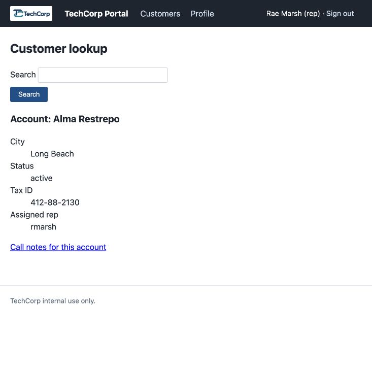
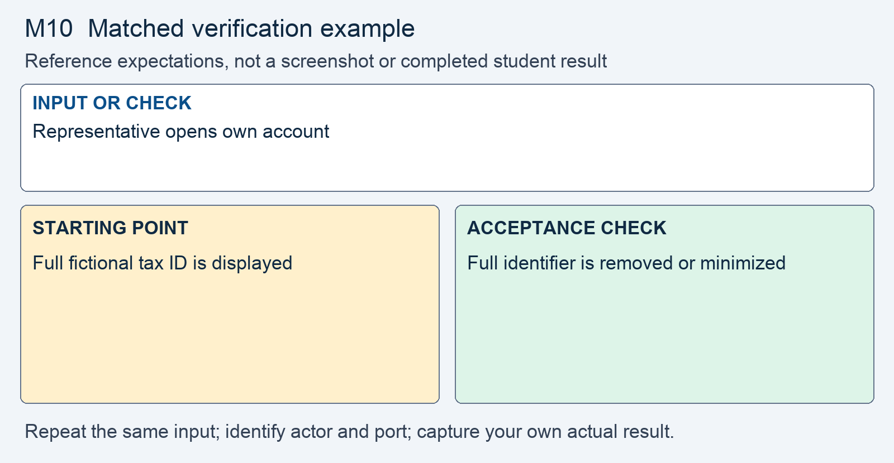

# M10 - Assignment: Incident Report and Fix - Tax Identifiers Stored in the Clear

> This repository copy contains the current task instructions and reference images. Download the Word report template from the matching Canvas assignment. Keep your existing Cloud Shell workspace and earlier repairs; returning students do not need a new clone.


## Downloads and instructions

| Supplied file | Use |
|---|---|
| **Download report**: obtain `m10-tc-ir-009-report-template.docx` from this module’s Canvas assignment | Read the supplied model, then complete the marked entries in Word or Word Online. |
| [Download assignment.md](assignment.md) | Keep this copy of the instructions unchanged and include it with the submission. |

All supplied downloads are listed here. The step-by-step activity follows. For Word editing and submission steps, use the course report guide in Orientation. Screenshots belong inside the report unless the activity explicitly requests a separate file.

<!-- verification-guide:start -->
## Visual guide and matched verification

Use an account assigned to rmarsh, such as seeded id 1. Keep Module 08 ownership checks. The baseline image contains only fictional fixture identifiers.

Open this path in your **original 8080 preview tab**, preserving its Cloud Shell hostname:

```text
/customer.php?id=1
```



This is an actual instructor browser capture from a disposable copy of the released portal. It shows the starting interface, not your repaired result. The capture used a temporary local port; your original and working copies remain **8080** and **8081**. Capture your own evidence.

### Keep the comparison controlled



This comparison card summarizes the first row below. It is a teaching guide, not an observed repaired result. The full table and commands remain selectable text.

For each row, record the exact input, signed-in actor, path, port, status or visible behavior, and any state change. Repeat the same test on the original **8080** and working **8081** copies; change only the intended control or comparison variable. If an earlier repair already blocks a case, record that result and keep the repair. Never invent the illustrated outcome.

| Input or check | Starting point to record | Acceptance check to capture |
|---|---|---|
| Representative opens own account | Full fictional tax ID is displayed | Full identifier is removed or minimized |
| Inspect every stored tax_id after migration | Plaintext baseline values | Sealed v1. values; no leftover plaintext rows |
| Tampered ciphertext; authorized admin audit | Record the authorized baseline workflow | Tampering refuses plaintext; authorized original value is recoverable |

**Legitimate use and limits.** Set the key only in fixed/.env; restart as directed. Never screenshot, print, or submit the key. A representative must still access their own non-sensitive account fields.

### Capture and submit consistently

Keep command inputs as selectable text beside their output. For browser evidence, show the relevant page, field, and result; a browser image alone does not establish the HTTP status. For HTTP evidence, retain the status and relevant headers as text, and verify any claimed write or refusal in application state. Label before and after captures with the port, actor, and test input. Add captions and alt text in the Word report. Use the complete verification steps below, not just the summary rows.

<!-- verification-guide:end -->

> [!NOTE] Shared lab and reporting references
> Use the **Incident Reporting Guide** (reference page in Canvas) for analysis and evidence, the **Lab Guide** (reference page in Canvas) for environment details, and **Rules Of Engagement** (reference page in Canvas) before testing. The requirements below define this assignment's scope and deliverables.

## What you will do

The review found customer tax identifiers readable in the database and visible in a workflow that did not require them. The response minimizes display, encrypts recoverable values with authenticated encryption, and migrates the existing rows. The administrator audit remains the authorized full-value workflow.

Read the supplied report, reproduce the original behavior, make the scoped change in the working copy, prove hostile refusal and normal operation, then add your own results and reasoning.

## The incident: TC-IR-009

Here is the ticket the desk filed, and the analyst's determination on top of it.

> **Incident TC-IR-009 - Customer tax identifiers stored and shown in the clear**
> The review that followed the pre-term breach, TC-IR-001, compared the copy of the database that left the server against the live portal. Every customer's tax identifier is in that copy, readable exactly as it was typed. The reviewer also found the identifier printed on the account detail page, which any signed-in rep can open for any account, and in the admin console's audit table.
>
> **Analyst determination.** The `tax_id` column of the `customers` table holds the identifier as entered, so whoever holds a copy of `data/portal.sqlite` holds every identifier. Two pages print it: the account detail on `customer.php` and the account audit table on `admin.php`. Only the audit table has a workflow that needs the full value; the support lead's quarterly audit runs from it, and that page already refuses anyone who is not an administrator. The account detail does not need it. This assignment closes the storage: show the identifier only where the workflow needs it, encrypt it at rest with authenticated encryption, and convert the rows already in the file. Protecting the value as it crosses the network is out of scope for this module.


## Your lab

Your work happens in your own course environment. If it is not open, launch it from the **Launch Course Environment** page in Module 01. It is your copy and the only target you are authorized to test. Sign in with the rep account from Module 01 for the account detail. The admin console needs an administrator; the seeded one is `dpatel`, password `12345678`. The files in question are `customer.php`, `admin.php`, `lib/crypto.php`, `data/seed.sql`, `scripts/start.sh`, and a `.env` file you create.

Use only the portal's seeded data. Never put a real tax identifier or any other real personal data into your environment.

## Read the report and required analysis

> [!CONCEPT] Read the supplied report
> The report supplies the corporate case and management record. Complete the marked [STUDENT] entries, keep every EXAMPLE, and write your own answer after Answer. Later modules require fuller justification; use evidence rather than expanding the report with unsupported claims.


Use the supplied Word report. The following table identifies the analytical coverage required; keep the completed corporate context and add your own contribution to its marked entries.


| Section | What it must say |
|---|---|
| **2. Executive summary** | Two or three sentences a manager could read: what was exposed, to whom, and whether it is fixed. No code. |
| **3. Systems and data affected** | The `customers` table and its `tax_id` column in `data/portal.sqlite`, and the two pages that print it, `customer.php` and `admin.php`. Name the data category precisely: a tax identifier, not "customer data". |
| **4. Timeline of events** | When the copy left, when the reviewer reported, and when you acted, in relative terms, each with its source. |
| **5. Detection and analysis** | Which property the identifier needs and why a hash cannot hold it. The weakness by name, CWE-311, and its OWASP Top 10 category. Every page that prints the value, with the role that can reach each. In 5.3, what the stored copy cannot tell you: who has read it. |
| **6. Response actions** | The fix you applied, in the lecture's words: the identifier removed from the page that does not need it, sealed with authenticated encryption bound to its row, the key kept in the environment, and the seeded rows converted by a one-time migration. Name the principle and the control. State what encryption at rest does not protect against. |
| **7. Confirmation of remediation, annotated** | Your before and after evidence from Part 2, one row per check, each annotated with what it proves and what it does not. |
| **8. Notification determination** | Whether a tax identifier is a data category that raises the notification question, who makes that call per the form, and the call for your environment, where every identifier is seeded. State the reason, not only the call. |
| **9. Post-incident actions** | The OWASP guidance you followed, by name, and one change that would stop this class of bug from recurring on other fields. |

## Open the working environment

1. [Launch Google Cloud Shell](https://shell.cloud.google.com/) with the account used for the earlier labs.
2. In the editor, locate the existing workspace containing `site`, `fixed`, `reports`, and `scripts`. Right-click the workspace folder and select **Open in Integrated Terminal**.
3. Run:

```bash
bash scripts/start.sh
```

4. Open **Web Preview → Preview on port 8080** for the original. Use **Web Preview → Change port → 8081** for the working copy. Check the port before testing. Sign in separately using the account required below.
5. Read/reproduce the starting flaw on **site, port 8080**. Edit and verify **fixed, port 8081**. Keep earlier repairs. If an earlier control already prevents the case on fixed, report that result and test the remaining work without removing the control.
6. Download the report from the list at the top, open it in Word or Word Online, and save your copy. The IDE is for the source and command evidence; the Word report stays outside the code repository.


> [!NOTE] Capture the comparison
> Record original and working results separately. The same demo username can have different password or session state after earlier modules. Use the current working credentials for 8081; do not reset the whole application to make an old example reappear.


## Fix and prove the working copy

> [!CORRECT] Change the working files
> Open the corresponding paths under fixed/. Use Find to locate the named expression or function; the cited line numbers are reference locations and will change as your repairs accumulate. Save each change before testing.


Do this in your course environment. Each step produces evidence that goes into the report.

1. **Reproduce it.** See the stored value and the two pages that print it.
   - In `data/seed.sql`, find the `tax_id` column (line 39), the comment above it, and the eight seeded identifiers (lines 54 to 61).
   - As the rep, open any account from the customer search. The **Tax ID** row shows the identifier.
   - As `dpatel`, open the admin console. The **Account audit** table shows every identifier.
   - Capture all three. This is your **before** evidence for section 7.

2. **Trace where the value is read and written.** Find, by line number, every place `tax_id` is selected from the database and every place it is written into a page.
   - As shipped, `customer.php` reads the row at line 58 and prints it at line 65; `admin.php` selects it at line 49 and prints it at line 92. Report your own line numbers.
   - Name the role that can reach each page.
   - Nothing in the portal writes a customer row. Say what that means for the rows already in the file.

3. **Name the property.** Before any code, write down what the identifier needs: it must be read back later, and any change to it must be detected.
   - Name the primitive and the course helper that row of the lecture's table points to.
   - Say in one sentence why a hash cannot hold this value, and in one more why base64 would protect nothing.

4. **Set the data key.** `enc_seal` and `enc_open` refuse to run until the key is in place.
   - Generate a key with the command in the header of `lib/crypto.php`.
   - Put it in `fixed/.env`, as one `TECHCORP_DATA_KEY=` line. The startup script reads each portal’s own environment. Do not put the working key in site/.
   - Run `bash scripts/start.sh` again so the running portal sees it.
   - Confirm `.env` is not listed in the Source Control panel (**Working in Google Cloud Shell**). The key never goes in a tracked file or in your report.

5. **Restrict where it is shown.** Remove the identifier from the account detail on `customer.php`.
   - Keep it on the audit table on `admin.php` only. That page already refuses anyone who is not an administrator.
   - In one sentence, say how this applies the deny-by-default rule from Module 08 lecture section 6 to a single field.

6. **Seal the stored rows.** The eight seeded rows are plaintext, and no page writes new ones, so a one-time migration is the whole write path.
   - From the workspace root, preserve a copy of `fixed/data/portal.sqlite` in the non-served `reports/` folder before migrating. Do not submit that database copy.
   - Create `scripts/migrate-tax-ids.php`, outside both served folders, targeting the working database. Load the key for that CLI process without printing it. Write a one-time migration for the `customers` table: read every row, skip any already sealed, seal `tax_id` with `enc_seal` bound to the row's `id`, write it back with a bound parameter. Lecture section 8 shows the shape on a different table.
   - Run it from the terminal, then run it again. The second run seals nothing.

7. **Open it on the one page.** On `admin.php`, open each stored value with `enc_open` and the same row id, and print what comes back.
   - The query at line 49 does not select `id`. The binding needs it.
   - When `enc_open` returns `null`, the page releases nothing: no partial value, and no message that says why.

> [!NOTE] Record your own results
> Switch to the working portal on 8081. Capture the actual hostile and legitimate outcomes and compare them with the original. Keep a failed check in the record while you correct it.

8. **Prove it.** Capture these beside your **before** evidence from step 1:
   - the account detail with no **Tax ID** row, the rest of the page unchanged;
   - the audit table as `dpatel`, every identifier correct;
   - the `tax_id` column read from `data/portal.sqlite` with a short PHP file that reads the column with `q_all`, the shape lecture section 8 uses: every row a `v1.` string;
   - one stored value altered by one character, then the audit table: no identifier for that row and nothing that says why. Put your copy of the file back afterward;
   - the output of the migration's second run.

A page that prints a tampered row, an identifier still readable in the file, or a key in a tracked file is a regression, not a fix.

This change protects storage and display; it does not establish transport enforcement. The browser’s HTTPS preview and the proxy-to-PHP hop are separate, and their verification belongs to Module 11.

## Design increment

The schedule on the **M08 - Design Project Kickoff** page gives this module's increment for your team's API: hashing the stored API keys, and HMAC signing for the values the API hands out (lecture section 9). The token exchange itself is built in Module 12. In your team's design notes, list each value the API stores or hands out, name the property it needs from the lecture's section 2 table, and mark where `hmac_sign` and `hmac_verify` (lecture section 9) check a value before the API acts on it.

Open notes and open book are both fine. Respond in your own words; do not copy from other sources.

**AI use on this assignment.** The syllabus policy governs; these are its terms for an incident report and fix.

> [!CORRECT] Permitted, with disclosure
> - Asking an AI to explain a concept, an OWASP guideline, or a PHP error message in general terms.
> - A grammar or spelling checker on your own writing.
> - Generating or refactoring code, proposing tests, and planning or editing the report, with disclosure of the tool, help requested, material used or changed, and checks performed. Report only results you observed.

> [!CRITICAL] Not permitted
> - Submitting AI-generated code, analysis, or writing without disclosing it.
> - Pointing an AI-assisted tool at any target other than your own course environment.

You must be able to explain every line you submit, on request. Undisclosed AI use is handled as academic dishonesty under the syllabus.

## Expected output

> [!CORRECT] Check the result, not just the syntax
> All stored identifiers used the v1. envelope. The audit still showed the expected seeded values, the representative view omitted the field, a modified envelope released no identifier, and a second migration changed no rows. These are EXAMPLE outcomes; record the actual results from your copy and annotate what each test establishes.


Your captures will differ in cosmetic detail; the behavior must not. The assignment passes when the report is complete and the fix holds:

- The account detail no longer shows a tax identifier; the rest of the page works as before.
- The audit table on `admin.php` shows the correct identifier for every account, to an administrator only.
- The `tax_id` column in `data/portal.sqlite` holds `v1.` strings and nothing readable.
- A stored value altered by one character produces no identifier on the audit table and no message that says why.
- The migration run a second time seals nothing.
- The key is in `.env` and in no tracked file, and `.env` is absent from the report.
- Section 5 names the property, the primitive, CWE-311, and every page that printed the value; section 6 says what the encryption does not protect against; section 7 shows the before and after.

## What to submit

- Completed `m10-tc-ir-009-report.docx` with your own results, required screenshots, disclosure, reflection, and Revision History.
- Supplied `assignment.md`, unchanged.
- Complete changed source, including `fixed/customer.php`, `fixed/admin.php`, `scripts/migrate-tax-ids.php`. Include every additional helper, migration, or test file you changed or added. Do not submit unchanged helper files merely because you called them.

In Word, save the report on your computer or document storage. In Cloud Shell Editor, right-click the required source files and choose **Download**. Download `assignment.md` from the list at the top. In Canvas, select **Start Assignment** or **New Attempt**, attach all required parts to the same attempt, select **Submit Assignment**, and check the file list and confirmation. A saved local file is not a submission.

Cite OWASP A04 Cryptographic Failures and the OWASP Cryptographic Storage Cheat Sheet where you relied on them.

## Grading rubric

Read the **Assignment rubric** (reference page in Canvas) before submitting. The rubric assesses this activity separately from the other work in the module.

## Complete the report record

Read the supplied business-impact assessment and likelihood–impact table. Complete its marked rating entries using the actual case or your own evidence, and explain why the control changes the risk. Keep the EXAMPLE responses and write your own answers after Answer. Finish the identity, sources, disclosure, reflection, and Revision History entries that the report requests.
