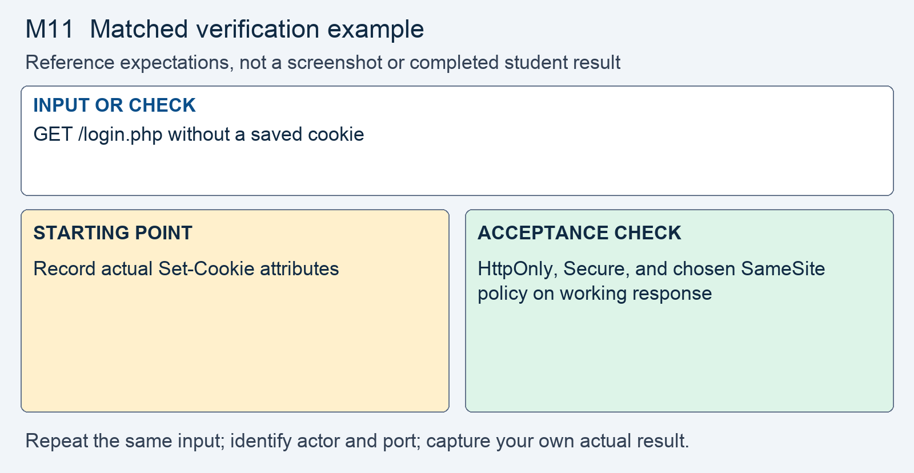

# M11 - Assignment: Incident Report and Fix - A Session Cookie Without Its Attributes

> This repository copy contains the current task instructions and reference images. Download the Word report template from the matching Canvas assignment. Keep your existing Cloud Shell workspace and earlier repairs; returning students do not need a new clone.


## Downloads and instructions

| Supplied file | Use |
|---|---|
| **Download report**: obtain `m11-tc-ir-010-report-template.docx` from this module’s Canvas assignment | Read the supplied model, then complete the marked entries in Word or Word Online. |
| [Download assignment.md](assignment.md) | Keep this copy of the instructions unchanged and include it with the submission. |

All supplied downloads are listed here. The step-by-step activity follows. For Word editing and submission steps, use the course report guide in Orientation. Screenshots belong inside the report unless the activity explicitly requests a separate file.

<!-- verification-guide:start -->
## Visual guide and matched verification

Read a fresh sign-in response without a cookie jar. The released startup script names the cookies TECHCORP_site and TECHCORP_fixed, not PHPSESSID.

Open this path in your **original 8080 preview tab**, preserving its Cloud Shell hostname:

```text
/login.php
```


This is an actual instructor browser capture from a disposable copy of the released portal. It shows the starting interface, not your repaired result. The capture used a temporary local port; your original and working copies remain **8080** and **8081**. Capture your own evidence.

### Keep the comparison controlled



This comparison card summarizes the first row below. It is a teaching guide, not an observed repaired result. The full table and commands remain selectable text.

For each row, record the exact input, signed-in actor, path, port, status or visible behavior, and any state change. Repeat the same test on the original **8080** and working **8081** copies; change only the intended control or comparison variable. If an earlier repair already blocks a case, record that result and keep the repair. Never invent the illustrated outcome.

| Input or check | Starting point to record | Acceptance check to capture |
|---|---|---|
| GET /login.php without a saved cookie | Record actual Set-Cookie attributes | HttpOnly, Secure, and chosen SameSite policy on working response |
| Inspect page response headers | No application HSTS in baseline | Strict-Transport-Security header with the chosen max-age |
| Browser on HTTPS Cloud Shell Web Preview | Proxy offers HTTPS for the browser hop | Legitimate login works with Secure cookie over HTTPS preview |

**Legitimate use and limits.** Plain-HTTP localhost curl verifies emitted headers, not browser enforcement of Secure or HSTS. Use the HTTPS preview for browser session testing; preserve earlier cookie safeguards.

### Copyable header comparison

Run both requests without a saved cookie so the server can issue a new session cookie. Redact cookie values before putting headers in a report. These commands inspect headers; they do not perform the login, rate-limit, or migration tests.

```bash
curl -sS -i http://127.0.0.1:8080/login.php
curl -sS -i http://127.0.0.1:8081/login.php
```

### Capture and submit consistently

Keep command inputs as selectable text beside their output. For browser evidence, show the relevant page, field, and result; a browser image alone does not establish the HTTP status. For HTTP evidence, retain the status and relevant headers as text, and verify any claimed write or refusal in application state. Label before and after captures with the port, actor, and test input. Add captions and alt text in the Word report. Use the complete verification steps below, not just the summary rows.

<!-- verification-guide:end -->

> [!NOTE] Shared lab and reporting references
> Use the **Incident Reporting Guide** (reference page in Canvas) for analysis and evidence, the **Lab Guide** (reference page in Canvas) for environment details, and **Rules Of Engagement** (reference page in Canvas) before testing. The requirements below define this assignment's scope and deliverables.

## What you will do

The browser reaches the portal through an HTTPS preview, but availability of TLS does not itself enforce how session cookies may travel. The response requires secure cookie attributes and a bounded HSTS policy in application responses. Certificate and TLS-version claims remain outside the application’s observation scope.

Read the supplied report, reproduce the original behavior, make the scoped change in the working copy, prove hostile refusal and normal operation, then add your own results and reasoning.

## The incident: TC-IR-010

Here is the ticket the desk filed, and the analyst's determination on top of it.

> **Incident TC-IR-010 - The session cookie carries no attributes**
> A reviewer read the headers the sign-in page returns and found the session cookie set as `TECHCORP_site=...; path=/` and nothing more: no `Secure`, no `HttpOnly`, no `SameSite`. No response from the portal carries a `Strict-Transport-Security` header. The reviewer noted that the portal is reached over HTTPS and asked why that was not enough.
>
> **Analyst determination.** The browser reaches the portal over HTTPS, so the traffic on the wire is encrypted. That is the transport being available, not enforced. `auth.php` starts the session with `session_start()` and sets nothing about the session cookie, so the cookie carries PHP's defaults. A cookie without `Secure` will ride on a plain `http://` request to the host; one without `HttpOnly` can be read by page script; one without `SameSite` travels on cross-site requests. With no `Strict-Transport-Security` header, the browser has no standing rule to refuse `http://` for this host. Closing this incident sets the cookie's attributes before the session starts and sends the header on every page.


## Your lab

Your work happens in your own course environment. If it is not open, start it as the **Working in Google Cloud Shell** page shows. It is your copy and the only target you are authorized to test. Sign in with the rep account from Module 01. The files in question are `auth.php`, where the session starts, and `layout.php`, where every page's output begins.

## Read the report and required analysis

> [!CONCEPT] Read the supplied report
> The report supplies the corporate case and management record. Complete the marked [STUDENT] entries, keep every EXAMPLE, and write your own answer after Answer. Later modules require fuller justification; use evidence rather than expanding the report with unsupported claims.


Read the completed corporate context in the Word report and complete its marked entries for this case.


| Section | What it must say |
|---|---|
| **1. Administrative details** | Report ID `TC-IR-010`, the severity with one sentence of justification, the dates in relative terms, and you as the preparer. |
| **2. Executive summary** | Two or three sentences a manager could read: what the session cookie lacked, what that allowed, and whether it is fixed. No code. |
| **3. Systems and data affected** | The session cookie `auth.php` creates and the responses `layout.php` writes, and what reaches through them: the session identifier, which is the signed-in session. |
| **4. Timeline of events** | When it was reported and when you acted, in relative terms. |
| **5. Detection and analysis** | The distinction the incident turns on: HTTPS is available but not enforced. Name each missing attribute and the header, and what each one's absence allows, in the lecture's words. Classify the flaw: the OWASP category and the CWE numbers from lecture section 11. In 5.3, name what your portal cannot show about TLS and why. |
| **6. Response actions** | The fix you applied: the three attributes on the session cookie, set before the session starts, and the `Strict-Transport-Security` header with its `max-age`. Name the principle and the control, using the lecture's words. |
| **7. Confirmation of remediation, annotated** | Your before and after evidence from Part 2, one row per check, each annotated with what it proves and what it does not. |
| **8. Notification determination** | Nothing is established to have left the system. Say who decided that and on what basis. |
| **9. Post-incident actions** | The OWASP cheat sheets you followed, by name, and one corrective action that keeps the attributes and the header in place on every page the portal adds later. |
| **10. Closure and attestation** | Sign and date, once section 7 is complete. |

For section 5, do not stop at "the portal uses HTTPS." The lock icon was already there. State plainly what could still leave the encrypted channel, and by which path, so a reader who was not present can follow the reasoning.

## Open the working environment

1. [Launch Google Cloud Shell](https://shell.cloud.google.com/) with the account used for the earlier labs.
2. In the editor, locate the existing workspace containing `site`, `fixed`, `reports`, and `scripts`. Right-click the workspace folder and select **Open in Integrated Terminal**.
3. Run:

```bash
bash scripts/start.sh
```

4. Open **Web Preview → Preview on port 8080** for the original. Use **Web Preview → Change port → 8081** for the working copy. Check the port before testing. Sign in separately using the account required below.
5. Read/reproduce the starting flaw on **site, port 8080**. Edit and verify **fixed, port 8081**. Keep earlier repairs. If an earlier control already prevents the case on fixed, report that result and test the remaining work without removing the control.
6. Download the report from the list at the top, open it in Word or Word Online, and save your copy. The IDE is for the source and command evidence; the Word report stays outside the code repository.


> [!NOTE] Capture the comparison
> Record original and working results separately. The same demo username can have different password or session state after earlier modules. Use the current working credentials for 8081; do not reset the whole application to make an old example reappear.


## Fix and prove the working copy

> [!CORRECT] Change the working files
> Open the corresponding paths under fixed/. Use Find to locate the named expression or function; the cited line numbers are reference locations and will change as your repairs accumulate. Save each change before testing.


Do this in `auth.php` and `layout.php` in your course environment. Each step produces evidence that goes into the report.

1. **Reproduce it.** From the terminal, request the sign-in page with the headers shown, as the **Requests and Developer Tools** page shows.
   - The released startup script names the original cookie `TECHCORP_site` and the working cookie `TECHCORP_fixed`. Record the actual `Set-Cookie` attributes; earlier repairs may already add some flags on 8081. No `Strict-Transport-Security` line appears.
   - In the browser, on the Web Preview, open the Application panel and read the stored cookie's attributes. Inspect `HttpOnly`, `Secure`, and `SameSite`; record the baseline on 8080 and preserve attributes already installed on 8081.
   - Capture both. This is your **before** evidence for section 7.

2. **Say what is available and what is enforced.** The preview address is `https://` and the lock is present.
   - Your browser speaks HTTPS to Cloud Shell's proxy. The proxy speaks plain HTTP to your `php -S` process. The lock describes the first hop only.
   - Write one sentence on the difference between HTTPS being offered and HTTPS being required.
   - From the table in lecture section 13, list the rows your portal can show and the rows the proxy owns. The second list goes in section 5.3.

3. **Find the code.** Open `auth.php` and `layout.php` and note these places by line number.
   - `auth_start()` at lines 18 to 23 of `auth.php` calls `session_start()` at line 21. On the original copy no call sets the session cookie attributes. Your working copy may already set HttpOnly and SameSite from Module 6; preserve those settings and add the remaining transport requirements.
   - `setcookie('role', ...)` at line 52 sets a second cookie with no attributes.
   - `page_header()` in `layout.php` begins at line 16, and the page's output begins at line 20. A response header has to be sent before that line.

4. **Set the session cookie parameters.** In `auth.php`, give the session cookie its attributes before the session starts, with `session_set_cookie_params()` as lecture section 11 shows.
   - Set `secure`, `httponly`, and `samesite`. `Secure` keeps the cookie off plain HTTP, `HttpOnly` keeps it from page script, and `SameSite` keeps it off cross-site requests.
   - The call must run before `session_start()`, in the one place every page passes through. Called afterwards, it changes nothing and raises no error.
   - If your working copy still sets the `role` cookie with `setcookie()`, give it the same three attributes with the options array. If an earlier fix removed that cookie, say so in the report.

5. **Add the transport header.** In `layout.php`, send a `Strict-Transport-Security` header with a `max-age` on every page, before any output.
   - Start with a short `max-age`, a day. The header is a commitment the browser keeps for that long, and you cannot recall it.
   - Leave out `includeSubDomains` and `preload`. Lecture section 10 says when each is earned; the portal has earned neither.

> [!NOTE] Record your own results
> Switch to the working portal on 8081. Capture the actual hostile and legitimate outcomes and compare them with the original. Keep a failed check in the record while you correct it.

6. **Prove it.** Capture the **after** evidence beside the **before** from step 1, and annotate each capture in section 7.
   - From the terminal: the `Set-Cookie` line now carries `secure`, `HttpOnly`, and `SameSite`, and the response carries `Strict-Transport-Security`. The terminal reaches `localhost` over plain HTTP and still receives both; say in your annotation why that is expected.
   - In the browser: the Application panel shows the three attributes on the stored cookie. Sign in and open **Customers**; the page loads signed in, and the Network panel shows the request carrying the `Cookie` header. A `Secure` cookie travelling back on the HTTPS preview is the legitimate case working.
   - For the certificate, the TLS version, and an HTTP-to-HTTPS redirect, write that the proxy owns them and your portal cannot show them. A claim you cannot evidence does not go in section 7.
   - A fix that sets the attributes but signs the rep out, or breaks the session, is a regression, not a fix.

How the proxy terminates TLS, and the certificate it presents, are out of scope for this module.

## The design increment

Your team's API design gains one piece this module, in the operations section of the design document: the API is served over TLS only, and keys never travel in a URL.

- State that every API response is meant for an HTTPS host, and name what that host would send: the cookie attributes and `Strict-Transport-Security`, as in your fix.
- State where a partner's API key travels, a header, and why a URL is the wrong place for it, in the words of lecture section 12.
- State which TLS facts your course environment can and cannot show, as in step 2, so the verification plan does not claim them.

This goes in the team's design document, not in the incident report.

Open notes and open book are both fine. Respond in your own words; do not copy from other sources.

**AI use on this assignment.** The syllabus policy governs; these are its terms for an incident report and fix.

> [!CORRECT] Permitted, with disclosure
> - Asking an AI to explain a concept, an OWASP guideline, or a PHP error message in general terms.
> - A grammar or spelling checker on your own writing.
> - Generating or refactoring code, proposing tests, and planning or editing the report, with disclosure of the tool, help requested, material used or changed, and checks performed. Report only results you observed.

> [!CRITICAL] Not permitted
> - Submitting AI-generated code, analysis, or writing without disclosing it.
> - Pointing an AI-assisted tool at any target other than your own course environment.

You must be able to explain every line you submit, on request. Undisclosed AI use is handled as academic dishonesty under the syllabus.

## Expected output

> [!CORRECT] Check the result, not just the syntax
> The working response set Secure, HttpOnly, and SameSite, and HSTS max-age=86400. Browser sign-in and Customers worked. Certificate configuration and TLS version were identified as proxy-owned, not asserted as application test results. These are EXAMPLE outcomes; record the actual results from your copy and annotate what each test establishes.


Your captures will differ in cosmetic detail; the behavior must not. The assignment passes when the report is complete and the fix holds:

- The `Set-Cookie` line for the session cookie carries `secure`, `HttpOnly`, and a `SameSite` value.
- Every page's response carries a `Strict-Transport-Security` header with a `max-age`.
- Sign-in still works on the Web Preview, and the session holds from page to page.
- Section 5 explains that HTTPS was available but not enforced and names what each missing piece allowed; section 5.3 names what the portal cannot show; section 7 shows the before and after for the cookie and the header, annotated.

## What to submit

- Completed `m11-tc-ir-010-report.docx` with your own results, required screenshots, disclosure, reflection, and Revision History.
- Supplied `assignment.md`, unchanged.
- Complete changed source, including `fixed/auth.php`, `fixed/layout.php`. Include every additional helper, migration, or test file you changed or added. Do not submit unchanged helper files merely because you called them.

In Word, save the report on your computer or document storage. In Cloud Shell Editor, right-click the required source files and choose **Download**. Download `assignment.md` from the list at the top. In Canvas, select **Start Assignment** or **New Attempt**, attach all required parts to the same attempt, select **Submit Assignment**, and check the file list and confirmation. A saved local file is not a submission.

Cite the OWASP Transport Layer Security Cheat Sheet and the OWASP HTTP Strict Transport Security Cheat Sheet where you relied on them.

## Grading rubric

Read the **Assignment rubric** (reference page in Canvas) before submitting. The rubric assesses this activity separately from the other work in the module.

## Complete the report record

Read the supplied business-impact assessment and likelihood–impact table. Complete its marked rating entries using the actual case or your own evidence, and explain why the control changes the risk. Keep the EXAMPLE responses and write your own answers after Answer. Finish the identity, sources, disclosure, reflection, and Revision History entries that the report requests.
