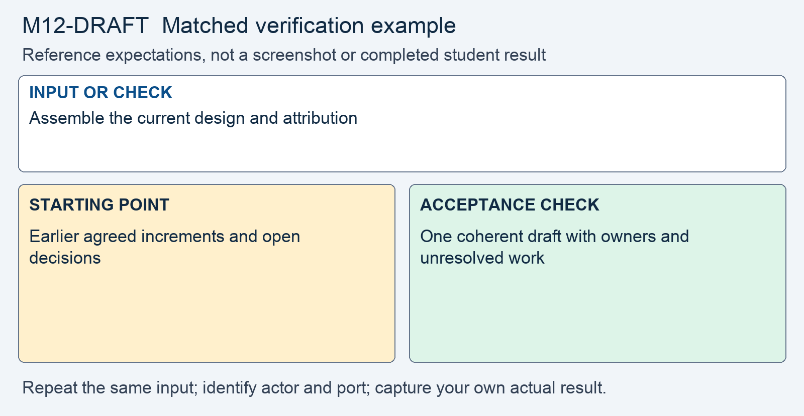

# M12 - Assignment: Collaborative Secure Design (Draft)

> This repository copy contains the current task instructions and reference images. Download the Word report template from the matching Canvas assignment. Keep your existing Cloud Shell workspace and earlier repairs; returning students do not need a new clone.


## Downloads and instructions

| Supplied file | Use |
|---|---|
| **Download report**: obtain `m12-draft-report-template.docx` from this module’s Canvas assignment | Read the supplied model, then complete the marked entries in Word or Word Online. |
| [Download assignment.md](assignment.md) | Keep this copy of the instructions unchanged and include it with the submission. |
| **Download individual build report**: obtain `m12-individual-build-template.docx` from this module’s Canvas assignment | Each member records their own implementation evidence in a separate Word file. |
| **Read the project kickoff** (reference page in Canvas) | Requirements, milestones, and feature scope. |
| **Read project expectations** (reference page in Canvas) | Required safeguards and evidence. |

All supplied downloads are listed here. The step-by-step activity follows. For Word editing and submission steps, use the course report guide in Orientation. Screenshots belong inside the report unless the activity explicitly requests a separate file.

<!-- verification-guide:start -->
## Visual guide and matched verification

This is a design/build checkpoint, not a repaired copy of a finished API. Keep request evidence from each member's own work on 8081.

### Keep the comparison controlled



This comparison card summarizes the first row below. It is a teaching guide, not an observed repaired result. The full table and commands remain selectable text.

The stages below are the evidence workflow for this activity. They are requirements, not completed student observations.

| Input or check | Starting point to record | Acceptance check to capture |
|---|---|---|
| Assemble the current design and attribution | Earlier agreed increments and open decisions | One coherent draft with owners and unresolved work |
| Request each implemented API endpoint | Identify the endpoint and implementation state | Paste the exact request and observed response per member |
| Mark missing safeguards and endpoints | Known gaps at this checkpoint | Explicit completion plan; do not invent passing output |

**Legitimate use and limits.** The shared design and individual implementation evidence are different deliverables. Use the exact header, endpoint, and policy agreed by your team.

### Copyable API evidence starting point

The project implements `POST /api/token` using the `X-API-Key` header. Test the implemented token endpoint without a key first:

```bash
curl -sS -i -X POST http://127.0.0.1:8081/api/token
```

The completed authentication boundary should return 401. At the draft checkpoint, an unimplemented route may return 404; report it as unfinished, not as a passed authentication test. Repeat with your own valid key and then prove scope, expiry, and object ownership using the interface your team designed. Do not publish real keys, token values, or session cookies in captures. A single 401 does not establish that the full API works.

### Capture and submit consistently

Keep command inputs as selectable text beside their output. For browser evidence, show the relevant page, field, and result; a browser image alone does not establish the HTTP status. For HTTP evidence, retain the status and relevant headers as text, and verify any claimed write or refusal in application state. Label before and after captures with the port, actor, and test input. Add captions and alt text in the Word report. Use the complete verification steps below, not just the summary rows.

<!-- verification-guide:end -->

> [!CONCEPT] Read the supplied report
> Use the supplied Word design report as the authoring structure. Complete the marked team decisions and attribution, and retain the EXAMPLE text. Submit the team design as the PDF export required below; the Word file is the working document.

## What you are doing, and why

Your team assembles the design it has grown since the kickoff into one document, and each member adds the endpoints they have built under `api/` so far, with the `curl` evidence that shows each safeguard working. The draft is a checkpoint: it shows what is assembled, what agrees, and what is still owed.

It practices the lecture's three gates on a request, authentication, scope, and ownership, and the way the lecture proves a control: a hand-typed `curl` request and the response it gets. Plan about two hours across the team. The **Design Project Expectations** page in Module 08 carries the criteria.

## The design so far

Since the **Design Project Kickoff** page in Module 08, your team has been designing the partner REST API from Dana Okafor's requirements memo, and each member has been building it in their own portal copy. The kickoff schedule lists the increments due through this module:

- **Authentication.** API-key authentication, and the exchange of a key for a short-lived, scoped token at `POST /api/token`. The token exchange is part of the required core: every member builds it.
- **Hashing and signing.** The stored key is its SHA-256 hash in `api_clients.key_hash`, and the token is signed with `hmac_sign` from `lib/hmac.php`.
- **Transport.** The API is served over TLS, and no key or token ever appears in a URL.

This module's lecture covers the whole API. Read it before you assemble, so the authorization and data section and the operations section reflect it.

## What you are given

- Your team's design increments since the kickoff, each with its author.
- The requirements memo and the feature menu, on the **Design Project Kickoff** page.
- Each member's build in progress: the endpoints under `api/` in their portal copy, reached through `router.php` at `localhost:8081`.
- The seeded data in `data/seed.sql`: partners 1 and 2, one `api_clients` row for partner 1 whose key is `demo-key`, and the customers each partner owns.
- The attribution table your team maintains.
- This module's lecture, Securing REST APIs in PHP.

> [!NOTE] A draft records completed work and open questions
> Clearly label controls as designed, implemented, tested, or still owed. This helps the instructor give useful feedback without mistaking a proposed control for a verified result.

## Open the working environment

1. [Launch Google Cloud Shell](https://shell.cloud.google.com/) with the account used for the earlier labs.
2. In the editor, locate the existing workspace containing `site`, `fixed`, `reports`, and `scripts`. Right-click the workspace folder and select **Open in Integrated Terminal**.
3. Run:

```bash
bash scripts/start.sh
```

4. Use **Web Preview → Change port → 8081** for your working application. Send the API test requests to `http://127.0.0.1:8081` from the terminal. The original on 8080 remains a portal reference, not a completed API.
5. Build under `fixed/api/` and update `fixed/router.php` only where needed for API routing. Preserve earlier portal repairs. Record evidence from your own working API; the original copy does not supply a completed project.
6. Download the report from the list at the top, open it in Word or Word Online, and save your copy. The IDE is for the source and command evidence; the Word report stays outside the code repository.


> [!NOTE] Capture the comparison
> Record original and working results separately. The same demo username can have different password or session state after earlier modules. Use the current working credentials for 8081; do not reset the whole application to make an old example reappear.


## Instructions

> [!CORRECT] Work through the required evidence
> Read each required item, add the answer or artifact to the matching report entry, and check it against the stated criterion before moving on. Use EXAMPLE text as a model, not as a substitute result.


1. **Assemble the design so far.** Bring the increments into one document.
   - The three sections, authentication, authorization and data, and operations, each as far as it has gone.
   - The threat model and the verification plan, as far as they have gone.
   - Each part names its author. It does not have to be polished; it has to read as one piece.

2. **Check the required core is in the design.** For each of the five, the document says the control, the exact point it is enforced, and the threat it stops.
   - API-key authentication: the key read from a header, the hash looked up, the compare with `hash_equals`.
   - The token exchange: a key traded for a signed token carrying a partner id, a scope, and an expiry, verified before any field in it is read.
   - The ownership check inside the query, on every endpoint that names an object.
   - Input validation: the allow-list of fields a caller may set, then type, length, and set on each.
   - Errors that leak nothing: one handler, a short message, a correlation id.

3. **Add each member's build in progress.** For every member, list the endpoints built under `api/` and paste the `curl` request and the response for each, as text.
   - Send requests as the **Requests and Developer Tools** page shows; a JSON body goes with `-X POST`, `-H 'Content-Type: application/json'`, and `-d`, as lecture section 3 shows.
   - For the token exchange, show the request with a JSON body and the key header answered 200 with a token, and the same request with a malformed body answered 400.
   - For each object endpoint built, show the three-part proof from lecture section 15: the owner gets 200, no key gets 401, another partner's row gets 404.
   - Name which member built each endpoint. An endpoint not yet built is listed in step 6, not here.

4. **Reconcile the obvious conflicts.** Where two sections describe the same control differently, make them agree.
   - Say which measures are authoritative (the one control a request cannot pass without, as the **Design Project Expectations** page explains) and which are defense in depth.
   - Note anywhere the sections still disagree, so the feedback can address it.

5. **Bring the attribution table current.** Every section, the threat model, the verification plan, and every endpoint names its author.

6. **List what is still owed.** Name the design parts and the endpoints not yet done.
   - The increments the kickoff schedule lists after this module: a CORS policy and security headers, the audit log, and the dependency decision.
   - Any part of the required core from step 2 that is designed but not yet running, per member.
   - A draft that states its gaps is more useful than one that hides them.

Open notes and open book are both fine. Respond in your own words; do not copy from other sources.

**AI use on this assignment.** The syllabus policy governs; these are its terms for a design document and build.

> [!CORRECT] Permitted, with disclosure
> - Asking an AI to explain a concept, an OWASP guideline, or a PHP error message in general terms.
> - A grammar or spelling checker on your own writing.
> - Generating or refactoring code, proposing tests, and planning or editing the report, with disclosure of the tool, help requested, material used or changed, and checks performed. Report only results you observed.

> [!CRITICAL] Not permitted
> - Submitting AI-generated code, analysis, or writing without disclosing it.
> - Pointing an AI-assisted tool at any target other than your own course environment.

You must be able to explain every line you submit, on request. Undisclosed AI use is handled as academic dishonesty under the syllabus.

## Expected output

> [!NOTE] Review what the evidence supports
> Confirm that each conclusion refers to a source, a supplied observation, your own test, or an explicit team decision. Mark unimplemented work and unresolved questions rather than describing them as complete.


Your team's wording will differ from another team's; the parts must not. The draft is complete when:

- The three sections, the threat model, and the verification plan are in one document, each as far as it has gone, each with an author.
- Each of the five required-core safeguards names its control, its enforcement point, and the threat it stops.
- Each member's endpoints appear with `curl` requests and responses as text, including the token exchange with a JSON body and the three-part proof for each object endpoint.
- Shared controls are described the same way in every section, or the disagreement is noted.
- The attribution table is current, and the list of what is still owed is honest.

## What to submit

The design document is your team's shared Google Doc; submit it once as a PDF export (in Google Docs: **File**, **Download**, **PDF Document**). Each member's build in progress is their build report, a Word (`.docx`) file completed outside the IDE using the individual build report listed above, with every curl request and response as selectable text. The team submits one PDF. Identify each member's accompanying Word build report by name and keep that member's observed results separate. The final has a separate individual-build submission. Embed screenshot evidence in the matching Word report, with captions and alt text. Upload a separate image only if directed or if it is referenced but not embedded.

Complete the identity, disclosure, reflection, and Revision History entries in the supplied report; each has an EXAMPLE.

Each member completes their own identity and contribution entries.

## Report preparation and submission record

Use the supplied Word design report to assemble the team document, complete attribution and Revision History, and export the team PDF as required above. Submit the unchanged `assignment.md` with it. The final individual build is assessed separately; each member submits their own Word evidence report and complete changed implementation code to that assignment. For the draft, include each member’s separate Word build report using the second report download above, labeled with that member’s name.

## Complete the report record

Read the supplied business-impact assessment and likelihood–impact table. Complete its marked rating entries using the actual case or your own evidence, and explain why the control changes the risk. Keep the EXAMPLE responses and write your own answers after Answer. Finish the identity, sources, disclosure, reflection, and Revision History entries that the report requests.
