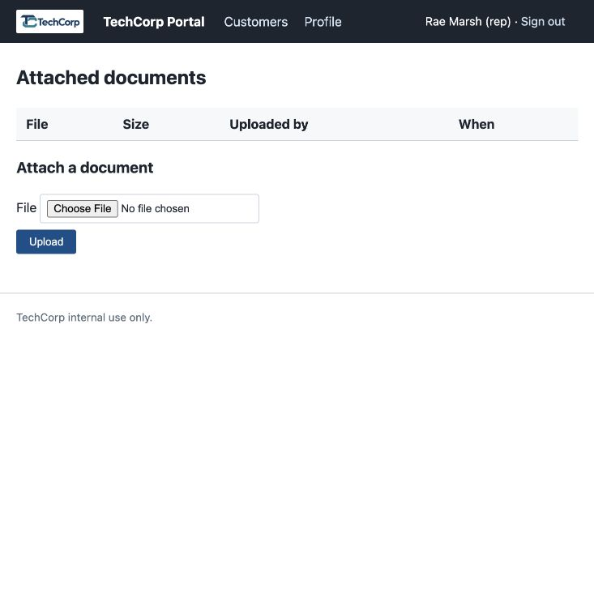
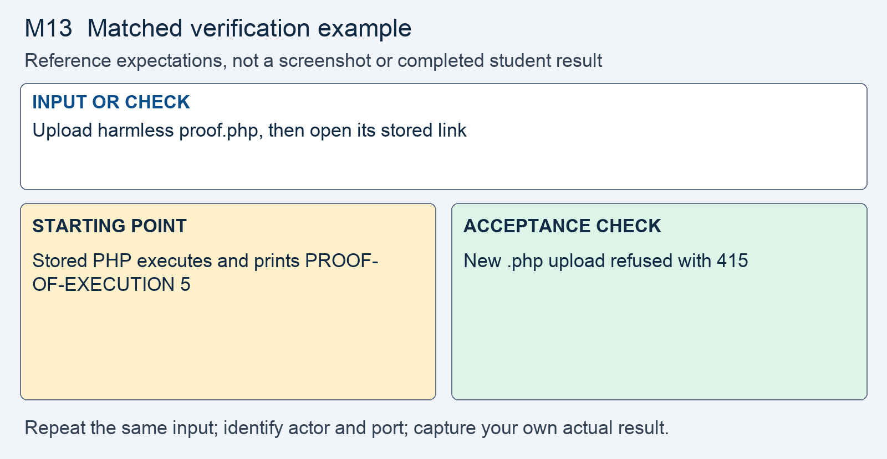

# M13 - Assignment: Incident Report and Fix - An Uploaded File Ran as Code

> This repository copy contains the current task instructions and reference images. Download the Word report template from the matching Canvas assignment. Keep your existing Cloud Shell workspace and earlier repairs; returning students do not need a new clone.


## Downloads and instructions

| Supplied file | Use |
|---|---|
| **Download report**: obtain `m13-tc-ir-011-report-template.docx` from this module’s Canvas assignment | Read the supplied model, then complete the marked entries in Word or Word Online. |
| [Download assignment.md](assignment.md) | Keep this copy of the instructions unchanged and include it with the submission. |

All supplied downloads are listed here. The step-by-step activity follows. For Word editing and submission steps, use the course report guide in Orientation. Screenshots belong inside the report unless the activity explicitly requests a separate file.

<!-- verification-guide:start -->
## Visual guide and matched verification

The released account page has a call-notes link but no Documents link. Open /upload.php?customer_id=1 directly in the same preview tab while signed in.

Open this path in your **original 8080 preview tab**, preserving its Cloud Shell hostname:

```text
/upload.php?customer_id=1
```



This is an actual instructor browser capture from a disposable copy of the released portal. It shows the starting interface, not your repaired result. The capture used a temporary local port; your original and working copies remain **8080** and **8081**. Capture your own evidence.

### Keep the comparison controlled



This comparison card summarizes the first row below. It is a teaching guide, not an observed repaired result. The full table and commands remain selectable text.

For each row, record the exact input, signed-in actor, path, port, status or visible behavior, and any state change. Repeat the same test on the original **8080** and working **8081** copies; change only the intended control or comparison variable. If an earlier repair already blocks a case, record that result and keep the repair. Never invent the illustrated outcome.

| Input or check | Starting point to record | Acceptance check to capture |
|---|---|---|
| Upload harmless proof.php, then open its stored link | Stored PHP executes and prints PROOF-OF-EXECUTION 5 | New .php upload refused with 415 |
| Rename the same file to proof.pdf | Browser-supplied type is not authoritative | Byte/type checks still refuse with 415 |
| Real PDF; oversized file; no file | Record starting behavior | Real PDF downloads safely; oversized and empty selections are refused |

**Legitimate use and limits.** Keep earlier repairs; remove the harmless uploaded PHP test artifact after recording it. A new upload rule does not remove an old served file. Verify the notes filter after applying CSP.

### Capture and submit consistently

Keep command inputs as selectable text beside their output. For browser evidence, show the relevant page, field, and result; a browser image alone does not establish the HTTP status. For HTTP evidence, retain the status and relevant headers as text, and verify any claimed write or refusal in application state. Label before and after captures with the port, actor, and test input. Add captions and alt text in the Word report. Use the complete verification steps below, not just the summary rows.

<!-- verification-guide:end -->


> [!NOTE] Shared lab and reporting references
> Use the **Incident Reporting Guide** (reference page in Canvas) for analysis and evidence, the **Lab Guide** (reference page in Canvas) for environment details, and **Rules Of Engagement** (reference page in Canvas) before testing. The requirements below define this assignment's scope and deliverables.

## What you will do

An uploaded document was executed as PHP after being stored inside a served directory under its original name. The same review identified missing browser security headers. The response separates storage from execution, validates files using their bytes, and serves authorized downloads with explicit attachment headers.

Read the supplied report, reproduce the original behavior, make the scoped change in the working copy, prove hostile refusal and normal operation, then add your own results and reasoning.

## The incident: TC-IR-011

Here is the ticket the desk filed, and the analyst's determination on top of it.

> **Incident TC-IR-011 - An uploaded file ran as code on the server**
> A rep attached a document to a customer record, then opened it from the record's document list. Instead of the file downloading, the page showed output the file itself produced. The document was a `.php` file the rep had attached by mistake.
>
> **Analyst determination.** `upload.php` accepts any file, keeps the name the browser supplied, and writes it into `uploads/`, a folder inside the served directory. When a URL asks for that file, the PHP engine runs it instead of returning it, so an uploaded `.php` executes on the server. That is remote code execution reached through an upload form. A second, separate finding: no page sends `Content-Security-Policy`, `X-Content-Type-Options`, or a framing header. The upload defect is the main work here; the headers are the deployment posture around it.


## Your lab

Your work happens in your own course environment. If it is not open, launch it from the **Launch Course Environment** page in Module 01. It is your copy and the only target you are authorized to test. Sign in with the rep account from Module 01. The feature in question is the document upload on `upload.php`; every page's headers come from `page_header()` in `layout.php`.

## Read the report and required analysis

> [!CONCEPT] Read the supplied report
> The report supplies the corporate case and management record. Complete the marked [STUDENT] entries, keep every EXAMPLE, and write your own answer after Answer. Later modules require fuller justification; use evidence rather than expanding the report with unsupported claims.


Use the supplied Word report. The following table identifies the analytical coverage required; keep the completed corporate context and add your own contribution to its marked entries.


| Section | What it must say |
|---|---|
| **2. Executive summary** | Two or three sentences a manager could read: that a file attached to a customer record ran as code on the server, who could reach the feature, and whether it is fixed. No code. |
| **3. Systems and data affected** | The `upload.php` feature, the `uploads/` folder the files land in, the `documents` table, and the headers every page gets from `layout.php`. |
| **4. Timeline of events** | When it was reported and when you acted, in relative terms. |
| **5. Detection and analysis** | Trace the file from the upload request to the server running it. Name the **source**, the **trust boundary**, the **sink**, and the **interpreter**. State the missing headers as a second finding, with the response that shows their absence. |
| **6. Response actions** | The fix you applied: the checks on the upload, the generated name, where files are stored now, how they are served, and the headers. Name the principle and the control, using the lecture's words. |
| **7. Confirmation of remediation, annotated** | Your before and after evidence from Part 2. The `.php` no longer runs; a real PDF still attaches and downloads; the headers are present. |
| **9. Post-incident actions** | The OWASP cheat sheets you followed, by name, and one change that would stop this class of bug from recurring on other features. |

## Open the working environment

1. [Launch Google Cloud Shell](https://shell.cloud.google.com/) with the account used for the earlier labs.
2. In the editor, locate the existing workspace containing `site`, `fixed`, `reports`, and `scripts`. Right-click the workspace folder and select **Open in Integrated Terminal**.
3. Run:

```bash
bash scripts/start.sh
```

4. Open **Web Preview → Preview on port 8080** for the original. Use **Web Preview → Change port → 8081** for the working copy. Check the port before testing. Sign in separately using the account required below.
5. Read/reproduce the starting flaw on **site, port 8080**. Edit and verify **fixed, port 8081**. Keep earlier repairs. If an earlier control already prevents the case on fixed, report that result and test the remaining work without removing the control.
6. Download the report from the list at the top, open it in Word or Word Online, and save your copy. The IDE is for the source and command evidence; the Word report stays outside the code repository.


> [!NOTE] Capture the comparison
> Record original and working results separately. The same demo username can have different password or session state after earlier modules. Use the current working credentials for 8081; do not reset the whole application to make an old example reappear.


## Fix and prove the working copy

> [!CORRECT] Change the working files
> Open the corresponding paths under fixed/. Use Find to locate the named expression or function; the cited line numbers are reference locations and will change as your repairs accumulate. Save each change before testing.


Do this on `upload.php` and `layout.php` in your course environment. Each step produces evidence that goes into the report.

1. **Reproduce it.** Sign in as `rmarsh`, then open `/upload.php?customer_id=1` directly in the same preview tab. The released account page has no Documents link. Create a file named `proof.php` whose only line is the one shown below this step.
   - Attach it. The page accepts it. Click its name in the document list.
   - If the browser shows `PROOF-OF-EXECUTION 5`, the server ran your file and sent you the result. Capture the screen. This is your **before** evidence for section 7.
   - Write only this line. Nothing that takes a parameter, runs a command, reads a file, or opens a connection. Watching the server do your arithmetic is the whole demonstration.

```php
<?php echo 'PROOF-OF-EXECUTION ' . (2 + 3);
```

2. **Read what the pages tell the browser.** Read the response headers for any portal page, on the Network panel or with `curl -i`, as the **Requests and Developer Tools** page shows.
   - Write down every header you received, then which of `Content-Security-Policy`, `X-Content-Type-Options`, `X-Frame-Options`, and `Referrer-Policy` are not there.
   - This is your header **before** evidence. A missing header shows nothing on the page; the response is the only evidence.

3. **Trace the flow.** In `upload.php`, find by line number:
   - where the file enters the script, and the field name the form posts it under;
   - the line that decides the stored name, and where that name came from;
   - the line that writes the file to disk, and the folder it writes to relative to the folder the server serves;
   - any check on the file's `error` code, size, type, or extension;
   - which of the three claims (filename, extension, declared `Content-Type`) the `documents` row records, and in which column;
   - how the document list links to a file, and whether anything checks who is asking.

4. **Validate the upload.** Before the file is stored, add the checks lecture section 8 teaches, in order.
   - Check PHP's own `error` code with a strict comparison, and cap the size at a limit you choose and write down.
   - Detect the type from the bytes with `finfo`, against a map you write for this feature. Signed forms are the feature's purpose, so `application/pdf` must be a key. Decide whether images belong and write the list down.
   - Refuse anything that is not a key with a 415 and a short message. The map's value, not the filename, is the extension the file will be stored under.

5. **Name, store, and serve.** Change where the file goes and how it comes back, as lecture section 9 shows on different code.
   - Generate the stored name on the server. No character the sender typed may survive into the path.
   - Store the file in a folder outside the one the server serves. No URL may reach it.
   - Record the detected type in the `content_type` column, not the declared one.
   - Replace the direct link at line 65 with a handler that requires sign-in, sets `Content-Type` from the row, sends `nosniff` and `Content-Disposition: attachment`, and then reads the file.
   - Remove the harmless proof upload from the original comparison copy once its before evidence is captured, and remove any equivalent served proof from the working copy. This is cleanup of the test artifact, not a rollback of source repairs. A check on new uploads does nothing about a file already sitting in a served folder.

6. **Send the headers.** In `layout.php`, `page_header()` starts output at line 20 and sends no headers before it. Add them there, as lecture section 6 shows: one place, before any output.
   - Inventory what the pages load before you write the policy: lines 26 to 30 of `layout.php` load a stylesheet of the portal's own and a stylesheet and a script from `cdn.jsdelivr.net`, and `notes.php` line 67 starts an inline script that changes with the query string. Write the policy from that list; the lecture's example policy as written would break the notes filter.
   - Send `X-Content-Type-Options: nosniff`, `X-Frame-Options: DENY` beside `frame-ancestors`, and a `Referrer-Policy`.
   - Send `Strict-Transport-Security` with a short `max-age` and no `includeSubDomains`, as the lecture shows. Your portal answers plain HTTP under `php -S`, so the browser ignores it there; your evidence is the header line in the response, nothing more.

> [!NOTE] Record your own results
> Switch to the working portal on 8081. Capture the actual hostile and legitimate outcomes and compare them with the original. Keep a failed check in the record while you correct it.

7. **Prove it.** Capture, side by side with your before evidence:
   - `proof.php` attached again, now refused with your 415 message;
   - `proof.php` renamed `proof.pdf`, so the browser declares `application/pdf`, refused the same way;
   - a real PDF attached, listed, and downloaded through your handler, with the download's response headers;
   - a 6 MB file and an empty file field, each refused;
   - the response headers of a portal page, now carrying the policy and the three headers, with the notes filter still working.
   - A fix that rejects a real PDF is a regression, not a fix.

The error page that prints a server path when a write fails is out of scope for this module. The portal records who uploaded each file in `uploaded_by`; it has no audit log for the action, and adding one is out of scope for this module.

Open notes and open book are both fine. Respond in your own words; do not copy from other sources.

**AI use on this assignment.** The syllabus policy governs; these are its terms for an incident report and fix.

> [!CORRECT] Permitted, with disclosure
> - Asking an AI to explain a concept, an OWASP guideline, or a PHP error message in general terms.
> - A grammar or spelling checker on your own writing.
> - Generating or refactoring code, proposing tests, and planning or editing the report, with disclosure of the tool, help requested, material used or changed, and checks performed. Report only results you observed.

> [!CRITICAL] Not permitted
> - Submitting AI-generated code, analysis, or writing without disclosing it.
> - Pointing an AI-assisted tool at any target other than your own course environment.

You must be able to explain every line you submit, on request. Undisclosed AI use is handled as academic dishonesty under the syllabus.

## Expected output

> [!CORRECT] Check the result, not just the syntax
> The PHP proof was refused under both .php and .pdf names with 415. A real PDF attached and downloaded through the authorized handler with attachment headers, and the intended notes filter still worked with the chosen CSP. These are EXAMPLE outcomes; record the actual results from your copy and annotate what each test establishes.


Your captures will differ in cosmetic detail; the behavior must not. The assignment passes when the report is complete and the fix holds:

- `proof.php` runs before the fix and is refused after it, by its bytes, under either name.
- Stored files carry a name the sender did not choose, in a folder no URL reaches.
- A real PDF still attaches, and downloads through the handler with its own `Content-Type`, `nosniff`, and `Content-Disposition: attachment`.
- Every portal page sends `Content-Security-Policy`, `X-Content-Type-Options`, `X-Frame-Options`, and `Referrer-Policy`, and the notes filter still works.
- Section 5 names the source, the trust boundary, the sink, and the interpreter; section 7 shows the before and after.

## What to submit

- Completed `m13-tc-ir-011-report.docx` with your own results, required screenshots, disclosure, reflection, and Revision History.
- Supplied `assignment.md`, unchanged.
- Complete changed source, including `fixed/upload.php`, `fixed/layout.php`, `fixed/download.php`. Include every additional helper, migration, or test file you changed or added. Do not submit unchanged helper files merely because you called them.

In Word, save the report on your computer or document storage. In Cloud Shell Editor, right-click the required source files and choose **Download**. Download `assignment.md` from the list at the top. In Canvas, select **Start Assignment** or **New Attempt**, attach all required parts to the same attempt, select **Submit Assignment**, and check the file list and confirmation. A saved local file is not a submission.

Cite the OWASP File Upload Cheat Sheet and the OWASP HTTP Headers Cheat Sheet where you relied on them.

## Grading rubric

Read the **Assignment rubric** (reference page in Canvas) before submitting. The rubric assesses this activity separately from the other work in the module.

## Complete the report record

Read the supplied business-impact assessment and likelihood–impact table. Complete its marked rating entries using the actual case or your own evidence, and explain why the control changes the risk. Keep the EXAMPLE responses and write your own answers after Answer. Finish the identity, sources, disclosure, reflection, and Revision History entries that the report requests.
