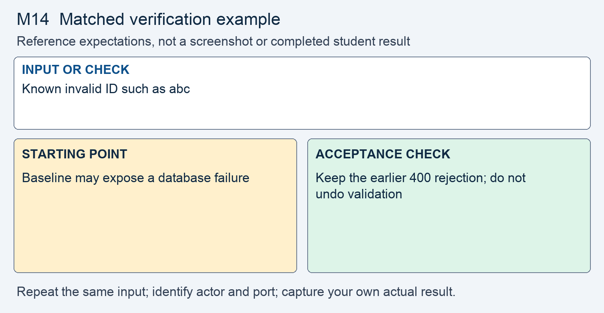

# M14 - Assignment: Incident Report and Fix - No Record of Who Did What

> This repository copy contains the current task instructions and reference images. Download the Word report template from the matching Canvas assignment. Keep your existing Cloud Shell workspace and earlier repairs; returning students do not need a new clone.


## Downloads and instructions

| Supplied file | Use |
|---|---|
| **Download report**: obtain `m14-tc-ir-012-report-template.docx` from this module’s Canvas assignment | Read the supplied model, then complete the marked entries in Word or Word Online. |
| [Download assignment.md](assignment.md) | Keep this copy of the instructions unchanged and include it with the submission. |

All supplied downloads are listed here. The step-by-step activity follows. For Word editing and submission steps, use the course report guide in Orientation. Screenshots belong inside the report unless the activity explicitly requests a separate file.

<!-- verification-guide:start -->
## Visual guide and matched verification

Read the released servers' logs at .lab-runtime/site.log and .lab-runtime/fixed.log. These are request logs, not the structured security log you will add.

Open this path in your **original 8080 preview tab**, preserving its Cloud Shell hostname:

```text
/customer.php?id=1
```


This is an actual instructor browser capture from a disposable copy of the released portal. It shows the starting interface, not your repaired result. The capture used a temporary local port; your original and working copies remain **8080** and **8081**. Capture your own evidence.

### Keep the comparison controlled



This comparison card summarizes the first row below. It is a teaching guide, not an observed repaired result. The full table and commands remain selectable text.

For each row, record the exact input, signed-in actor, path, port, status or visible behavior, and any state change. Repeat the same test on the original **8080** and working **8081** copies; change only the intended control or comparison variable. If an earlier repair already blocks a case, record that result and keep the repair. Never invent the illustrated outcome.

| Input or check | Starting point to record | Acceptance check to capture |
|---|---|---|
| Known invalid ID such as abc | Baseline may expose a database failure | Keep the earlier 400 rejection; do not undo validation |
| Controlled temporary unexpected-error probe | Test unexpected failure separately from invalid ID | Generic 500; correlation ID matches internal record |
| Admin action with log writable versus unwritable | No adequate structured audit record | Recorded actor/action/object; 503 and no change if logging fails |

**Legitimate use and limits.** Normal permitted customer reads and sign-ins still work and generate the assigned events. No passwords, session IDs, tokens, or keys in logs. Remove the temporary probe after testing.

### Capture and submit consistently

Keep command inputs as selectable text beside their output. For browser evidence, show the relevant page, field, and result; a browser image alone does not establish the HTTP status. For HTTP evidence, retain the status and relevant headers as text, and verify any claimed write or refusal in application state. Label before and after captures with the port, actor, and test input. Add captions and alt text in the Word report. Use the complete verification steps below, not just the summary rows.

<!-- verification-guide:end -->


> [!NOTE] Shared lab and reporting references
> Use the **Incident Reporting Guide** (reference page in Canvas) for analysis and evidence, the **Lab Guide** (reference page in Canvas) for environment details, and **Rules Of Engagement** (reference page in Canvas) before testing. The requirements below define this assignment's scope and deliverables.

## What you will do

Existing request records cannot attribute sensitive actions to authenticated actors, and an error path exposes internal details. The response adds structured security events and a single generic error boundary with correlation IDs. Better logging improves future accountability; it cannot reconstruct events that were never recorded.

Read the supplied report, reproduce the original behavior, make the scoped change in the working copy, prove hostile refusal and normal operation, then add your own results and reasoning.

## The incident: TC-IR-012

Here is the ticket the desk filed, and the analyst's determination on top of it.

> **Incident TC-IR-012 - A call note nobody on the desk wrote**
> On Monday morning the support lead opened the account of customer 4 and found a call note, "Duplicate record, disregard.", dated 02:39 on Sunday and signed Rae Marsh. Rae Marsh says she did not write it and was not signed in that weekend. Six more weekend notes signed with her name sit on customers 4, 5, and 6. The team went to find out who was signed in and what they did. The portal has nothing to say: it records no sign-ins, no failed sign-ins, no admin actions, and no reads of customer records. The only record is the web server's own log, one line per request. Separately, a rep reported that asking the customer page for an account by a non-numeric id prints an error, a file path, and part of a query to the screen.
>
> **Analyst determination.** Two weaknesses, one incident. First, the portal writes no security events. `auth_login` in `auth.php` returns `false` on a bad password and records nothing. `admin.php` runs its `UPDATE` on the `users` table and redirects. `customer.php` shows a record and writes nothing. The server log holds a method, a path, and a status, and no identity. Which account the weekend sign-ins used, and whether the person who owns that account made them, cannot be established from the records. Second, `db.php` turns error display on for every page, and the lookup at `customer.php` line 58 is built by concatenation, so `customer.php?id=abc` prints the exception, the file path, and the start of the query. This assignment closes both. The concatenated query itself is out of scope for this module.


## Your lab

Your work happens in your own course environment. If it is not open, launch it from the **Launch Course Environment** page in Module 01. It is your copy and the only target you are authorized to test. You will sign in as two people: the rep account from Module 01, `rmarsh`, and the administrator, `dpatel`, whose password is `12345678`. The files in question are `auth.php`, `admin.php`, `customer.php`, and `db.php`.

## Read the report and required analysis

> [!CONCEPT] Read the supplied report
> The report supplies the corporate case and management record. Complete the marked [STUDENT] entries, keep every EXAMPLE, and write your own answer after Answer. Later modules require fuller justification; use evidence rather than expanding the report with unsupported claims.


Read the completed corporate context in the Word report and complete its marked entries for this case.


| Section | What it must say |
|---|---|
| **1. Administrative details** | The report id, TC-IR-012. The severity per runbook section 4, with the one sentence of justification naming the record that supports the tier word you chose, as lecture section 9 explains. Discovery, with its time zone. Earliest established activity, saying "earliest established" and who established it. The Incident Commander, the status, and the carrier field. |
| **2. Executive summary** | Five to eight sentences a manager could read: what was found, what the portal could and could not tell you, the root cause in one plain sentence, what you did, and where things stand. Written last. No code. |
| **3. Systems and data affected** | One row per asset: the sign-in path, the admin page, the customer record page, and the call notes. Name the data categories precisely, as the form asks. The customer record page shows a tax identifier. For each asset say read, changed, exposed, or unknown, and say "unknown" where the records cannot tell you. |
| **4. Timeline of events** | Every event with a time and the source that proves it. A server log line proves a request happened and nothing about who sent it; the row says so. Where the source is a record that was never written, the row says that too. Keep the weekend activity apart from the response actions. |
| **5.1 How the incident was found** | The actual channel: the support lead, reading a note, by accident. Not an alert, because there is nothing to alert on. |
| **5.2 The vulnerability identified** | The two weaknesses in your own words, each with its OWASP Top 10:2025 category and CWE number, and whether it lives in the code, the configuration, or the design. Say why each existed, not only what it was. |
| **5.3 What analysis could not determine** | The center of this report. Each question the weekend activity raises that the records cannot answer, written as a question, with the missing record named. Do not guess the answers. Lecture section 10 shows the shape. |
| **6.1 Containment** | Any stopgap you took, labeled a mitigation, with what it does not protect against. Turning error display off in configuration is a mitigation. |
| **6.2 Eradication: the remediation** | Three parts, in order: the remediation identified against 5.2, the pseudocode, then the code. The logging you added, the fail-closed rule on the admin action, and the error handler. |
| **6.3 Recovery** | How the portal was kept in service, what you now watch and for how long, and what would count as recurrence. |
| **7. Confirmation of remediation, annotated** | One row per check from Part 2, step 8. Each row records what you did, what resulted, and what the check proves and does not prove. |
| **8. Notification determination** | Who decides, on what basis, and the outcome, with your confidence stated as lecture section 9 defines it. Say plainly what the missing records prevent you from ruling out. The carrier's 72-hour rule is playbook section 8.1. |
| **9. Post-incident actions** | Every corrective action with an owner, a target date, and a status. Each entry in 5.3 reappears here. Name the OWASP guidance you followed: A09, the Logging Cheat Sheet, the Error Handling Cheat Sheet. Playbook steps P-2 and D-6 name what the portal must now be able to produce. |
| **10. Closure and attestation** | What the form requires before the Incident Commander may sign, and which of those conditions are met at the time you submit. |

## Open the working environment

1. [Launch Google Cloud Shell](https://shell.cloud.google.com/) with the account used for the earlier labs.
2. In the editor, locate the existing workspace containing `site`, `fixed`, `reports`, and `scripts`. Right-click the workspace folder and select **Open in Integrated Terminal**.
3. Run:

```bash
bash scripts/start.sh
```

4. Open **Web Preview → Preview on port 8080** for the original. Use **Web Preview → Change port → 8081** for the working copy. Check the port before testing. Sign in separately using the account required below.
5. Read/reproduce the starting flaw on **site, port 8080**. Edit and verify **fixed, port 8081**. Keep earlier repairs. If an earlier control already prevents the case on fixed, report that result and test the remaining work without removing the control.
6. Download the report from the list at the top, open it in Word or Word Online, and save your copy. The IDE is for the source and command evidence; the Word report stays outside the code repository.


> [!NOTE] Capture the comparison
> Record original and working results separately. The same demo username can have different password or session state after earlier modules. Use the current working credentials for 8081; do not reset the whole application to make an old example reappear.


## Fix and prove the working copy

> [!CORRECT] Change the working files
> Open the corresponding paths under fixed/. Use Find to locate the named expression or function; the cited line numbers are reference locations and will change as your repairs accumulate. Save each change before testing.


Do this in your own course environment. Each step produces evidence that goes into the report.

1. **Put your copy in the state the desk found.** Download the [incident state SQL file](assets/incident-injection.sql) into the workspace root. Load the additive teaching state into the original comparison database with the command below. Read only the fixture header until the analysis is complete; preserve the working database and earlier repairs.
   - On the original **8080** copy, sign in as `rmarsh`, open `/customer.php?id=4`, and follow **Call notes for this account**. Do not remove ownership checks from 8081 to reproduce the original exposure.
   - Capture the weekend notes. This is the first piece of your **before** evidence for section 7.
   - Stop reading the file where its header tells you to. The rows below that line are the answer key.


Copy the supplied fixture from `assignments/module-14/assets/incident-injection.sql` to the workspace root first, then run this once. This affects only the assigned fictional database state; keep the working source repairs. The single quotes preserve PHP variable names in the shell:

```bash
php -r '$pdo = new PDO("sqlite:site/data/portal.sqlite"); $pdo->exec(file_get_contents("incident-injection.sql"));'
```

This adds the supplied fictional notes to the original comparison database only; it does not change original source. Do not rerun it repeatedly or duplicate the fixture rows.

2. **Read what the portal kept.** The released startup script writes original request logs to `.lab-runtime/site.log` and working request logs to `.lab-runtime/fixed.log`, relative to the workspace root. The [server log excerpt](assets/access-log-excerpt.txt) covers the weekend and the Monday the note was found.
   - For each weekend line, write what it proves and what it cannot say: who, which account, which record, what outcome.
   - This is your raw material for section 4 and section 5.3.

3. **Reproduce the leak.** Signed in, request `customer.php?id=abc`.
   - Capture the page. Then send the same request with `curl -i` and keep the status line; the **Requests and Developer Tools** page shows how to send a signed-in request.
   - Note what a stranger learns from that screen, using the five points in lecture section 3.
   - If an earlier fix in your copy means `abc` no longer fails, say so in section 7 and force a query failure another way: use the controlled error probe in step 8 after installing the shared handler. Do not rename or delete the database: `db.php` creates a fresh database when the path is absent. The point is what the page shows when a query fails.

4. **Confirm an admin action leaves no record.** Sign out, then sign in as `dpatel`.
   - Open **Admin** and enable the account `sformer`, or disable `lchen`. Then put the account back.
   - Read the last lines of the server log. Write down what they say about who acted and which account changed.
   - This is the rest of your **before** evidence.

5. **Decide what to record.** For each of the four events, sign-in success, sign-in failure, the admin enable or disable, and a customer record read, list the fields a useful event carries, as lecture section 5 groups them.
   - Use the event names from the logging vocabulary where one fits.
   - Check each field against lecture section 6. Not one of them may be a password, a token, a session id, or a key.

6. **Add the logging.** Write one structured event per security decision, each value in its own field, to a log file outside the project folder.
   - In `auth.php`, `auth_login` writes one event on success and one on failure.
   - In `admin.php`, the enable or disable writes one event naming the actor, the action, and the account changed. The record is written first. If it cannot be written, the account is not changed and the reply says so, with the status lecture section 7 uses.
   - In `customer.php`, showing one account by id writes one event with the object type and id, not the record.

7. **Fix the error path.** Handle the failure once, at the boundary, in a file every page includes before it writes output. Every page that touches the database starts with `require_once` of `db.php`.
   - The user gets a generic message and a correlation id, with a status that says something failed.
   - The log gets the exception's class, message, file, and line under the same id.
   - Then turn error display off as well. Lecture section 4 says why the order matters.

> [!NOTE] Record your own results
> Switch to the working portal on 8081. Capture the actual hostile and legitimate outcomes and compare them with the original. Keep a failed check in the record while you correct it.

8. **Prove it.** Capture each check, side by side with your before evidence, for section 7:
   - Keep earlier ID validation and parameterized queries. If `customer.php?id=abc` is already refused with 400, record that protection. To test the unexpected-error boundary deterministically, create a temporary `fixed/ir_error_probe.php` containing the two lines below, request it on 8081, and capture the generic 500 beside the internal record with the same correlation ID. Remove the probe after testing; do not submit it as application code.
   - `customer.php?id=1` still shows the account, and one event with its object type and id appears.
   - A sign-in as `rmarsh` with the wrong password writes one event with no password in it; the right password still signs in and writes one event.
   - As `dpatel`, the enable or disable still works and writes one event naming actor, action, and account.
   - A username containing a newline and fake log text produces one record, the value inside one field.
   - With the log file made unwritable, the admin action is refused with a 503 and the account is unchanged; with the log restored, it works again.
   - Read every new line. None contains a password, a token, a session id, or a key.

Use this temporary probe only in your own course copy, after installing the shared error handler:

```php
<?php
require __DIR__ . '/db.php';
throw new RuntimeException('Controlled lab error-boundary check');
```

The probe requests an unexpected failure independently of malformed-ID handling. Keep the previous query and authorization repairs; do not restore their original defects.

Open notes and open book are both fine. Respond in your own words; do not copy from other sources.

**AI use on this assignment.** The syllabus policy governs; these are its terms for an incident report and fix.

> [!CORRECT] Permitted, with disclosure
> - Asking an AI to explain a concept, an OWASP guideline, or a PHP error message in general terms.
> - A grammar or spelling checker on your own writing.
> - Generating or refactoring code, proposing tests, and planning or editing the report, with disclosure of the tool, help requested, material used or changed, and checks performed. Report only results you observed.

> [!CRITICAL] Not permitted
> - Submitting AI-generated code, analysis, or writing without disclosing it.
> - Pointing an AI-assisted tool at any target other than your own course environment.

You must be able to explain every line you submit, on request. Undisclosed AI use is handled as academic dishonesty under the syllabus.

## Design project increment

The schedule on the **Design Project Kickoff** page gives this module's increment for your team's API: the audit log, and errors that leak nothing, both in the shape this lecture teaches (sections 4 and 5). Record the increment in your build report; it is not part of this incident report.

## Expected output

> [!CORRECT] Check the result, not just the syntax
> Sign-in outcomes, an account change, and a customer view each produced the intended event. The controlled exception produced a generic 500 whose correlation ID matched one internal record; the malformed-ID validation remained intact. These are EXAMPLE outcomes; record the actual results from your copy and annotate what each test establishes.


Your captures will differ in cosmetic detail; the behavior must not. The assignment passes when the report is complete and the fix holds:

- A sign-in, a failed sign-in, an admin enable or disable, and a customer record read each write one structured event with the actor, the action, and the outcome.
- No event contains a password, a token, a session id, or a key, and a hostile username cannot forge a second line.
- When the audit record cannot be written, the admin action is refused and not performed.
- The controlled exception returns a generic 500 with a correlation ID and one matching internal record. Any existing malformed-ID 400 remains intact.
- Sign-in, the admin page, and the customer record page still work for legitimate use.
- All ten sections of the form are complete. Section 5.3 names each unanswerable question with its missing record, and section 8 states the determination with its confidence.

## What to submit

- Completed `m14-tc-ir-012-report.docx` with your own results, required screenshots, disclosure, reflection, and Revision History.
- Supplied `assignment.md`, unchanged.
- Complete changed source, including `fixed/auth.php`, `fixed/admin.php`, `fixed/customer.php`, `fixed/db.php`, `fixed/lib/security_log.php`. Include every additional helper, migration, or test file you changed or added. Do not submit unchanged helper files merely because you called them.

In Word, save the report on your computer or document storage. In Cloud Shell Editor, right-click the required source files and choose **Download**. Download `assignment.md` from the list at the top. In Canvas, select **Start Assignment** or **New Attempt**, attach all required parts to the same attempt, select **Submit Assignment**, and check the file list and confirmation. A saved local file is not a submission.

Cite OWASP A09, the Logging Cheat Sheet, and the Error Handling Cheat Sheet where you relied on them.

## Grading rubric

Read the **Assignment rubric** (reference page in Canvas) before submitting. The rubric assesses this activity separately from the other work in the module.

## Complete the report record

Read the supplied business-impact assessment and likelihood–impact table. Complete its marked rating entries using the actual case or your own evidence, and explain why the control changes the risk. Keep the EXAMPLE responses and write your own answers after Answer. Finish the identity, sources, disclosure, reflection, and Revision History entries that the report requests.
