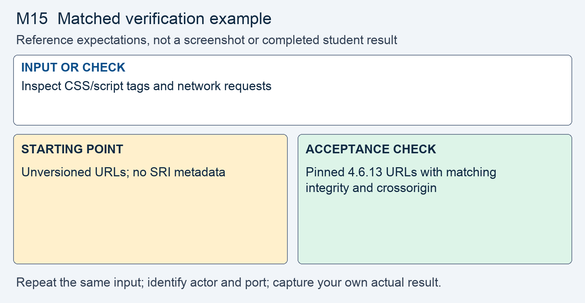

# M15 - Assignment: Incident Report and Fix - Advisory Against the CDN Date Picker

> This repository copy contains the current task instructions and reference images. Download the Word report template from the matching Canvas assignment. Keep your existing Cloud Shell workspace and earlier repairs; returning students do not need a new clone.


## Downloads and instructions

| Supplied file | Use |
|---|---|
| **Download report**: obtain `m15-tc-ir-013-report-template.docx` from this module’s Canvas assignment | Read the supplied model, then complete the marked entries in Word or Word Online. |
| [Download assignment.md](assignment.md) | Keep this copy of the instructions unchanged and include it with the submission. |
| [Download dependency advisory](assets/dependency-advisory.md) | Supplied advisory and conditions for the reachability determination. |

All supplied downloads are listed here. The step-by-step activity follows. For Word editing and submission steps, use the course report guide in Orientation. Screenshots belong inside the report unless the activity explicitly requests a separate file.

<!-- verification-guide:start -->
## Visual guide and matched verification

Use the Since field on the actual notes page. Keep the same from value and inspect the Response bytes and dependency requests before and after.

Open this path in your **original 8080 preview tab**, preserving its Cloud Shell hostname:

```text
/notes.php?customer_id=1
```


This is an actual instructor browser capture from a disposable copy of the released portal. It shows the starting interface, not your repaired result. The capture used a temporary local port; your original and working copies remain **8080** and **8081**. Capture your own evidence.

### Keep the comparison controlled



This comparison card summarizes the first row below. It is a teaching guide, not an observed repaired result. The full table and commands remain selectable text.

For each row, record the exact input, signed-in actor, path, port, status or visible behavior, and any state change. Repeat the same test on the original **8080** and working **8081** copies; change only the intended control or comparison variable. If an earlier repair already blocks a case, record that result and keep the repair. Never invent the illustrated outcome.

| Input or check | Starting point to record | Acceptance check to capture |
|---|---|---|
| Inspect CSS/script tags and network requests | Unversioned URLs; no SRI metadata | Pinned 4.6.13 URLs with matching integrity and crossorigin |
| Deliberately alter one integrity character, then restore it | No integrity enforcement in baseline | Browser refuses mismatched resource; restored resource works |
| from=2026-01-01 versus markup input | Record original picker input | Real date preserved; rejected input becomes empty |

**Legitimate use and limits.** The unchanged date characterization test passes before and after; the negative test fails before and passes after. No claim that pinning alone proves a library vulnerability-free.

### Capture and submit consistently

Keep command inputs as selectable text beside their output. For browser evidence, show the relevant page, field, and result; a browser image alone does not establish the HTTP status. For HTTP evidence, retain the status and relevant headers as text, and verify any claimed write or refusal in application state. Label before and after captures with the port, actor, and test input. Add captions and alt text in the Word report. Use the complete verification steps below, not just the summary rows.

<!-- verification-guide:end -->


> [!NOTE] Shared lab and reporting references
> Use the **Incident Reporting Guide** (reference page in Canvas) for analysis and evidence, the **Lab Guide** (reference page in Canvas) for environment details, and **Rules Of Engagement** (reference page in Canvas) before testing. The requirements below define this assignment's scope and deliverables.

## What you will do

A date-picker dependency is loaded without an explicit version or byte-integrity assertion. The advisory handout requires a reachability determination at the portal’s own call site, not an assumption that a library name alone proves exposure. The response pins and verifies the resources and refactors the untrusted date path with regression tests.

Read the supplied report, reproduce the original behavior, make the scoped change in the working copy, prove hostile refusal and normal operation, then add your own results and reasoning.

## The incident: TC-IR-013

Here is the notice application security sent the team, and the analyst's determination on top of it. The notice itself is the dependency advisory listed in Downloads and instructions; read it before you start.

> **Incident TC-IR-013 - Advisory against the date picker the page shell loads**
> Application security has forwarded a published advisory against `flatpickr`, the date-picker library the portal loads from a public CDN. The advisory says a value placed in the library's date field can reach a DOM sink inside the library and be read as markup. It asks the team for two things: a reachability determination, and a remediation decision with the reasoning written down.
>
> **Analyst determination.** `layout.php`, the page shell every page includes, loads the library's stylesheet and script from `cdn.jsdelivr.net` at lines 29 and 30. Neither URL names a version, and neither tag carries an `integrity` or `crossorigin` attribute, so the browser runs whatever the CDN serves and the application cannot state which version it is running. The picker is called on one page, the notes date filter added in sprint 20 on `notes.php`. Whether the advisory applies to this portal depends on that call site, and that determination is yours to make and defend. The weakness class is a software supply-chain failure (OWASP A03).


## Your lab

Your work happens in your own course environment. If it is not open, launch it from the **Launch Course Environment** page in Module 01. It is your copy and the only target you are authorized to test. Sign in with the rep account from Module 01. The files in question are `layout.php`, the page shell, and `notes.php`, the call notes page with the date filter.

## Read the report and required analysis

> [!CONCEPT] Read the supplied report
> The report supplies the corporate case and management record. Complete the marked [STUDENT] entries, keep every EXAMPLE, and write your own answer after Answer. Later modules require fuller justification; use evidence rather than expanding the report with unsupported claims.


Use the supplied Word report. The following table identifies the analytical coverage required; keep the completed corporate context and add your own contribution to its marked entries.


| Section | What it must say |
|---|---|
| **1. Administrative details** | The report ID, a severity with one sentence of justification, and the status. Discovery is the arrival of the advisory. |
| **2. Executive summary** | Two or three sentences a manager could read: which dependency, why loading it unpinned and unverified is a risk, whether the advisory reaches this application, and whether it is fixed. No code. |
| **3. Systems and data affected** | The `layout.php` page shell, the two `flatpickr` files it loads from the CDN, and `notes.php`, the page that calls the picker. Name what the picker's value could reach in a visitor's browser. |
| **4. Timeline of events** | When the advisory records the finding as first accepted, when the advisory arrived, and when you acted, in relative terms, with a source for each row. |
| **5. Detection and analysis** | 5.1: how the finding reached you. 5.2: the reachability determination. Name the **source**, the **trust boundary**, the **sink**, and the **interpreter** for the picker's value in `notes.php`, with line numbers, then state whether attacker-influenced input reaches the library's affected path and why. Work the nine triage questions from lecture section 7. 5.3: what you could not determine, and the record that would have answered it. |
| **6. Response actions** | 6.2: the remediation, in the form's three parts: the change identified, the pseudocode, the code. Say which of the advisory's four options you applied, why, and what each one does not cover. 6.1 and 6.3: one sentence each on whether a stopgap was needed and how you confirmed the pages still work. |
| **7. Confirmation of remediation, annotated** | Your evidence from Part 2, one row per check: the pinned and verified files loading, the tampered-file case refused, the two tests before and after the refactor, and the hostile and legitimate requests to `notes.php`. Each row says what it proves and what it does not. |
| **8. Notification determination** | State what the case and your evidence establish, what remains unknown about data access, and which role owns a notification determination. Do not infer absence of exfiltration from a passing dependency test. |
| **9. Post-incident actions** | The OWASP guidance you followed, by name, and one change that would stop this class of finding from recurring on other tags and other libraries: an inventory, an integrity rule for third-party tags, or advisory monitoring. |
| **10. Closure and attestation** | The residual risk in one line, as lecture section 10 shows for the CDN case, and whether you declare closure. |

## Open the working environment

1. [Launch Google Cloud Shell](https://shell.cloud.google.com/) with the account used for the earlier labs.
2. In the editor, locate the existing workspace containing `site`, `fixed`, `reports`, and `scripts`. Right-click the workspace folder and select **Open in Integrated Terminal**.
3. Run:

```bash
bash scripts/start.sh
```

4. Open **Web Preview → Preview on port 8080** for the original. Use **Web Preview → Change port → 8081** for the working copy. Check the port before testing. Sign in separately using the account required below.
5. Read/reproduce the starting flaw on **site, port 8080**. Edit and verify **fixed, port 8081**. Keep earlier repairs. If an earlier control already prevents the case on fixed, report that result and test the remaining work without removing the control.
6. Download the report from the list at the top, open it in Word or Word Online, and save your copy. The IDE is for the source and command evidence; the Word report stays outside the code repository.


> [!NOTE] Capture the comparison
> Record original and working results separately. The same demo username can have different password or session state after earlier modules. Use the current working credentials for 8081; do not reset the whole application to make an old example reappear.


## Fix and prove the working copy

> [!CORRECT] Change the working files
> Open the corresponding paths under fixed/. Use Find to locate the named expression or function; the cited line numbers are reference locations and will change as your repairs accumulate. Save each change before testing.


Do this in your course environment. Each step produces evidence that goes into the report.

1. **Reproduce the finding.** Sign in and open `notes.php?customer_id=1`. Click into the **Since** field; the picker opens.
   - Open `layout.php` in the editor and read lines 29 and 30. Record what is missing from each tag: a version in the URL, an `integrity` value, a `crossorigin` value.
   - Open the Network panel as the **Requests and Developer Tools** page shows and reload. Find the two requests to `cdn.jsdelivr.net`. The first line of the script's response names the version served this time; the tag does not.
   - Capture the tags and the two requests. This is your **before** evidence for section 7.

2. **Trace the flow and decide reachability.** In `notes.php`, find by line number where the `from` value enters from the query string, where it is written into the **Since** field, and where it is handed to the picker.
   - Name the source, the trust boundary, the sink, and the interpreter, as lecture section 7 does for a library call.
   - Open `notes.php?customer_id=1&from=2026-01-01`. In the Network panel's **Response** tab, find the value you typed inside the picker call. That is the fact your decision rests on.
   - Write the decision with the file and line, and what you considered and rejected.

3. **Pin the version and verify the bytes.** Change both tags in `layout.php` to version `4.6.13`, using the URL format from lecture section 6.
   - The script's `integrity` value is in lecture section 6. Use it.
   - The stylesheet's value is yours to produce. Fetch `https://cdn.jsdelivr.net/npm/flatpickr@4.6.13/dist/flatpickr.min.css` with `curl` (the **Requests and Developer Tools** page), saving the response to a file with `-o`, then run the lecture's hash command on it. Check it with the PHP version.
   - Put `integrity` and `crossorigin="anonymous"` on both tags.

4. **Prove the integrity check.** Two cases, both captured.
   - The legitimate case: reload `notes.php?customer_id=1`. The Network panel shows both versioned URLs with status 200, and the picker still opens on **Since**.
   - The tampered case: change one character of one recorded hash, which stands in for a changed file, and reload. The console reports an integrity error and the picker does not appear. Then restore the hash.
   - A check that has never refused anything has not been shown to work.

5. **Refactor the call site with two tests.** The advisory's flaw is reachable only if a value from outside reaches the picker. Close that path on `notes.php` the way lecture section 9 works: tests first.
   - Move the line that reads `from` into a small function that returns the value the picker will receive. At first it returns the value unchanged; that is the refactor, and the page behaves exactly as before.
   - In a PHP file of its own, write a characterization test (a real date such as `2026-01-01`, and the empty string, come back unchanged) and a negative test (a markup payload such as `` does not come back). Run the file from the terminal. Keep the output: characterization passes, negative fails.
   - Make the smallest change that closes the weakness: the function accepts only the one shape a date can have, and returns the empty string for anything else. Lecture section 7 shows the control on different code.
   - Run the same tests again. Both pass. Keep the output.

6. **Prove the refactor end to end.** Two requests, both captured from the **Response** tab.
   - The hostile case: `notes.php?customer_id=1&from=`. The picker call now receives an empty date.
   - The legitimate case: `notes.php?customer_id=1&from=2026-01-01`. The field shows the date, and the list is filtered.

7. **Shape the change for review.** You made two changes with two purposes: the tags in `layout.php`, and the function in `notes.php`.
   - Present each in the report as its own before-and-after block with a one-line message that says what changed and why, as lecture section 10 asks.
   - `layout.php` is included by every page. Open one other page, such as the customer list, and confirm it still loads with the pinned tags.

The flaw inside the library, if the advisory is right about it, is still there at the end of this assignment. Pinning and SRI prove the bytes; the validation removes reachability at this one call site. Upgrading or replacing the library is out of scope for this module.

Open notes and open book are both fine. Respond in your own words; do not copy from other sources.

**AI use on this assignment.** The syllabus policy governs; these are its terms for an incident report and fix.

> [!CORRECT] Permitted, with disclosure
> - Asking an AI to explain a concept, an OWASP guideline, or a PHP error message in general terms.
> - A grammar or spelling checker on your own writing.
> - Generating or refactoring code, proposing tests, and planning or editing the report, with disclosure of the tool, help requested, material used or changed, and checks performed. Report only results you observed.

> [!CRITICAL] Not permitted
> - Submitting AI-generated code, analysis, or writing without disclosing it.
> - Pointing an AI-assisted tool at any target other than your own course environment.

You must be able to explain every line you submit, on request. Undisclosed AI use is handled as academic dishonesty under the syllabus.

## Design project increment

For your team's API, record the dependency decision in your build report: every library the API uses beyond PHP and the course `lib/` folder, and for each one the version pinned, where the bytes come from, and how you would learn of an advisory against it. If the API uses none, write that down; it is a decision too.

## Expected output

> [!CORRECT] Check the result, not just the syntax
> The exact pinned resources loaded, a deliberately wrong integrity hash was refused, the hostile date became empty, and 2026-01-01 still filtered notes. Both characterization and negative tests passed after refactoring. These are EXAMPLE outcomes; record the actual results from your copy and annotate what each test establishes.


Your captures will differ in cosmetic detail; the behavior must not. The assignment passes when the report is complete and the fixes hold:

- Both `flatpickr` tags in `layout.php` name version `4.6.13` and carry an `integrity` hash and `crossorigin="anonymous"`.
- The pinned, verified files load and the picker still works; a wrong hash makes the browser refuse the file with an integrity error.
- The two tests fail and pass as lecture section 9 describes: characterization passing throughout, negative failing before the change and passing after.
- A markup payload in `from` never reaches the picker call; a real date still filters the notes.
- Section 5 names the source, the trust boundary, the sink, and the interpreter with line numbers and states the reachability decision; section 7 shows each check with its annotation.

## What to submit

- Completed `m15-tc-ir-013-report.docx` with your own results, required screenshots, disclosure, reflection, and Revision History.
- Supplied `assignment.md`, unchanged.
- Complete changed source, including `fixed/layout.php`, `fixed/notes.php`, `tests/date-filter-test.php`. Include every additional helper, migration, or test file you changed or added. Do not submit unchanged helper files merely because you called them.

In Word, save the report on your computer or document storage. In Cloud Shell Editor, right-click the required source files and choose **Download**. Download `assignment.md` from the list at the top. In Canvas, select **Start Assignment** or **New Attempt**, attach all required parts to the same attempt, select **Submit Assignment**, and check the file list and confirmation. A saved local file is not a submission.

Cite OWASP A03 Software Supply Chain Failures and the OWASP Vulnerable Dependency Management Cheat Sheet where you relied on them.

## Grading rubric

Read the **Assignment rubric** (reference page in Canvas) before submitting. The rubric assesses this activity separately from the other work in the module.

## Complete the report record

Read the supplied business-impact assessment and likelihood–impact table. Complete its marked rating entries using the actual case or your own evidence, and explain why the control changes the risk. Keep the EXAMPLE responses and write your own answers after Answer. Finish the identity, sources, disclosure, reflection, and Revision History entries that the report requests.
