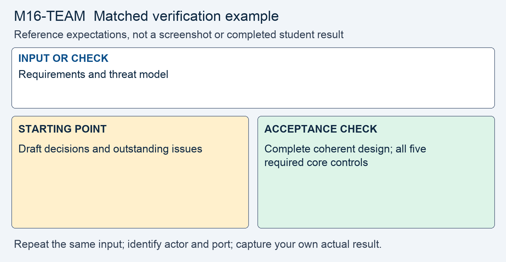

# M16 - Assignment: Collaborative Secure Design (Team Final)

> This repository copy contains the current task instructions and reference images. Download the Word report template from the matching Canvas assignment. Keep your existing Cloud Shell workspace and earlier repairs; returning students do not need a new clone.

## Downloads and instructions

| Supplied file | Use |
|---|---|
| **Download report**: obtain `m16-team-report-template.docx` from this module’s Canvas assignment | Read the supplied model, then complete the marked entries in Word or Word Online. |
| [Download assignment.md](assignment.md) | Keep this copy of the instructions unchanged and include it with the submission. |
| **Read the project kickoff** (reference page in Canvas) | Requirements, milestones, and feature scope. |
| **Read project expectations** (reference page in Canvas) | Required safeguards and evidence. |

All supplied downloads are listed here. The step-by-step activity follows. For Word editing and submission steps, use the course report guide in Orientation. Screenshots belong inside the report unless the activity explicitly requests a separate file.

<!-- verification-guide:start -->
## Visual guide and matched verification

The team final is a design document. Use the agreed requirements and each member's evidence; there is no common screenshot of a finished team application.

### Keep the comparison controlled

This comparison card summarizes the first row below. It is a teaching guide, not an observed repaired result. The full table and commands remain selectable text.

The stages below are the evidence workflow for this activity. They are requirements, not completed student observations.

| Input or check | Starting point to record | Acceptance check to capture |
|---|---|---|
| Requirements and threat model | Draft decisions and outstanding issues | Complete coherent design; all five required core controls |
| Per-safeguard verification plan | Planned method, identity, input, and expected result | Requests match the implemented interface and member evidence |
| Attribution and cross-section review | Named lead and reviewer per decision | Resolved contradictions; final authorship reflects actual work |

**Legitimate use and limits.** Do not substitute another student's successful request for your own individual implementation evidence.

### Capture and submit consistently

Keep command inputs as selectable text beside their output. For browser evidence, show the relevant page, field, and result; a browser image alone does not establish the HTTP status. For HTTP evidence, retain the status and relevant headers as text, and verify any claimed write or refusal in application state. Label before and after captures with the port, actor, and test input. Add captions and alt text in the Word report. Use the complete verification steps below, not just the summary rows.

<!-- verification-guide:end -->

> [!CONCEPT] Read the supplied report
> Use the supplied Word design report as the authoring structure. Complete the marked team decisions and attribution, and retain the EXAMPLE text. Submit the team design as the PDF export required below; the Word file is the working document.

## What you are doing, and why

Your team finishes the design document for the partner REST API it has grown since the kickoff. Each of you finishes building that API under `api/` in your own portal copy. The team submits one design document. Each member submits their build report and decision under challenge to the **Individual API Build assignment** (reference page in Canvas).

It practices what the lecture teaches. A safeguard is written in four parts. A verification plan holds a hand-typed `curl` request per safeguard. Three sections are reconciled into one design. The threat model is grounded in the term's incidents. One decision is defended or conceded against its strongest objection. Plan several hours across the team, plus your own build and defense. The **Design Project Expectations** page in Module 08 carries the criteria named in each step below.

## The design since the draft

The draft at Module 12 assembled the three sections, the threat model, and the verification plan as far as they had gone. It also listed what was still owed. The kickoff schedule has added three increments since then. They are a CORS policy and security headers, the audit log and errors that leak nothing, and the dependency decision for any library the API uses. The final is where the owed list reaches zero, the sections agree, and every safeguard has evidence.

## What you are given

- Your team's draft from Module 12 and the feedback you received on it, including its list of what was still owed.
- The requirements memo and the feature menu, on the **Design Project Kickoff** page in Module 08. The token exchange is part of the required core.
- The evidence table on the **Design Project Expectations** page in Module 08: for each category, the `curl` result that proves its safeguard.
- Each member's build under `api/` in their own portal copy, reached through `router.php` at `localhost:8081`.
- The seeded data in `data/seed.sql`: partners 1 and 2, one `api_clients` row for partner 1 whose key is `demo-key`, and the customers each partner owns.
- The attribution table your team maintains.
- This module's lecture, Secure PHP Synthesis, From Request to Evidence.

## Part 1 - The team design document

1. **Finish the threat model.** It opens the document and supplies the requirements and scope for the shared Assignment Rubric.
   - Name each actor and what it may do, as lecture section 9 does. The actors are a partner's own system, a stolen key, a partner probing other partners' ids, the third-party dashboard, a registered callback URL, and TechCorp staff.
   - For each actor, state the risk the design answers, and tie it to a feature in the requirements memo.
   - For each safeguard, name the TC-IR incident this term whose class it prevents.
   - Where a term incident does not apply to the API, say so and say why. A risk left out without a reason is a gap.
   - Close with the risk that remains after the controls, its treatment, and its owner, as lecture section 10 shows.

2. **Write every safeguard in four parts.** This supplies precise concepts, controls, and verification for the shared Assignment Rubric.
   - Do this for the five required-core safeguards and for each elective your team built. State the control, the exact point it is enforced, the threat it prevents, and the verification that shows it works. Lecture section 6 defines the four parts.
   - Name the point by file and the line of reasoning, so two members cannot each assume the other built it.
   - A control name alone is a checklist entry, not a safeguard. Compare your wording with the weak and strong pair in lecture section 6.

3. **Say what your team built from the feature menu and what it left out.** This supports completeness, scope, and control selection.
   - For each elective chosen, name the memo feature it serves and the threat it answers.
   - For each elective left out, give the reason in one or two sentences.
   - Originality is not graded; the reasoning is.

4. **Reconcile the three sections.** This supports correctness and coherent reasoning.
   - Find every control that more than one section describes. Name the section that owns it, and make the other section point there, as lecture section 8 shows. The overlap table in that section lists the usual ones.
   - For each shared control, say which measure is authoritative and which is defense in depth. Lecture section 5 gives those two terms their meaning.
   - Keep the conflict record for each control you settled: what the draft said, what the final says, and why.
   - Identity is defined once, in the authentication section. Every other section uses that caller and never redefines it.

5. **Write the verification plan.** This supports verification and evidence.
   - For each safeguard, give the hand-typed `curl` request that shows it working and the result it should return, as lecture section 7 does.
   - Cover every row of the rubric's evidence table that your design builds. No key gets 401, and a wrong key gets the same 401. The owner gets 200. A non-owner gets 404, or 403 if your reconciled design says so. An unknown or oversized field gets 400, and so does malformed JSON. A forced failure gets 500 with a correlation id and nothing else.
   - For the token exchange, a valid key trades for a scoped token. An altered or expired token gets 401.
   - Each plan entry names the safeguard it verifies, so a reader can move between the two.

6. **Confirm the attribution table.** This supports communication and accountability.
   - Every section, the threat model, the verification plan, and every endpoint names its author and who reviewed it.
   - Each member's separate build report must match the contribution record.

## What to submit

Submit the team's shared design document as a PDF, with the current attribution table, threat model, reconciled security decisions, and verification plan. Identify all team members and the member responsible for the team submission. Each student's code and build evidence belong in the separate Individual API Build assignment.

> [!SECURE] Distinguish the plan from the results
> The team document states the verification that each safeguard requires. Each member's report records their actual results because implementations can differ even when the design agrees.

## AI assistance

AI may help explain concepts, compare design alternatives, plan or edit the document, and propose implementation or tests with disclosure. Record who used the assistance and how the team verified the material. The separate individual decision under challenge remains unaided.

## Report preparation and submission record

Use the supplied Word design report to assemble the team document, complete attribution and Revision History, and export the team PDF as required above. Submit the unchanged `assignment.md` with it. The final individual build is assessed separately; each member submits their own Word evidence report and complete changed implementation code to that assignment. For the draft, include each member’s separate Word build report using the second report download above, labeled with that member’s name.

## Complete the report record

Read the supplied business-impact assessment and likelihood–impact table. Complete its marked rating entries using the actual case or your own evidence, and explain why the control changes the risk. Keep the EXAMPLE responses and write your own answers after Answer. Finish the identity, sources, disclosure, reflection, and Revision History entries that the report requests.
