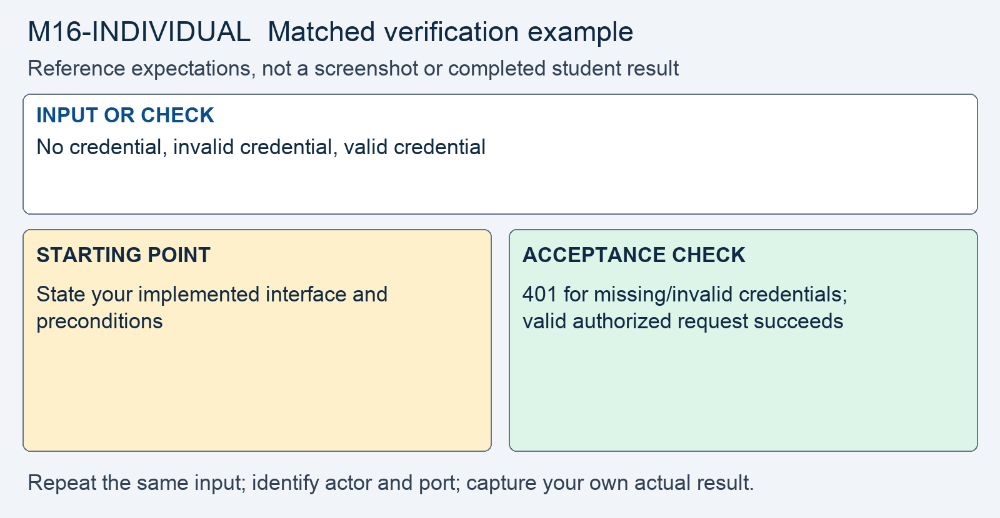

# M16 - Assignment: Individual API Build and Decision Under Challenge

> This repository copy contains the current task instructions and reference images. Download the Word report template from the matching Canvas assignment. Keep your existing Cloud Shell workspace and earlier repairs; returning students do not need a new clone.


## Downloads and instructions

| Supplied file | Use |
|---|---|
| **Download report**: obtain `m16-individual-report-template.docx` from this module’s Canvas assignment | Read the supplied model, then complete the marked entries in Word or Word Online. |
| [Download assignment.md](assignment.md) | Keep this copy of the instructions unchanged and include it with the submission. |
| **Read the project kickoff** (reference page in Canvas) | Requirements, milestones, and feature scope. |
| **Read project expectations** (reference page in Canvas) | Required safeguards and evidence. |

All supplied downloads are listed here. The step-by-step activity follows. For Word editing and submission steps, use the course report guide in Orientation. Screenshots belong inside the report unless the activity explicitly requests a separate file.

<!-- verification-guide:start -->
## Visual guide and matched verification

Capture your own implemented API on 8081. The original 8080 portal is not a completed model API, and your team may choose a different route shape.

### Keep the comparison controlled



This comparison card summarizes the first row below. It is a teaching guide, not an observed repaired result. The full table and commands remain selectable text.

The stages below are the evidence workflow for this activity. They are requirements, not completed student observations.

| Input or check | Starting point to record | Acceptance check to capture |
|---|---|---|
| No credential, invalid credential, valid credential | State your implemented interface and preconditions | 401 for missing/invalid credentials; valid authorized request succeeds |
| Owner versus non-owner request to the same object | Same method, object, and payload; change caller identity only | Owner succeeds; non-owner receives agreed 403 or 404 |
| Malformed JSON and legitimate request | Same endpoint and content-type | 400 for malformed input; valid request still works |

**Legitimate use and limits.** Also prove scoped expiring tokens, safe errors, and required validation. The decision under challenge is your own unaided explanation, as the activity specifies.

### Copyable API evidence starting point

The project implements `POST /api/token` using the `X-API-Key` header. Test the implemented token endpoint without a key first:

```bash
curl -sS -i -X POST http://127.0.0.1:8081/api/token
```

The completed authentication boundary should return 401. At the draft checkpoint, an unimplemented route may return 404; report it as unfinished, not as a passed authentication test. Repeat with your own valid key and then prove scope, expiry, and object ownership using the interface your team designed. Do not publish real keys, token values, or session cookies in captures. A single 401 does not establish that the full API works.

### Capture and submit consistently

Keep command inputs as selectable text beside their output. For browser evidence, show the relevant page, field, and result; a browser image alone does not establish the HTTP status. For HTTP evidence, retain the status and relevant headers as text, and verify any claimed write or refusal in application state. Label before and after captures with the port, actor, and test input. Add captions and alt text in the Word report. Use the complete verification steps below, not just the summary rows.

<!-- verification-guide:end -->

> [!CONCEPT] Read the supplied report
> The report supplies the corporate case and management record. Complete the marked [STUDENT] entries, keep every EXAMPLE, and write your own answer after Answer. Later modules require fuller justification; use evidence rather than expanding the report with unsupported claims.

Implement the team's agreed design in your own portal copy and submit evidence from that build. This assessment verifies your implementation and your ability to explain a security decision. It is the individual portion of the collaborative project.

Read the project kickoff listed in Downloads and instructions, project expectations listed in Downloads and instructions, and **team final requirements** (reference page in Canvas) for the shared scope. The five required-core controls apply to every member; sharing section ownership does not divide those implementation requirements among students.

> [!CONCEPT] Evidence belongs to the tested build
> Record the request, expected result, actual response, and what the check establishes. Distinguish the team's verification plan from the tests you performed. A planned request is not a passing result.

## Open the working environment

1. [Launch Google Cloud Shell](https://shell.cloud.google.com/) with the account used for the earlier labs.
2. In the editor, locate the existing workspace containing `site`, `fixed`, `reports`, and `scripts`. Right-click the workspace folder and select **Open in Integrated Terminal**.
3. Run:

```bash
bash scripts/start.sh
```

4. Use **Web Preview → Change port → 8081** for your working application. Send the API test requests to `http://127.0.0.1:8081` from the terminal. The original on 8080 remains a portal reference, not a completed API.
5. Build under `fixed/api/` and update `fixed/router.php` only where needed for API routing. Preserve earlier portal repairs. Record evidence from your own working API; the original copy does not supply a completed project.
6. Download the report from the list at the top, open it in Word or Word Online, and save your copy. The IDE is for the source and command evidence; the Word report stays outside the code repository.


> [!NOTE] Capture the comparison
> Record original and working results separately. The same demo username can have different password or session state after earlier modules. Use the current working credentials for 8081; do not reset the whole application to make an old example reappear.


## Build and verify your API

1. **Finish the required core in your own portal copy.** This supplies correctness, verification, and evidence for the shared Assignment Rubric.
   - Build the token endpoint and about three resource endpoints under `api/`, one file per resource, reached through `router.php`. Build on `lib/`: `query.php`, `hmac.php`, and the other helpers you have used.
   - All five of the required core have to run. They are API-key authentication, the token exchange, the ownership check inside the query, input validation on every body, and errors that leak nothing.
   - Order the gates in each handler as lecture section 3 does: method, authentication, validation, authorization, response, with one catch-all around the whole handler.
   - Add the electives your section of the design owns.

2. **Record the `curl` evidence for every safeguard you built.** This supplies your personal verification evidence for the shared Assignment Rubric.
   - Type each request at `localhost:8081` as the **Requests and Developer Tools** page shows. Paste the request and the full response, status line included, as text.
   - For each object endpoint, show the three requests from lecture section 7. No key gets 401, the owner gets 200, and a non-owner gets the refusal your design chose. One of the three alone proves nothing.
   - Show a wrong key answered with the same 401 body as a missing key, and a malformed id answered 400.
   - For the token exchange, show three requests. A JSON body with the key header is answered 200 with a token. The same request with a malformed body is answered 400. An altered or expired token is answered 401.
   - Force one failure as lecture section 7 shows, and paste the 500 response beside the log line that carries the same correlation id.
   - Every response has to come from your own portal copy. A teammate's output proves the teammate's build.

3. **Write your decision under challenge.** This supplies individual reasoning and accountability for the shared Assignment Rubric.
   - Pick one safeguard the attribution table says you designed or built.
   - Write the five parts in the shape lecture section 10 gives. They are the decision, the strongest objection a skeptical reviewer would raise, the principle behind your choice, why that principle applies to this API rather than in general, and your verdict.
   - The verdict either defends the decision with reasoning or concedes and says what you would change. Both pass when the objection is given its full weight.
   - Tie the principle to a fact about this API, such as its sequential ids or how authentication defines the caller. Naming the principle alone is not enough.


## AI assistance

AI assistance with implementation, test planning, and report editing is permitted with disclosure. Understand the generated code, run the checks yourself, and report only observed results. The **decision under challenge is unaided**: write that section without AI because it assesses your own reasoning about a decision you contributed.

## What to submit

Submit your individual Word build report, supplied `assignment.md`, and all complete changed or added implementation files, including `fixed/api/` handlers and any router/helper changes. Include any required evidence attachments. Use the **Word Reports and Assignment Files** (reference page in Canvas) reference for formatting. Each member submits separately to this assignment so the grade and feedback reflect their own work.

The report includes your name, incident-free project title, AI disclosure, endpoint inventory, actual request/response evidence, unresolved limitations, reflection, and unaided decision under challenge. Do not include live credentials or tokens; label any redactions because the reader needs to understand the evidence.

## Final file checklist

- Completed `m16-individual-report.docx` with your own results, required screenshots, disclosure, reflection, and Revision History.
- Supplied `assignment.md`, unchanged.
- Complete changed source, including `fixed/api/ (all changed or added PHP handlers)`, `fixed/router.php if changed`, `any changed shared helpers`. Include every additional helper, migration, or test file you changed or added. Do not submit unchanged helper files merely because you called them.

In Word, save the report on your computer or document storage. In Cloud Shell Editor, right-click the required source files and choose **Download**. Download `assignment.md` from the list at the top. In Canvas, select **Start Assignment** or **New Attempt**, attach all required parts to the same attempt, select **Submit Assignment**, and check the file list and confirmation. A saved local file is not a submission.

## Complete the report record

Read the supplied business-impact assessment and likelihood–impact table. Complete its marked rating entries using the actual case or your own evidence, and explain why the control changes the risk. Keep the EXAMPLE responses and write your own answers after Answer. Finish the identity, sources, disclosure, reflection, and Revision History entries that the report requests.
