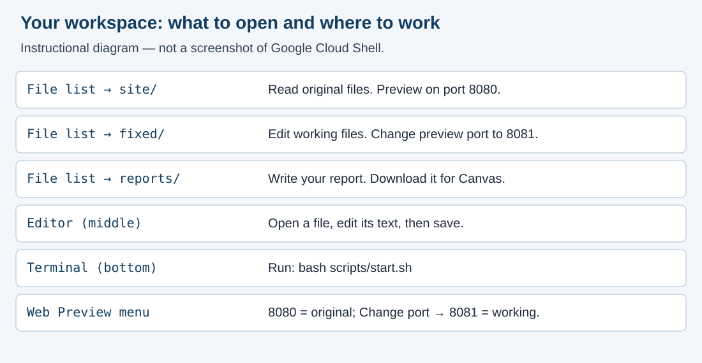
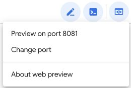
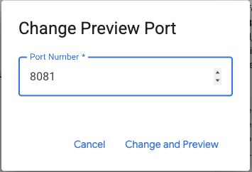
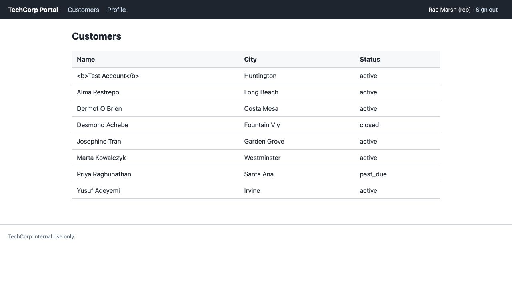
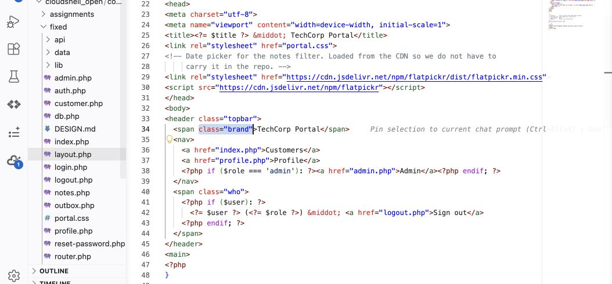

# M01 - Launch Course Environment

## What you are doing, and why

Set up two copies of the TechCorp portal: **site** is the original you read and compare, and **fixed** is the working copy you change throughout the term. Practice the read, change, prove, report routine with two harmless labels. Plan about an hour.

## Your report template

Download the accessible Word report template from this module’s Canvas assignment.

1. Open the template in Word or a DOCX editor. Choose **Save As** and name your copy `m01-setup.docx`.
2. Read the supplied executive summary and case narrative as a model of professional reporting. Keep its title, headings, supplied facts, [STUDENT] prompts, and **EXAMPLE** entries. Examples show the expected form and detail; they are not your observations. Write your own response after **Answer:**.
3. Record actual before-and-after results as you work. Paste command output as selectable text. In the screenshot spaces, choose **Insert → Pictures**, use **In Line with Text**, and add descriptive **Alt Text**. Add a short written description of the result as well.
4. Before submission, use **Review → Check Accessibility**, address the findings, and save the completed Word report. Submit this one report file with `assignment.md` and your changed code. Required screenshots can go inside the Word report; separate image uploads are needed only if you reference files that are not included in it.

## Step 1: Launch Google Cloud Shell

1. Sign in to your Google account in this browser.
2. First visit: click [Launch Google Cloud Shell with the course files](https://shell.cloud.google.com/cloudshell/open?cloudshell_git_repo=https://github.com/toantranlearning/coastline-ics230-support-desk&cloudshell_tutorial=TUTORIAL.md). Accept the welcome and repository-trust prompts if shown. No credit card or paid trial is needed.
3. Returning: [open your existing Cloud Shell](https://shell.cloud.google.com/) with the same account. Keep using that copy rather than launching another clone.
4. Select **Open Editor** if needed. Locate the workspace folder containing `site`, `fixed`, `reports`, and `scripts`. Right-click the workspace folder and choose **Open in Integrated Terminal**.
5. Type the following and press **Enter**:

```bash
bash scripts/start.sh
```

6. Wait for both startup messages and copy your actual messages for the report:

```text
site portal is running on port 8080.
fixed portal is running on port 8081.
```

For missing folders, an occupied port, or an older workspace, follow the [Cloud Shell Guide](../module-01/6_m01_working-in-google-cloud-shell.html). Your own two portal copies are the only authorized targets.



*Workspace map: a simplified instructional diagram, not a Cloud Shell screenshot. Commands and labels remain written in the steps above.*

## Step 2: Read the original and open the working copy

1. Choose **Web Preview → Preview on port 8080**. This is **site**, the original.
2. Sign in with username `rmarsh` and password `password`. These fictional portal credentials are separate from your Google account.
3. Check for **TechCorp Portal** in the top bar and **Customers** as the heading. Take **Capture 1**, saved as `m01-setup-before.png`.
4. Return to Cloud Shell. Choose **Web Preview → Change port**, enter **8081**, and click **Change and Preview**. This is **fixed**, your working copy. Sign in separately with the same fictional credentials.


*Actual Cloud Shell controls: the Preview label remembers the last selected port (8081 here). Use Change port to select 8080 for site or 8081 for fixed.*



*Enter 8081, then select Change and Preview to open fixed.*

5. Check that both copies initially show the same labels. Keep both tabs open and check their ports before reloading or testing.
6. In the editor, open `site/layout.php` and `site/index.php` to read the original labels. Leave these files unchanged.



*Reference screenshot from the local course portal: look for TechCorp Portal in the top bar and Customers above the table. Use your own captures in your submission.*

## Step 3: Change only the working copy

1. Open `fixed/layout.php`. Use **Ctrl+F** (**Cmd+F** on a Mac) to find:

```html
<span class="brand">TechCorp Portal</span>
```

2. Replace only `TechCorp Portal` with your own label, such as `Rae's Support Desk`. Keep the HTML tags and save with **Ctrl+S** (**Cmd+S** on a Mac).
3. Open `fixed/index.php`. Find `<h2>Customers</h2>` and change it to:

```html
<h2>My Customers</h2>
```

4. Save. From the workspace-root terminal, check both files:

```bash
php -l fixed/layout.php
php -l fixed/index.php
```

5. Resolve any syntax errors. Successful checks say `No syntax errors detected`; you still need the browser comparison below.



*Actual Cloud Shell editor: fixed is expanded in the file list, with layout.php selected and its brand span visible. Change only the TechCorp Portal text inside the brand span. Your workspace folder name may differ.*

## Step 4: Prove the copies are separate

1. Reload **fixed, port 8081**. Confirm both your custom label and **My Customers** appear. Save **Capture 2** as `m01-setup-changed.png`.
2. Reload **site, port 8080**. Confirm it still shows **TechCorp Portal** and **Customers**. Record this comparison in your report.
3. Before restoring the labels, right-click `fixed/layout.php` in the editor file list and choose **Download**. Do the same for `fixed/index.php`. These are the changed source files you will submit. Keep them in a local folder named `changed-code` so you can distinguish them from restored files.

## Step 5: Restore only the two practice labels

1. In `fixed/layout.php`, replace your label with `TechCorp Portal` and save.
2. In `fixed/index.php`, change `My Customers` back to `Customers` and save.
3. Reload **fixed, port 8081**. Save **Capture 3** as `m01-setup-restored.png`, showing the original labels again.
4. Check that **site, port 8080** remains unchanged. Restore only these practice labels by editing; a full reset would discard other repairs.

This setup exercise restores its cosmetic edits after you download the changed source. Later security repairs stay in `fixed/` across the term.

## Step 6: Report and submit

1. Open your saved Word report and complete each [STUDENT] prompt. Record actual startup messages, syntax results, your comparison of the two copies, and a brief reflection.
2. Insert the original, changed, and restored screenshots beside their prompts. Add a caption and descriptive alt text to each. Use selectable text for commands and output.
3. Save the report and run Word’s **Review → Check Accessibility**.
4. In Canvas, choose **Start Assignment** (or **New Attempt**). Upload your completed `m01-setup.docx`, supplied `assignment.md`, and the changed `layout.php` and `index.php` saved before restoring the labels. Screenshots included in the report do not need separate uploads.
5. Select **Submit Assignment** and check the confirmation and filenames.

If blocked, record the exact action, which copy and port, and the error. Contact the instructor through Canvas Inbox or course Q&A; report only results you actually observed.

Place screenshots in the Word report beside their prompts, with a caption and alt text. Keep written test results in the report too.

## Download and submit the assignment instructions

Submit these three parts together: **assignment.md**, your completed **m01-setup.docx**, and your changed **layout.php and index.php**. Include any screenshots required above. Keep the [STUDENT] prompts in your report and write each answer directly below its prompt.

1. In the IDE file list, expand `assignments`, then `module-01`, and click `assignment.md`. This is the supplied task description. Leave it unchanged.
2. Right-click that `assignment.md` file and choose **Download**. You can also [download assignment.md here](assignment-files/assignment.md).
3. Save your completed Word report on your computer and download the changed source file(s) from `fixed/`, as directed above.
4. Upload **all three parts** to the same Canvas attempt, together with required evidence images. For Module 1, the code part contains both changed `layout.php` and `index.php` downloaded before restoration.
5. Before selecting **Submit Assignment**, confirm the upload list contains `assignment.md`, your report, every required changed source file, and required images. Keep the lab instructions, your completed report, and your changed code together in the same submission.

Open notes and open book are both fine. Respond in your own words; do not copy from other sources.

**AI use on this assignment.** The syllabus policy governs; these are its terms for a setup lab.

> [!CORRECT] Permitted, with disclosure
> - Asking an AI to explain a concept, an OWASP guideline, or a PHP error message in general terms.
> - A grammar or spelling checker on your own writing.
> - Generating or refactoring code, proposing tests, and planning or editing the report, with disclosure of the tool, help requested, material used or changed, and checks performed. Report only results you observed.

> [!CRITICAL] Not permitted
> - Submitting AI-generated code, analysis, or writing without disclosing it.
> - Pointing an AI-assisted tool at any target other than your own course environment.

You must be able to explain every line you submit, on request. Undisclosed AI use is handled as academic dishonesty under the syllabus.

## Expected output

- Both portals start and allow the fictional representative to sign in.
- Only `fixed/` shows the two label changes; `site/` stays original.
- Both changed PHP files pass syntax checks and are downloaded before restoration.
- The working labels are restored after the comparison, with three captures documenting the exercise.
- The report explains the two copies and contains actual startup and syntax results.

## What to submit

- Completed `m01-setup.docx`, including all answers and three screenshots
- Supplied `assignment.md`
- Changed `layout.php` and `index.php` downloaded from fixed before restoration

Complete the name, AI disclosure, and reflection prompts in the Word report. Keep earlier repairs in fixed.

## Explain the impact

Read report section **4 Business impact and risk**, including TechCorp’s initial ratings and risk matrix. Complete the [STUDENT] entry: confirm or revise **Impact** and **Likelihood** as Low, Medium, or High, give a short reason for each, and explain how the control helps. Use the clearly labeled **EXAMPLE** as a model and write your own answer below it. Module 1 assesses the reliability of the setup and comparison process; it does not ask you to discover a vulnerability or claim customer-data exposure. Keep answers brief.
